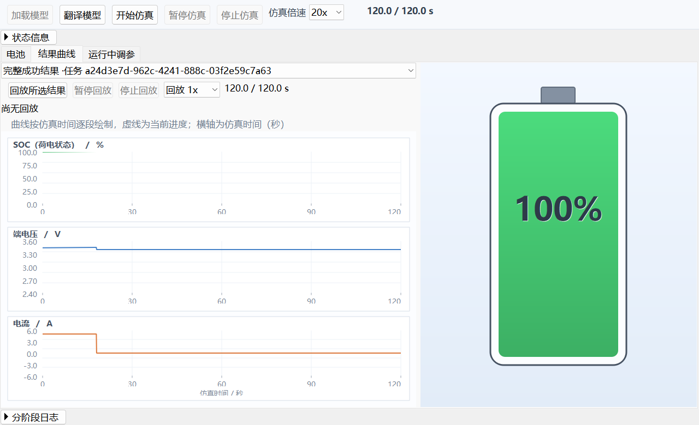
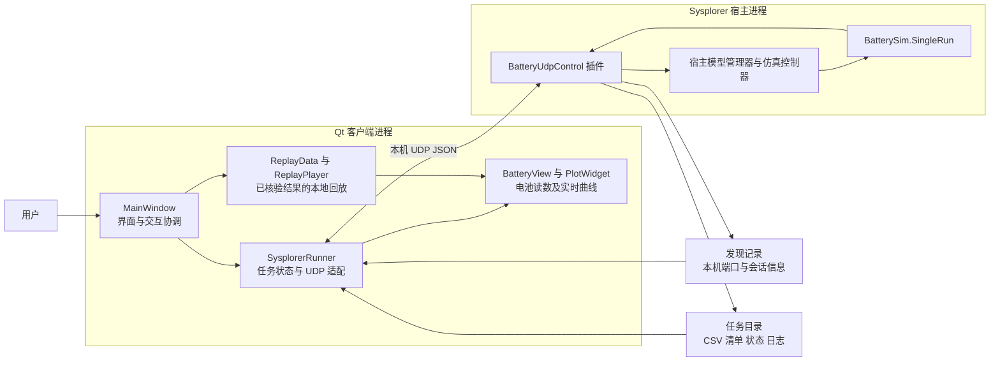
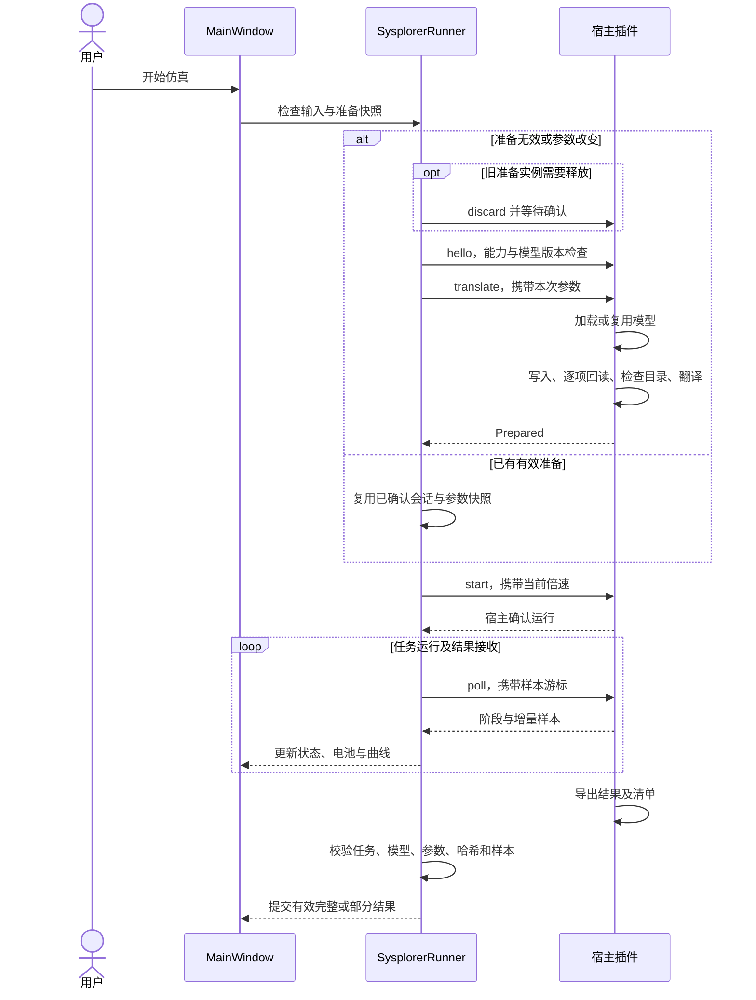

# Qt 与 Sysplorer 电池充放电仿真操作台

基于 **Qt Widgets + Sysplorer 宿主内 C++ 插件 + Modelica** 的 Windows 桌面仿真项目。Qt 负责参数输入、任务控制、实时显示和历史结果回放；Sysplorer 负责模型加载、翻译与真实求解。两者通过本机 UDP 交换命令和增量样本，通过本地任务文件交接最终结果。

当前模型为 `BatterySim.SingleRun`。界面支持独立加载、翻译、一键开始、真实暂停与继续、主动停止、运行中调参、完整及部分结果核验，以及所选结果的独立回放。当前入口按 2026 年 11 月 6 日的主目录实现整理。



## 目录

- [当前架构设计](#当前架构设计)
- [Qt 界面设计](#qt-界面设计)
- [任务流程与通信](#任务流程与通信)
- [结果与参数模型](#结果与参数模型)
- [构建部署与启动](#构建部署与启动)
- [验证记录与已知限制](#验证记录与已知限制)
- [源码目录与文档导航](#源码目录与文档导航)

## 当前架构设计

### 两个主要进程与三种数据载体



这里的“两个主要进程”指 Qt 客户端和 `mworks.exe`，不代表操作系统进程总数固定为二。Sysplorer 仍可启动编译器、求解器等子进程。C++ SDK 是插件使用的进程内接口，不是额外的网络服务。

| 组成 | 责任 | 主要实现 |
|---|---|---|
| Qt 界面协调层 | 构建布局、读取输入、组织按钮流程、管理显示来源及结果选择 | [main_window.cpp](app/ui/src/main_window.cpp) |
| 客户端任务适配层 | 发现或启动宿主、能力与模型校验、请求去重及有限重试、接收样本、核验结果 | [sysplorer_runner.cpp](app/ui/src/sysplorer_runner.cpp) |
| 宿主插件 | 校验任务归属、调用 SDK 加载与翻译模型、控制求解、采集输入与输出、导出结果 | [control_plugin.cpp](tools/sysplorer_udp_plugin/control_plugin.cpp) |
| Modelica 模型 | 按电池方程计算 SOC、实际电流、端电压等状态 | [BatterySim.mo](model/BatterySim.mo) |
| 本地播放器 | 按仿真时间播放已核验采样，不向宿主发送求解命令 | [replay_player.cpp](app/ui/src/replay_player.cpp) |

架构使用三种载体，各有职责：

1. **发现记录**：插件在 `%LOCALAPPDATA%/BatteryConsole/udp/<PID>.json` 发布端口、进程、会话、模型哈希等信息。记录含连接令牌，属于本机运行数据。
2. **UDP JSON**：用于命令、确认状态及增量样本。协议为 `battery-udp/1`、`schema=1`，只绑定 `127.0.0.1`，不提供远程服务。
3. **本地任务文件**：用于日志、状态及最终 CSV 和结果清单。Qt 再次校验文件与任务归属后，才将数据作为有效结果展示。

选择宿主内插件，是为了操作可见 Sysplorer 中已有的模型管理、翻译与求解对象。正式链路不依赖独立 SDK helper，也没有常驻 Python 桥接；仓库中的 Python 诊断脚本和历史探针用于验证与排障。

## Qt 界面设计

### 主窗口布局

主窗口使用 C++ 直接构建 Qt Widgets，顶层为 `QMainWindow`，中央区域使用 `QVBoxLayout`。默认窗口尺寸为 `1280 × 780`，入口设置微软雅黑 10 磅字体。应用名称和电池图标保留在 Windows 标题栏，内容区不再重复显示大标题。

```text
Windows 标题栏：电池充放电仿真操作台
┌──────────────────────────────────────────────────────────────────┐
│ 加载模型 翻译模型 开始仿真 暂停/继续仿真 停止仿真 倍速 当前/终点 │
├──────────────────────────────────────────────────────────────────┤
│ ▸ 状态信息                                                      │
│ 操作错误摘要（发生错误时直接显示）                                │
├──────────────────────────────────────────────────────────────────┤
│ 电池  |  结果曲线  |  运行中调参                                │
│                                                                  │
│                   当前页签内容                                   │
│                                                                  │
├──────────────────────────────────────────────────────────────────┤
│ ▸ 分阶段日志                                                    │
└──────────────────────────────────────────────────────────────────┘
```

顶部使用自定义 `ControlFlowLayout`。它依据可用宽度安排控件，常规宽度下主控制并排，窄窗下按顺序换行，保持每个控件完整。工具栏采用普通按钮，最小宽度 78、最小高度 30，均为 Qt 逻辑像素；边距为左右 12、上下 8，间距为 10。仿真时间加粗显示，并预留标签宽度以容纳较长时间字符串。

界面不使用阶段卡片或常驻宿主连接侧栏。后台连接状态、任务编号与详细说明收进“状态信息”，主视图区占用整行宽度。窗口最小高度会随展开内容及控件的最小尺寸调整；不同 DPI 仍需专项验证。

### 三个页签

#### 电池页

`BatteryView` 将参数表单与自绘电池放在同一页面。左侧使用 `QFormLayout`，包含当前电量、剩余容量、充放电方向、截止电压、电流、起始 SOC 和“保存参数”；右侧由 `QPainter` 绘制电池轮廓、填充、渐变及电量百分比。

输入设定与实际读数分开处理。截止电压是充电上限或放电下限，实际端电压由模型计算；电流输入是幅值，方向由模式决定。“保存参数”只保存客户端设置并更新预览，不启动任务，也不向宿主写参。翻译及开始都会重新读取当前输入，因此不要求用户先点击保存。

| 初始参数 | 有效范围 | 含义 |
|---|---|---|
| 方向 | 充电或放电 | 新任务的起始恒流方向 |
| 截止电压 | 2.50–3.45 V | 充电时作为上限，放电时作为下限 |
| 电流 | 0–5 A | 起始恒流幅值 |
| 起始电量 | 0–100% | 新任务初始化时的 SOC |

保存相同数值不会使已有准备实例失效。输入与准备快照不同时，开始入口先重新准备；加载、写参、翻译、运行、暂停及结果处理期间按任务状态限制参数编辑。

#### 结果曲线页

页面左侧是结果选择、本地回放工具栏和曲线，右侧是隐藏参数控件的只读电池视图，布局伸展比例约为 `3:2`。

`PlotWidget` 使用 `QPainter` 自绘三个纵向排列的子图：SOC 百分比、端电压和实际电流。横轴统一为仿真时间，虚线表示当前进度；实时任务追加真实样本，历史回放按播放进度绘制。绘图不依赖 Qt Charts 或第三方图表库。

结果选择区区分当前实时任务、完整成功结果及各次停止后的部分结果。回放始终使用下拉框**当前选中的结果**。部分结果显示真实有效时间范围；新任务失败不会替换旧的有效结果，并恢复准备前所选历史结果。

#### 运行中调参页

该页使用 `QFormLayout` 编辑六项运行期输入，并显示提交与模型采样确认状态：

| 参数 | 模型作用 |
|---|---|
| 工作模式 | 静置、恒流充电、恒流放电、恒压或限流充电 |
| 恒流电流指令 | 恒流模式的电流幅值，方向由模式决定 |
| 恒压目标 | 恒压模式下计算电流的目标端电压 |
| 放电截止下限 | 达到下限时封锁放电电流 |
| 充电截止上限 | 达到上限时封锁充电电流 |
| 电流上限 | 限制实际电流绝对值 |

约束为 `0 ≤ 电流指令、电流上限 ≤ 5 A`、`2.50 ≤ 下限 < 上限 ≤ 3.45 V`、`2.50 ≤ 恒压目标 ≤ 上限`。提交的是整组六个值，不能只省略暂时不参与计算的字段。

运行中提交时，插件先暂停、写入输入并继续；本来已经暂停的任务保持暂停，继续后再确认采样。仿真时间和已累计 SOC 不归零。界面只有收到实际模型输入采样与请求一致的确认后，才显示生效时刻。初始 SOC 不能在本页重置。

完整参数解释、例子和恒压模型细节见 [仿真参数使用说明](docs/仿真参数使用说明.md)。

### 主按钮采用包含关系

| 按钮 | 实际职责 | 完成后 |
|---|---|---|
| 加载模型 | 只加载并确认目标模型，不写参、不翻译、不求解 | 等待翻译 |
| 翻译模型 | 必要时加载，已有有效模型则复用；校验当前输入、写参、逐项回读、检查目录、翻译 | 等待开始，不自动求解 |
| 开始仿真 | 准备有效时直接启动；否则自动补齐加载和翻译 | 宿主确认后进入运行 |

用户可以直接点击“开始仿真”。参数改变后，若旧准备实例仍存在，先等待 `discard` 确认，再完整准备新任务。写参、回读或翻译失败就终止后续步骤，不把“请求已接受”当作求解已经运行。

### 仿真与回放完全分开控制

| 项目 | 顶部仿真控制 | 结果页回放控制 |
|---|---|---|
| 控制对象 | 当前客户端拥有的真实宿主任务 | 当前所选结果的本地播放器 |
| 暂停或继续 | 发送 `pause` 或 `resume`，等待宿主确认 | 暂停或继续 `ReplayPlayer` 的计时器 |
| 停止 | 请求宿主停止，等待导出并核验部分结果 | 保留当前显示；再次回放从头开始 |
| 倍速 | 配置真实求解的减速因子 `1 / speed` | 只调整历史数据播放速度 |
| 时间与状态 | 真实任务当前时间、计划终点与阶段 | 本地播放进度和回放状态 |

倍速选项为 `0.5、1、5、20、60x`，默认仿真 20x、回放 1x。倍速不改变电池方程中的电流或电压，也不是实时性能保证。任务处于准备、求解、结束处理，或控制请求正在等待确认时，界面禁用回放入口。

### 状态驱动与折叠信息

按钮启用由 `SysplorerRunner` 的内部阶段、准备有效性、参数数值比较、控制请求是否待确认及本地播放器状态决定，不读取界面文字反推状态。

- 宿主启动及初始等待期间禁用模型与求解入口；连接失败后保留明确错误，并允许通过翻译入口手动重试连接。
- 运行确认后才启用暂停和停止，暂停确认后切换为继续；未确认请求期间禁用相关操作。
- 停止、失败或自然结束后，不把任务当作暂停实例继续；新求解重新检查准备条件。
- “状态信息”和“分阶段日志”默认分别收起，始终可以操作，状态刷新和实时绘图不会改变用户选择。
- `QSettings` 使用 IniFormat、UserScope 和 `BatteryConsole / ButtonDetails` 保存展开选择及已保存的初始参数。
- 启动错误用非阻塞警告提示；任务错误摘要直接显示，详情同步追加日志。信息区收起不影响日志记录。
- 日志支持阶段分类、复制和打开实际存在的任务目录。

### Qt 代码之间如何协作

| 模块 | 关键关系 |
|---|---|
| `MainWindow` | 组织页签、控件和用户流程；保存本次请求快照、历史结果及显示来源 |
| `BatteryView` | 发出 `applyRequested` 保存输入；接收 SOC、电压、电流更新，绘制电池 |
| `PlotWidget` | 管理采样数组、进度及已绘制范围，通过 `update()` 触发重绘 |
| `SysplorerRunner` | 用 `QUdpSocket` 和 `QTimer` 驱动通信，发出 `stateChanged`、`samplesArrived`、`finished`、`stopped` 等信号 |
| `ReplayData` | 读取 CSV，按指定时间对采样做线性插值 |
| `ReplayPlayer` | 用本地 `QTimer` 推进播放时间，发出 `tick` 和 `finished` |

典型数据方向为 `samplesArrived → MainWindow::onLiveSamples → 曲线追加与电池读数更新`；历史播放为 `ReplayPlayer::tick → MainWindow::onTick → 曲线进度与电池更新`。两条数据源在界面层互斥使用。网络轮询与本地播放当前均使用 50 ms 定时器，但这不代表宿主每 50 ms 产生一个新的仿真采样。

## 任务流程与通信



已保持有效准备实例时，开始入口复用现有会话直接发送 `start`，不重复加载或翻译。

| 命令 | 作用 |
|---|---|
| `hello` | 检查就绪、控制器状态、模型哈希及能力 |
| `load` | 独立加载，结束于 `Loaded` |
| `translate` | 自动加载或复用、写参回读和翻译，结束于 `Prepared` |
| `start` | 从有效 `Prepared` 启动求解 |
| `poll` | 查询阶段并获取 `[time, SOC, I_act, V_term]` 增量样本 |
| `pause / resume / stop / speed` | 控制本任务的真实求解 |
| `tune` | 提交六个运行期输入并等待实际采样确认 |
| `discard` | 释放旧准备实例 |
| `begin` | 保留的旧准备命令；新客户端使用 `load / translate` |

主要状态路径为 `Loading → Loaded`、`Preparing → Translating → Prepared → Starting → Running`。运行期间可进入暂停、继续、停止；结束进入 `Finalizing → Completed / Stopped`，错误进入 `Failed`。

请求包含请求编号、宿主会话、令牌、客户端和任务 UUID；响应按会话与请求匹配。插件检查任务所有者及控制器归属，相同请求 ID 的重发不会重复执行。客户端对 UDP 做有限次数重试，按连续游标追加实时样本，并拒绝模型、参数或任务不匹配的结果。新客户端要求 `splitLifecycle=true`、`modelLifecycle=true`，不将旧插件降级伪装成独立加载。

详细字段、失败代码及重试约定见 [UDP 任务协议](docs/UDP任务协议.md)。

## 结果与参数模型

默认任务目录为 `%TEMP%/BatteryConsoleUDP/<任务 UUID>`，可通过 `BATTERY_SIM_WORKSPACE` 改变。手动启动宿主时，应让宿主和客户端继承一致的工作目录配置。

| 文件 | 内容 |
|---|---|
| `client.log` | 客户端请求、阶段、诊断与校验记录 |
| `plugin.log` | 宿主内部阶段、参数回读及控制操作 |
| `status.json` | 最近一次任务状态快照 |
| `result.csv` | `time,SOC,I_act,V_term` 采样 |
| `result.json` | 任务、模型、参数、结果哈希、完整性及运行期修改历史 |

正常结束通过核验后形成完整结果。主动停止通过核验后形成部分结果，仅保留真实有效时间范围。失败结果不会替换此前有效结果。结果列表与完整缓存目前只存在于当前 Qt 进程，磁盘任务文件保留，但重启客户端后不会自动重建历史结果列表。

当前电池模型为 2.5 Ah 的 Rint 等效电路：使用 OCV-SOC 表、0.01 Ω 内阻和电流积分计算 SOC，不含温度、老化、极化支路及自放电。OCV 表是示意数据。恒压方程在目标低于当前开路电压时可能产生负电流；达到截止阈值时封锁电流，不一定结束仿真。因此不能将该实现直接当作完整充电器的标准恒流转恒压控制器。

## 构建部署与启动

### 已验证环境

| 组件 | 当前脚本与验证环境 |
|---|---|
| 操作系统 | Windows x64 |
| Qt | 5.14.2，`msvc2017_64`，Widgets、Network 等模块；测试另需 TestLib |
| C++ | Visual Studio 2017 Professional，x64 C++ 工具链与 Windows SDK，C++11 |
| Sysplorer | MWORKS Sysplorer 2026a，配置可用许可 |
| SDK | Sysplorer SDK 2026a（vs2017），提供头文件和导入库 |
| 脚本 | Windows PowerShell、Git；Python 仅为部分诊断工具所需 |

构建脚本的默认路径为 `C:/Qt/Qt5.14.2/5.14.2/msvc2017_64`、`C:/Program Files (x86)/Microsoft Visual Studio/2017/Professional` 和 `C:/Program Files/MWORKS/Sysplorer SDK 2026a(vs2017)`。安装位置不同，需要调整 `build.cmd`、`app/ui/deploy.ps1` 和插件 `plugin.pro`。这些路径是本项目脚本配置，并非自动探测所有开发环境。

### 获取并构建

以下命令在 PowerShell 中执行，工作目录为仓库根目录：

```powershell
git clone https://github.com/dfq-1104/Qt_with_Sysplorer.git
Set-Location .\Qt_with_Sysplorer

.\tools\sysplorer_udp_plugin\build.cmd
if ($LASTEXITCODE -ne 0) { throw '插件构建失败' }
.\app\ui\build.cmd
if ($LASTEXITCODE -ne 0) { throw 'Qt 客户端构建失败' }
```

仓库不提供 Sysplorer 安装程序、SDK、许可、Qt 运行库或构建产物，需要在本机准备。

### 准备专用宿主并部署界面

建议在简短的纯英文目录创建独立测试副本，使用已有安装的依赖，不覆盖其他任务正在使用的插件：

```powershell
$ErrorActionPreference = 'Stop'
$installedSysplorer = 'C:\Program Files\MWORKS\Sysplorer 2026a'
$batteryHost = Join-Path $env:TEMP ('BQ' + (Get-Date -Format 'MMddHHmmss'))
if (Test-Path -LiteralPath $batteryHost) { throw '请选择新的专用宿主目录' }

& .\tools\sysplorer_udp_plugin\prepare_isolated_host.ps1 `
    -SysplorerHome $installedSysplorer -Destination $batteryHost

& .\app\ui\deploy.ps1 `
    -RuntimeDirectory app/ui/runtime_buttons -SysplorerHome $batteryHost
Add-Content -LiteralPath .\app\ui\runtime_buttons\sysplorer.ini `
    -Value 'TimeoutMs=180000' -Encoding utf8

.\app\ui\run_ui.bat
```

`prepare_isolated_host.ps1` 复制宿主可执行文件与插件，对部分依赖目录建立链接，并校验插件哈希。宿主、SDK 与已安装依赖仍需匹配；隔离目录和仿真工作目录应保持纯英文且尽量简短。

主入口为 `run_ui.bat → start_ui.ps1`。启动器优先选择 `runtime_buttons`，不存在对应配置时回退到 `runtime_tuning` 或 `runtime`；启动前核对宿主插件与本次构建的 DLL 哈希。若插件不匹配且该目标宿主正在运行，会停止启动流程并给出提示；目标空闲时可调用部署脚本同步插件。向安装目录写入插件可能需要管理员权限。

若需要直接更新某个已退出的安装实例，可使用 [插件部署脚本](tools/sysplorer_udp_plugin/deploy.ps1) 的 `-SysplorerHome` 与 `-Elevate` 参数。重新构建 DLL 后，必须让加载旧插件的目标实例退出并重新启动，不能仅凭磁盘 DLL 已替换就认为进程中的插件已经更新。

### 客户端配置

`deploy.ps1 -SysplorerHome` 会在 EXE 旁生成 `sysplorer.ini`：

```ini
[Host]
Home=C:/path/to/dedicated/Sysplorer
TimeoutMs=180000
```

| 配置 | 作用 |
|---|---|
| `SYSPLORER_HOME` | 覆盖 `Host/Home`，指定同一套配套插件宿主 |
| `BATTERY_HOST_TIMEOUT_MS` | 覆盖 `Host/TimeoutMs`；未配置时默认 90000 ms，实际取值限制为 1000–600000 ms |
| `BATTERY_SIM_WORKSPACE` | 改变任务与宿主独立工作目录的基础位置 |

模型通过 Qt 资源嵌入客户端与插件。修改 `model/BatterySim.mo` 后，需要重新构建和部署两端，并重启对应宿主；否则模型哈希检查会阻止任务继续。

## 验证记录与已知限制

### 运行现有测试

```powershell
.\app\ui\tests\build.cmd
if ($LASTEXITCODE -ne 0) { throw '测试程序构建失败' }

& .\app\ui\tests\run_button_details.ps1 -TestHost $batteryHost
```

测试会创建真实任务与专用宿主实例，需要可用许可，初始化与翻译可能较慢。应使用专用测试副本。逐项结果、QtTest 报告与截图输出到 `logs/button_details/`；`$batteryHost` 使用前面部署时选定的目录。

最近一轮已归档的主目录真实验证发生于 **2026 年 11 月 5 日**，不是本次 README 更新时重新执行的结果：

| 验证 | 已记录结果 |
|---|---|
| 主目录客户端、插件、Qt 测试重新构建 | 全部通过 |
| 启动器插件预检与运行包冒烟 | 通过，启动退出码 0 |
| 首次完整回归 | 9 passed、1 failed；独立加载后的首次翻译返回 `TRANSLATE_FAILED` |
| 相同源码与二进制的完整复测 | 10 passed、0 failed，约 182 秒 |
| 业务覆盖 | 8 项业务，另 2 项为初始化与清理，不能称为 10 项独立业务 |
| 结果文件 | 6 份真实结果摘要，3 份完整、3 份部分，CSV 哈希重新核验一致 |

覆盖布局与折叠、启动失败重试、独立加载及模型复用、一键自动开始、错误阶段日志、真实暂停继续停止、结果选择与回放、运行中调参和实例隔离。完整记录见 [主目录合并测试结果](docs/主目录合并测试结果.md)，包含首次失败及其原始日志。

当前仍有以下边界：

- 首次原生翻译失败的根因未确证，复测通过不代表冷启动问题已经修复。
- 长时间丢包、翻译超时后的完整后台恢复、宿主中途重启、多客户端压力和不同 DPI 尚需专项验收。失联后应先核对宿主实际任务状态再重试。
- SDK 与安装宿主的部分导出接口存在版本依赖，不承诺其他 Sysplorer 或 SDK 版本直接兼容。
- 主动停止的任务不能当作暂停任务继续；历史回放也不会继续真实求解。

常见排查路径：找不到宿主先检查 `Host/Home`；能力不足或模型不匹配时检查两端构建与插件版本；翻译、求解及结果错误按本次任务的 `stage`、错误代码和日志定位。Qt 平台插件错误则检查运行包的依赖与 `platforms/qwindows.dll`。

## 源码目录与文档导航

```text
app/ui/
  src/                         Qt 界面、任务适配、自绘与回放
  tests/                       Qt 交互与真实宿主集成测试
  ui.pro                       客户端 qmake 工程
  run_ui.bat / start_ui.ps1     主启动入口与插件预检
  deploy.ps1                   Qt 运行包部署
model/BatterySim.mo             正式电池模型
tools/                         正式插件与历史诊断工具
  sysplorer_udp_plugin/        正式宿主控制插件及专用宿主准备脚本
  sdk_probe/                   历史独立 SDK 探针
  udp_host_probe/              历史宿主内诊断探针
docs/                          协议、参数、架构记录与验收证据
logs/                          本机新生成日志，默认忽略；保留的历史验证材料另见仓库
```

- [本地 UDP 任务协议](docs/UDP任务协议.md)：命令、字段、阶段与结果交接。
- [Qt 界面运行说明](app/ui/UDP运行说明.md)：当前入口及操作。
- [仿真参数使用说明](docs/仿真参数使用说明.md)：六项运行参数、初始条件、作用与约束。
- [按钮细化界面交付记录](docs/按钮细化界面开发交付记录.md)：界面调整与验证过程。
- [主目录合并测试结果](docs/主目录合并测试结果.md)：实际主目录构建、冲突处理及真实回归。
- [UDP 架构设计与 helper 方案对比](docs/UDP架构设计与开发经验及helper方案对比.md)：历史架构复盘；当前按钮流程以本 README 和任务协议为准。
- [插件构建部署说明](tools/sysplorer_udp_plugin/README.md)：宿主侧工具与验证。

`docs/交付文档/` 和根目录部分 SDK 故障文档描述早期 helper 阶段，应结合日期阅读。源码、模型、必要截图与精选验证材料纳入版本控制；运行包、SDK 和 Qt 二进制、临时任务、发现令牌及本机配置不作为发布内容。
