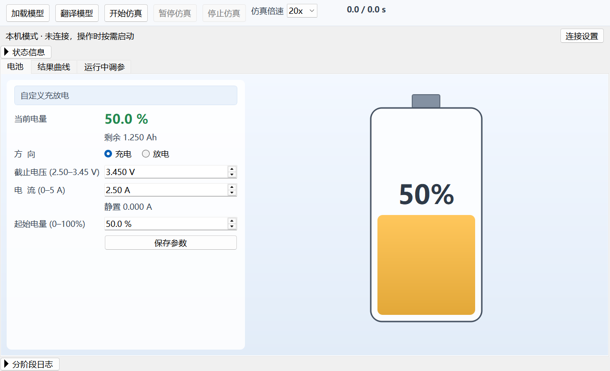
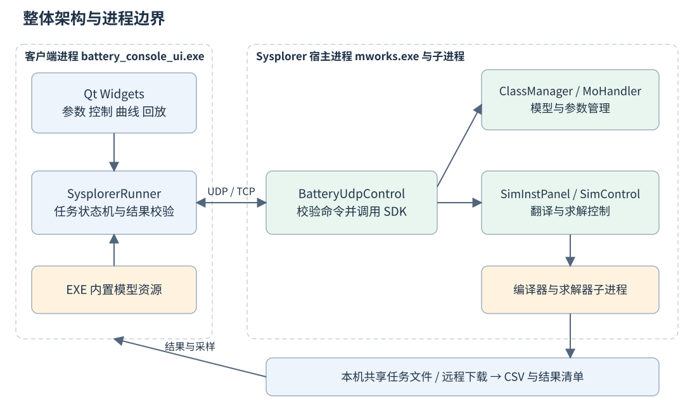
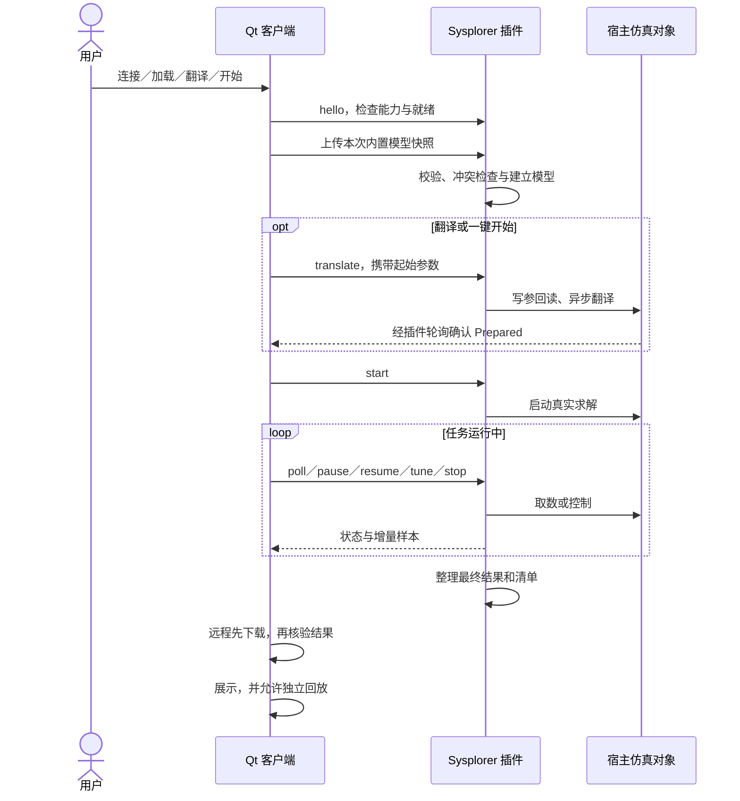
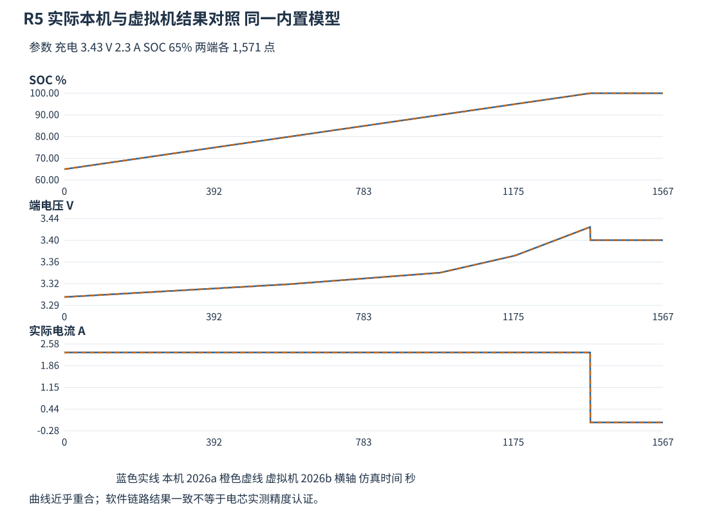

# Qt 与 Sysplorer 电池充放电仿真操作台

**[下载 R5 Windows x64 客户端 ZIP（23.6 MB）](https://github.com/dfq-1104/Qt_with_Sysplorer/releases/download/20261108-embedded-model-r5/BatteryConsole-Client-win64.zip)**（预发行版）。完整解压后，双击 `Start-Client.cmd` 启动。

**[下载 R5 Windows x64 服务器端 ZIP（137 KB）](https://github.com/dfq-1104/Qt_with_Sysplorer/releases/download/20261108-embedded-model-r5/BatteryConsole-Server-win64.zip)**（预发行版）。在服务器上完整解压后，双击 `Setup-Server.cmd` 进行配置。

基于 **Qt Widgets、Sysplorer 宿主内 C++ 插件和 Modelica** 的 Windows 桌面仿真项目。用户在同一个界面输入参数、控制真实计算、查看实时曲线，并回放已经核验的完整或部分结果。计算可以发生在本机，也可以发生在另一台安装并授权 Sysplorer 的电脑上。

当前基线为 **20261108-embedded-model-r5**。模型只有一个发布来源：**客户端 EXE 内置的 Qt 资源 `:/models/BatterySim.mo`**。本机通过 UDP、远程通过认证 TCP 上传；插件收到文本后调用 SDK 建立模型，不再内置第二份业务模型。正式客户端不读取旁边的外部 `.mo`，也不接受 `BATTERY_MODEL_FILE` 覆盖。

本文依据 be10 的《项目总览》《Qt 客户端详解》《Sysplorer 调用与部署详解》整理，于 **2026-11-09** 更新。历史实机验收与当前工作树合并回归分别列出；本次 README 更新没有重新运行仿真。



*截图来自来源 R5 ZIP 启动检查，说明启动和界面布局，不作为本次新验收。配图来源见[说明](docs/readme-assets/来源说明.md)。*

## 项目详解阅读入口

完整图文介绍位于 [docs/项目详解](docs/项目详解/阅读说明.md)，已从 be10 同名目录完整同步，保留 Markdown、HTML、全部配图和来源清单。

| 顺序 | GitHub 上阅读 Markdown | 离线 HTML |
|---|---|---|
| 1 | [项目总览](docs/项目详解/01_项目总览.md)：项目目标、整体架构、双模式和模型来源 | [项目总览 HTML](docs/项目详解/01_项目总览.html) |
| 2 | [Qt 客户端详解](docs/项目详解/02_Qt客户端详解.md)：组件、状态机、通信、结果和开发经验 | [Qt 客户端 HTML](docs/项目详解/02_Qt客户端详解.html) |
| 3 | [Sysplorer 调用与部署详解](docs/项目详解/03_Sysplorer调用与部署详解.md)：宿主对象、SDK、两端部署与故障定位 | [Sysplorer 调用与部署 HTML](docs/项目详解/03_Sysplorer调用与部署详解.html) |

离线阅读请下载或克隆仓库后，用浏览器打开 [index.html](docs/项目详解/index.html)；三篇正文 HTML 内嵌图片和样式，可单独复制。阅读 Markdown 时保留同目录 `assets/`。截图和测试的来源、适用范围见[阅读说明](docs/项目详解/阅读说明.md)与 [manifest.json](docs/项目详解/manifest.json)。这些介绍以来源 R5 为基线，本工作树后续合并回归仍以本文“验证记录和已知边界”及相应记录为准。

## 目录

- [项目详解阅读入口](#项目详解阅读入口)
- [项目能做什么](#项目能做什么)
- [系统架构与职责](#系统架构与职责)
- [本机与远程通信](#本机与远程通信)
- [界面和任务流程](#界面和任务流程)
- [电池模型与结果](#电池模型与结果)
- [使用与部署](#使用与部署)
- [源码构建与打包](#源码构建与打包)
- [验证记录和已知边界](#验证记录和已知边界)
- [源码结构与文档导航](#源码结构与文档导航)

## 项目能做什么

直接使用 Sysplorer 可以编辑和求解 Modelica 模型。本项目将固定电池业务流程集中到客户端，减少反复选模型、填参数和查变量的操作，同时保留 Sysplorer 的真实求解能力。

| 场景 | 客户端电脑 | 计算位置 | 所需配置 |
|---|---|---|---|
| 本机计算 | 运行 Qt，安装并授权 Sysplorer | 当前电脑 | 首次配置宿主安装和插件 |
| 远程计算 | 运行 Qt，无需本机安装 Sysplorer | 已授权的服务器电脑 | 服务器地址、TCP 端口及原访问凭据 |
| 结果回放 | 使用已核验的结果样本 | Qt 本地播放器 | 选择完整或部分结果及回放倍速 |

主要能力包括独立加载模型、翻译、自动补齐准备后开始、真实暂停与继续、主动停止、在线调参、结果下载核验及独立回放。打开客户端只读取设置并显示界面，不自动连接、启动宿主或求解；远程失败不会自动切换本机。

## 系统架构与职责



`battery_console_ui.exe` 通过消息控制 `mworks.exe` 内的 `BatteryUdpControl`。插件 DLL 运行在 Sysplorer 进程内，SDK 是进程内开发接口；Qt 不跨进程直接调用宿主对象指针。宿主仍可能启动编译器、求解器等子进程，因此“客户端与宿主两个主要应用”不表示操作系统中永远只有两个进程。

| 层次 | 主要代码 | 职责 |
|---|---|---|
| 界面层 | `MainWindow`、`BatteryView`、`PlotWidget` | 输入、按钮编排、状态、自绘电池和实时曲线 |
| 客户端任务层 | `SysplorerRunner` | 发现或连接、上传、控制、下载及结果核验 |
| 通信与契约层 | `RemoteLink`、`RemoteServer`、`ModelTransfer` | TCP 帧、认证、模型块和完整性约束 |
| 宿主适配层 | `BatteryUdpControl` | 使用宿主现有模型管理器、仿真面板、控制器和数据服务 |
| 模型层 | `BatterySim.SingleRun`、`BatteryCell` | 按方程计算 SOC、电流和端电压 |
| 结果与回放层 | CSV、JSON、`ReplayData`、`ReplayPlayer` | 校验有效结果，按仿真时间本地播放 |

正式链路没有独立 SDK helper 或常驻 Python 查看桥接，也不会在连接失败后用 Qt 内部近似算法接替求解。仓库保留的历史探针不代表正式运行路径；应以 `app/ui/ui.pro` 和插件工程的编译清单判断。

## 本机与远程通信

两种传输进入插件同一套任务命令执行逻辑。切换的是连接和结果交接方式，电池计算仍由 Sysplorer 执行。

| 项目 | 本机 UDP | 远程 TCP |
|---|---|---|
| 地址与端口 | 仅 `127.0.0.1`，端口由插件动态分配 | 用户指定服务器 IPv4，默认 TCP 39001 |
| 定位方式 | 当前用户发现记录，检查 PID、宿主 EXE 和会话 | 直接连接服务器地址，不读取远端发现文件 |
| 身份与归属 | 发现令牌、session、client、taskId | 挑战响应双向认证、签名消息、会话及任务归属 |
| 模型传输 | 原始文本块最多 768 字节 | 原始文本块最多 48 KiB |
| 最终结果 | 读取同机任务文件 | 下载到客户端后再校验 |
| 失败处理 | 明确报错，按需显式重试 | 保留远程模式，显式重连或重新下载 |

本机发现记录通常位于 `%LOCALAPPDATA%/BatteryConsole/udp/<PID>.json`，包含运行令牌，不能公开或提交。客户端发现忙碌实例时按入口和任务规则处理，不接管其他用户任务，也不无限启动新实例。

远程使用带长度前缀的 JSON 帧，单帧上限 1 MiB；HMAC-SHA256 用于认证和消息完整性，序号用于防止消息重放。**认证不是 TLS 加密**，当前没有每人独立账号、角色权限或多租户隔离；跨不可信网络应使用受控 VPN。TCP 有序传输也不能替代消息边界、任务归属和业务去重。

两端对模型使用 `model.begin → model.chunk → model.commit` 上传事务，检查长度、UTF-8、块及 SHA-256。当前固定模型接口为 `battery-console/1`，顶层为 `BatterySim.SingleRun`；不是任意 Modelica 文本执行服务。协议细节见[模型上传协议](docs/模型上传协议.md)、[TCP 协议](docs/TCP远程任务协议.md)和[UDP 协议](docs/UDP任务协议.md)。

## 界面和任务流程

客户端使用 C++ 直接构建 Qt Widgets 界面，曲线由 `QPainter` 绘制，未依赖 Qt Charts。界面分为顶部仿真控制、连接与状态、中间三个页签，以及底部可展开日志。

| 操作或页面 | 行为与边界 |
|---|---|
| 电池页／保存参数 | 保存本地设置并更新预览，不立即写入宿主或开始计算 |
| 加载模型 | 连接、上传并确认加载，结束于 Loaded；不写起始参数、不翻译、不求解 |
| 翻译模型 | 必要时加载，写入并回读起始参数，翻译后停在 Prepared |
| 开始仿真 | 复用有效 Prepared，或自动补齐加载、设参、翻译后启动 |
| 暂停／继续仿真 | 控制宿主当前任务，按宿主确认状态更新按钮 |
| 停止仿真 | 终结本次计算，保留有效部分结果；不是可继续的暂停 |
| 结果曲线页 | 显示 SOC、端电压、电流，选择完整或部分结果 |
| 回放控件 | 只控制当前所选结果的本地播放，具有独立倍速、时间和状态 |
| 运行中调参页 | 提交六项运行期输入，保留同一任务、时间和 SOC |

翻译和开始会读取当前输入，不要求先点保存；参数变化不能复用旧准备实例。仿真倍速调整宿主运行节奏，回放倍速调整已有数据的播放时间，两者不改变模型物理参数。界面中的秒是仿真时间，不是程序耗时；倍速也不保证达到固定墙钟性能。



在线调参包括模式、电流指令、恒压目标、放电下限、充电上限和电流上限。运行中先暂停、批量写入再恢复；已暂停时保持暂停。即时回读可能仍是旧步值，必须等后续**模型实际采样确认**才表示生效。动态调参轨迹不能当作静态初始参数缓存复用。

实时样本经过 `samplesArrived → MainWindow::onLiveSamples → PlotWidget::appendSamples` 更新曲线和电池。Qt 当前使用 50 ms 定时器推进任务和回放，这不代表求解器每 50 ms 积分一次。

## 电池模型与结果

模型源为 [model/BatterySim.mo](model/BatterySim.mo)，由 [models.qrc](app/ui/models.qrc) 编入客户端 EXE。更新模型需要重新构建发布客户端；插件按上传内容处理，无需仅为模型文本变化维护第二份内置资源。内置模型不等于加密或防提取。

当前单体模型采用 **2.5 Ah、内阻 0.01 Ω 的 Rint 等效模型**，根据 OCV–SOC 表和库仑积分计算：

```text
V_term = OCV(SOC) + I_act × R0
der(SOC) = eta × I_act / Q_rated
Q_rated = 2.5 × 3600 C
```

电流充电为正、放电为负。初始设置支持充电／放电、电流 0–5 A、截止电压 2.50–3.45 V、SOC 0–100%；运行期另支持静置、恒压及限流输入。截止保护可能令电流归零，但不必立即结束求解。当前不包含温度、老化和 RC 极化支路，OCV 表为工程示意值；软件跑通不等于实测电芯精度认证。



*此图来自来源 R5 已核验 CSV：两端均为充电、3.43 V、2.3 A、起始 SOC 65%，各 1571 个采样点。数值差异符合当次比较阈值；不是本次 README 更新产生的新结果。接近截止条件后电流归零、欧姆压降项消失，可导致图中电压回落，不能直接据此判断为通信丢点。*

插件先校验，再导出 `result.csv` 和 `result.json`；客户端进一步核对任务、模型、参数、点数、时间、数值及 CSV 哈希。文件存在或网络收到响应，都不能单独证明完整成功。

- 完整结果为 `complete=true`；主动停止产生 `complete=false` 的有效部分结果。
- 部分结果可独立回放，不覆盖完整成功缓存；失败不替换此前有效结果。
- 远程下载失败保留重试入口，不应因此重复启动服务器计算。
- 当前结果列表和缓存只属于本次 Qt 进程；磁盘文件保留不等于已实现重启恢复。

本机任务通常位于 `%TEMP%/BatteryConsoleUDP/<任务 UUID>`，含客户端／插件日志、状态、CSV 和清单；远程服务器使用自己的任务目录，下载文件保存在客户端。当前 `nativeResult` 是宿主结果根目录，不是具体 `.msr` 文件名。

## 使用与部署

### 本机计算

1. 完整解压客户端 ZIP，双击 `Check-Model.cmd` 检查内置模型，再运行 `Start-Client.cmd`。
2. 连接设置选择本机。首次使用按提示选择已安装且授权的 Sysplorer，配置配套插件；更新被占用的插件前，先保存并关闭对应宿主，必要时接受管理员授权。
3. 保存并连接，或直接点击加载、翻译、开始，由程序按需发现或启动本机宿主。
4. 按“加载 → 设置参数 → 翻译 → 开始”操作；也可直接开始，由程序自动补齐准备。
5. 运行中可暂停、继续、调参或停止；结束后选择结果并回放。退出前先停止并确认终态。

### 远程计算

**服务器电脑，首次配置：**

1. 完整解压服务器 ZIP，确认有效 Sysplorer 许可、编译器和求解器可用。
2. 保存工作并关闭需要更新的目标宿主，运行 `Setup-Server.cmd`，选择实际安装目录并按提示授权。脚本安装插件、启用监听并配置防火墙，已有有效凭据、端口和目录会沿用。
3. 安全提供服务器地址、端口及原访问凭据。不要把网关地址当服务器地址，也不要把凭据文件路径填入密钥框。
4. 从原桌面图标启动 Sysplorer，等待初始化，运行 `Check-Server.cmd` 确认监听、认证、上传能力和引擎均 READY。

**客户端电脑，日常使用：**

1. 运行 `Start-Client.cmd`，连接设置选择远程，填写服务器可达 IPv4、端口和访问凭据。
2. 保存并连接后，执行加载、翻译、开始及结果查看。仅远程使用时客户端无需安装 Sysplorer 或 SDK。
3. 断线使用显式重连并核对；仅下载失败时重试下载，不重复启动计算。

凭据以当前 Windows 用户的 DPAPI 保护保存，通常无需每次输入。服务器必须保持 Sysplorer 运行；当前没有后台服务或开机自启实现。防火墙默认限制 Domain/Private 和本地子网，跨子网由管理员按实际来源配置，不以关闭防火墙作为正常步骤。

详细步骤、插件更新和回退见[可移植部署说明](docs/可移植部署说明.md)。首次设置与仅更新插件是不同入口；不要因超时随意轮换密钥或覆盖其他安装。

## 源码构建与打包

### 开发环境

| 组件 | 当前脚本基线 |
|---|---|
| 系统 | Windows x64 |
| Qt | 5.14.2，msvc2017_64，Core／Gui／Widgets／Network；测试另需 TestLib |
| 编译器 | Visual Studio 2017 Professional x64、Windows SDK，C++11 |
| 仿真引擎 | MWORKS Sysplorer 2026a／2026b；仅承诺已记录的接口与测试范围 |
| SDK | Sysplorer SDK 2026a（vs2017）的头文件和导入库 |
| 脚本 | PowerShell；Python 仅部分诊断和文档工具使用 |

仓库不包含 Sysplorer、SDK、许可、Qt 运行库或预编译交付包。开发脚本默认 Qt 路径为 `C:/Qt/Qt5.14.2/5.14.2/msvc2017_64`，VS 为 2017 Professional，SDK 位于 `C:/Program Files/MWORKS/Sysplorer SDK 2026a(vs2017)`；安装不同先核对构建及部署脚本，不擅自升级工具链。

从仓库根目录的 PowerShell 使用新的目录名构建并生成两端包：

```powershell
$ErrorActionPreference = 'Stop'
$buildName = 'release-' + (Get-Date -Format 'yyyyMMdd-HHmmss')
& .\tools\deployment\Build-Clean.ps1 -BuildName $buildName
$buildRoot = Join-Path (Get-Location).Path ('build/' + $buildName)
& .\tools\deployment\package.ps1 `
    -OutputDirectory (Join-Path (Get-Location).Path ('dist/' + $buildName)) `
    -ClientExe (Join-Path $buildRoot 'ui/release/battery_console_ui.exe') `
    -PluginDll (Join-Path $buildRoot 'plugin/release/battery_udp_control.dll')
```

打包产物为 `BatteryConsole-Client-win64.zip`、`BatteryConsole-Server-win64.zip` 和哈希清单。生成包本身不安装插件、不配置服务器；安装、提权和防火墙操作在目标电脑显式设置时完成。包内不得携带私有宿主绑定、开发工作树路径或访问凭据。测试、安装和路径要求见 [AGENTS.md](AGENTS.md) 及各脚本参数。

## 验证记录和已知边界

下表区分来源版本验收与当前工作树的合并回归；本次文档更新未重新运行测试。

| 证据范围 | 已记录结果 | 入口 |
|---|---|---|
| 来源 R5 校验及模拟回归 | 模型 17 通过；传输 15 通过、3 跳过；连接／布局 70 通过、3 跳过；启动 4 项通过 | [内置模型交付报告](docs/内置模型交付测试报告.md) |
| 来源普通双击本机 2026a | 加载、翻译、完整求解及回放通过 | 同上 |
| 来源实际虚拟机 2026b | 正式 EXE 的显式诊断入口完成认证、上传、求解、下载及核验 | 同上；不等同普通双击远程全流程验收 |
| 本工作树 2026-11-08 合并 | 7 个构建目标成功；模型 17 通过；传输 15 通过、3 跳过；启动及 ZIP 检查通过 | [最终双模式合并记录](docs/最终双模式版本合并记录_20261108.md) |
| 同次合并的连接／界面回归 | **69 通过、1 失败、3 跳过**；失败为关闭客户端后停止未及时生效 | 同上，不标记整组通过 |

QtTest 数量包含数据行、初始化和清理；跳过不算通过。来源报告中的 `build/`、`logs/` 是当次本机证据路径，不保证克隆后存在。

已知边界：

- 关闭窗口发送停止仍有时序不稳定，日常先点停止并等待终态，再退出客户端。
- 来源远程连接／认证曾超时，显式重试后成功，根因未确证；不能宣称从未超时或已彻底修复。
- R5 尚未重新完整验收远程普通双击回放与调参；本工作树合并也没有重新执行实际两机求解。
- 不承诺任意 Modelica 模型、所有宿主／SDK 版本、长期运行、多任务并发、跨宿主重启接管或无条件断线恢复。
- 内置资源解决了本轮外部文件读取链路问题，没有修改文件保护策略，也不是模型精度或安全发布认证。

排障按阶段检查：连接地址和凭据 → 插件加载与 READY → 上传与模型接口 → 参数回读与翻译 → 求解器、许可和依赖 → 下载与结果清单。优先保留无密钥诊断及任务日志，不公开 `remote.ini`、配置备份或发现令牌。

## 源码结构与文档导航

```text
app/ui/src/                    Qt 界面、任务适配、数据与回放
app/ui/tests/                  模型校验、传输、连接及真实宿主测试
common/                        认证 TCP、模型传输与校验、发布标识
model/BatterySim.mo            固定电池模型源，编入客户端资源
tools/sysplorer_udp_plugin/    宿主插件、SDK 适配与采样
tools/deployment/              两端打包、首次设置、更新和诊断
docs/                         部署、协议、验收与历史复盘
docs/项目详解/                完整项目总览、Qt 和 Sysplorer 图文详解
docs/readme-assets/            README 必要配图与来源说明
```

| 阅读目的 | 推荐入口 |
|---|---|
| 从整体架构深入代码及部署 | [项目总览](docs/项目详解/01_项目总览.md) → [Qt 客户端详解](docs/项目详解/02_Qt客户端详解.md) → [Sysplorer 调用与部署详解](docs/项目详解/03_Sysplorer调用与部署详解.md) |
| 使用、安装和日常启动 | [可移植部署说明](docs/可移植部署说明.md) |
| 模型从哪里来、如何上传 | [模型上传协议](docs/模型上传协议.md)、[双击启动与模型读取说明](docs/双击启动与模型读取说明.txt) |
| 通信联调 | [TCP 远程协议](docs/TCP远程任务协议.md)、[UDP 协议](docs/UDP任务协议.md) |
| 验收范围及遗留问题 | [R5 交付报告](docs/内置模型交付测试报告.md)、[最终双模式合并记录](docs/最终双模式版本合并记录_20261108.md) |
| 追踪客户端代码 | [main_window.cpp](app/ui/src/main_window.cpp)、[sysplorer_runner.cpp](app/ui/src/sysplorer_runner.cpp) |
| 追踪宿主 SDK 调用 | [control_plugin.cpp](tools/sysplorer_udp_plugin/control_plugin.cpp)、[插件构建说明](tools/sysplorer_udp_plugin/README.md) |
| 后续代理协作 | [AGENTS.md](AGENTS.md) |

`docs/交付文档/` 和部分早期 SDK 文档保留 helper 阶段；其他旧 UDP、私有环境和 R3/R4 外部模型文档也有各自适用日期。阅读时以当前源码、上传协议和 R5 报告为准，不把旧路径或旧截图恢复成当前行为。
