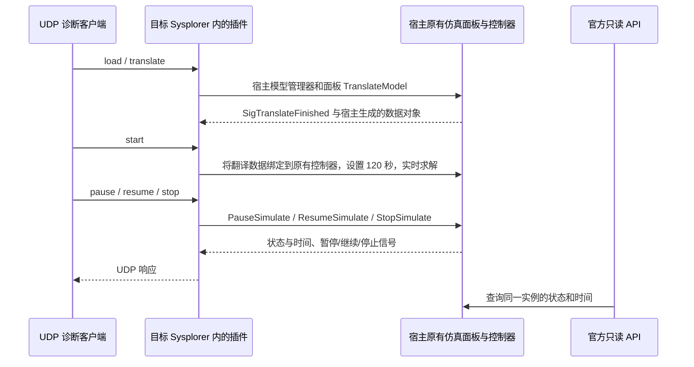

# UDP 插件加载与宿主仿真对象控制验证

日期：2026-11-04（Asia/Shanghai）。状态：限定范围验证通过。

## 结论与范围

已把 C++ UDP 插件实际加载进本机 `Sysplorer 2026a/Bin64/mworks.exe`，取得宿主原有仿真面板的 `MwSimControl`，通过本地 UDP 完成模型加载、翻译、开始、暂停、继续、停止。最小模型和项目 `BatterySim.SingleRun` 均通过。

本次命令发送端是独立 Python 诊断脚本。现有 Qt 电池客户端的按钮和通信实现没有改动，尚未接入这条新路径。本报告不代表 Qt 按钮端到端验收已完成。

## 验证架构



插件没有创建新的 `MwApp`、`MwClassManager`、`MwSimControl`。它创建 UDP socket 和自身插件对象，并使用宿主拥有的模型管理器、仿真面板及控制器。

## 环境与二进制

| 项目 | 实际值 |
|---|---|
| 宿主 | `C:/Program Files/MWORKS/Sysplorer 2026a/Bin64/mworks.exe` |
| 宿主文件版本 | 26.3.0.749 |
| SDK 根目录 | `C:/Program Files/MWORKS/Sysplorer SDK 2026a(vs2017)` |
| SDK build_info | 26.2.0.1197；SDK mw_develop.dll 文件版本 26.2.0.569 |
| Qt | 5.14.2，MSVC 2017 x64 |
| 最终验证宿主 PID | 21556，仅对本轮运行有效 |
| UDP 地址 | 127.0.0.1:63239，启动时动态选择，仅本轮有效 |
| 官方查询 API 端口 | 50441，仅本轮有效 |
| 插件位置 | `C:/Program Files/MWORKS/Sysplorer 2026a/Bin64/addins/BatteryUdpHostProbe/battery_udp_host_probe.dll` |
| 最终插件 SHA-256 | `7cde29d56ad2ec86527ade3dd90c1535222dcd8658344949484f8134109f1e9d` |

安装目录受 Windows ACL 保护，普通写入失败。通过管理员授权，在独立子目录中部署了本次 DLL；没有替换原厂 DLL 或其他插件。

SDK 与宿主的小版本不同。验证对易受布局变化影响的内联 getter 使用目标 DLL 真实导出函数，避免使用旧头文件计算私有成员偏移。这是本机指定接口的实测结果，不是对所有接口或其他版本的 ABI 兼容承诺。

## 如何确认是宿主实际使用的对象

1. 插件初始化日志的 PID 与启动的目标 mworks.exe PID 相同。
2. 进程模块清单独立确认，该 PID 加载了安装目录中的验证 DLL、宿主 mw_develop.dll 和 mw_sim_inst.dll。
3. 对象获取链为：宿主 `MwApp` → 工作台 → 工作台 Core → 仿真面板 → `GetSimControl()`。
4. UDP 状态响应每次重新调用宿主面板 getter，比较返回指针是否一致，记录 `sameAsHostPanel=true`。
5. 两种模型沿用同一控制器；切换的是宿主翻译生成的仿真数据对象。
6. UDP 暂停后，独立连接该进程官方 API，查询到相同的 Paused 状态与时间。

| 对象 | 本轮地址 |
|---|---|
| 宿主仿真面板 | `0x14e03698e40` |
| 宿主原有控制器 | `0x14e0483dc60` |
| 最小模型数据 | `0x14e0710a0d0` |
| 电池模型数据 | `0x14e07109d10` |

这些地址仅是本轮诊断证据，不能硬编码到后续实现。

## 已通过的验证

| 项目 | 最小模型 UdpProbeModel | 电池 BatterySim.SingleRun |
|---|---|---|
| UDP 模型加载 | 通过 | 通过，模型来自插件内嵌资源 |
| UDP 翻译 | 收到成功翻译信号 | 收到成功翻译信号 |
| UDP 开始 | Running | Running |
| UDP 暂停 | Pausing → Paused | Paused |
| 暂停后间隔约 2 秒再次查询 | 1.988 → 1.988 秒 | 2.002 → 2.002 秒 |
| 官方 API 交叉查询暂停 | Paused，1.988 秒 | Paused，2.002 秒 |
| UDP 继续后时间推进 | 1.988 → 3.944 秒 | 2.002 → 3.944 秒 |
| 控制器和数据对象持续一致 | 通过 | 通过 |
| UDP 停止 | Stopping → Idle | Stopping → Idle |
| 官方 API 查询停止状态 | Idle | Idle |

电池结果还通过官方查询读取了 `cell.SOC`、`cell.I_act`、`cell.V_term`，各 2014 个有限数值。SOC 为 0.5，实际电流为 0 A，电压约 3.26 V。

本轮使用模型默认参数：放电、3 A、截止电压 3.45 V、初始 SOC 50%。该组合触发放电截止条件，所以曲线不发生充放电变化；这不代表求解失败。本轮没有进行自定义参数传入及曲线变化验收。

停止属于异步操作：响应被接受后仍需等待 Idle。日志包含停止事件 `exitCode=-1`。停止后控制器 getter 报告时间 120 秒，与停止前约 4 秒不同；不能据此宣称完整计算了 120 秒。后续 UI 接入必须定义停止时读数和时间显示策略，并核对结果时间轴。

## 实际遇到的问题与处理

| 问题 | 证据与处理 |
|---|---|
| 安装目录拒绝写入 | 普通复制失败；管理员部署成功并校验哈希 |
| 翻译成功但控制器数据为空 | 第一轮记录翻译得到的数据地址，但 GetSimData 为零；开始前绑定宿主翻译数据 |
| 开始后很快结束，暂停被拒绝 | 第二轮停止事件退出码 0，实际终止时间 1 秒；显式设置目标配置为 120 秒并采用实时模式 |
| 启动早期翻译返回 false | 第三轮早期请求未接受；稍后重试成功。启动任务占用是可能原因，尚未从内部错误码确证；不能把控制器 Idle 当成整个宿主已就绪 |
| SDK 与宿主版本不同 | 核查导出函数，避免跨版本内联成员布局；所用路径通过实际运行验证 |

保留第一、二轮及第三轮早期失败记录，没有把所有失败归为 SDK 不可用。

## 文件与复现入口

项目中的工具目录：`tools/udp_host_probe/`。

| 文件 | 用途 |
|---|---|
| probe.cpp / probe.h / probe.json | 插件与 UDP 命令实现 |
| probe.qrc | 内嵌项目电池模型 |
| udp_host_probe.pro / build.cmd | Qt/MSVC 构建 |
| deploy_admin.ps1、deploy_update*.ps1 | 本轮带哈希约束的管理员部署记录；不能直接当通用更新器 |
| launch_direct.py | 启动目标宿主，设置本轮令牌与日志路径，记录 UDP 端口 |
| verify_udp.py | 通过 UDP 执行操作并断言；官方 API 仅用于只读交叉核验 |
| summarize.py | 汇总断言、变量和文件哈希 |
| evidence_v3/verification.json | 最小模型成功记录 |
| evidence_v3/verification_battery.json | 电池模型成功记录 |
| evidence_v3/host.jsonl | 插件生命周期、命令响应、仿真事件 |
| evidence_v3/host_modules.json | 目标进程模块证据 |
| evidence_v3/battery_result_query.json | 电池结果查询 |
| evidence_v3/summary.json | 两个成功用例及二进制/源码哈希摘要 |
| evidence/、evidence_v2/ | 前两轮失败定位证据 |
| evidence_v3/verification_early_start.json | 第三轮早期翻译拒绝记录 |

复现前应选择全新的证据目录，防止覆盖日志。示例：

```powershell
& 'C:/Program Files/MWORKS/Sysplorer 2026a/External/python64/python.exe' tools/udp_host_probe/launch_direct.py evidence_new
& 'C:/Program Files/MWORKS/Sysplorer 2026a/External/python64/python.exe' tools/udp_host_probe/verify_udp.py evidence_new
& 'C:/Program Files/MWORKS/Sysplorer 2026a/External/python64/python.exe' tools/udp_host_probe/verify_udp.py evidence_new BatterySim.SingleRun
```

同一模型再次执行会覆盖对应 verification 文件；需保留历史时使用新实例与新证据目录。部署脚本中旧/新哈希是本轮固定值，重新构建后必须重新审核，不可盲目重跑。

## 探针运行边界与后续接入

- 仅绑定 IPv4 回环地址，需匹配本轮随机令牌；令牌文件 `session.private.json` 不应对外分发。
- 未提供令牌和日志环境变量时，插件不创建 UDP 监听器；环境变量只传给专用测试进程，没有全局设置。
- 探针支持 status/load/translate/start/pause/resume/stop。只允许两个指定测试模型，不接收任意脚本执行命令。
- 有请求 ID 和最多 256 条响应缓存；这不是已经完成丢包、乱序、重连及长期压力验收的生产协议。
- 模型切换、翻译失效、并发任务、异常清理、启动就绪判断仍需产品化状态机。当前正确顺序由验证脚本保证。
- 本次没有建立常驻 Python 桥接服务；诊断发送器和官方查询脚本执行完即退出。编译器与求解器仍可能产生子进程。
- 原 Qt 客户端尚未接入 UDP，也没有通过其实际按钮验收这条新链路。
- 当前测试宿主已停止仿真并保留窗口，供查看；本次 DLL 保留在独立插件目录。普通后续启动不监听 UDP，除非显式传入探针环境变量。

## 验收清单

- [x] 目标安装版 mworks.exe 实际加载验证 DLL。
- [x] UDP 响应来自该宿主 PID。
- [x] 使用宿主原有控制器，没有另建控制器。
- [x] 最小模型加载、翻译、开始、暂停、继续、停止通过。
- [x] 项目电池模型同组操作通过。
- [x] 暂停期间时间冻结，继续后时间推进。
- [x] 官方只读 API 交叉确认同一实例状态和时间。
- [x] 读取电池结果变量并确认非空、有限。
- [ ] Qt 实际按钮接入与界面状态同步。
- [ ] 用户参数经 UDP 设置、回读和变化曲线验收。
- [ ] 生产协议、异常状态、跨版本/跨机器及长期运行验收。
