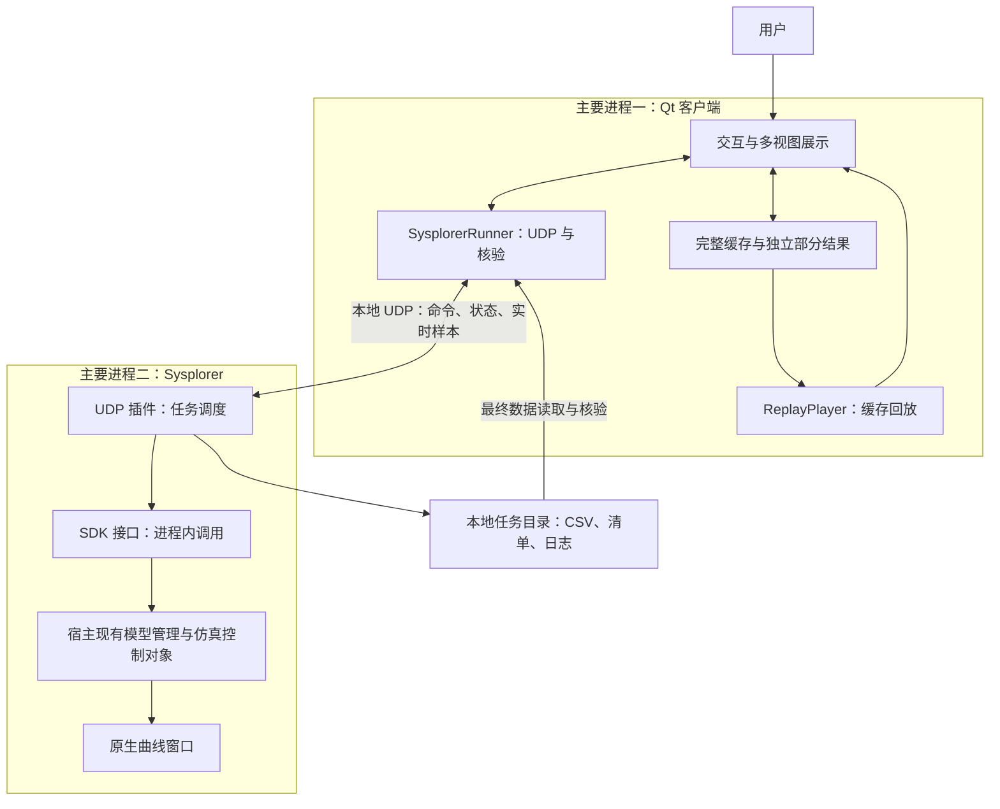
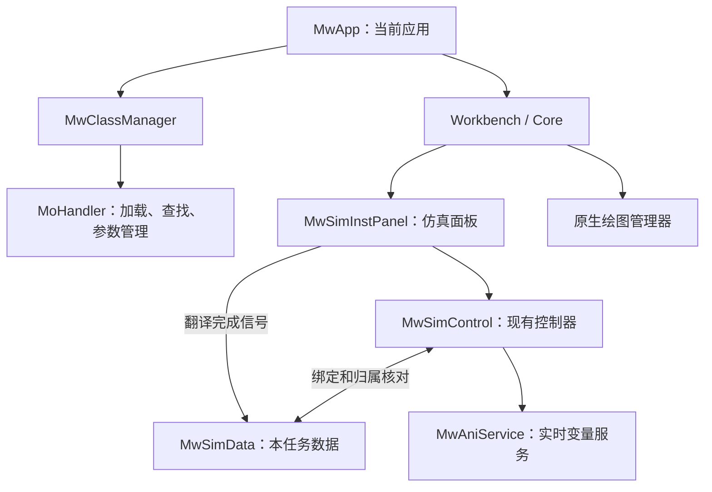
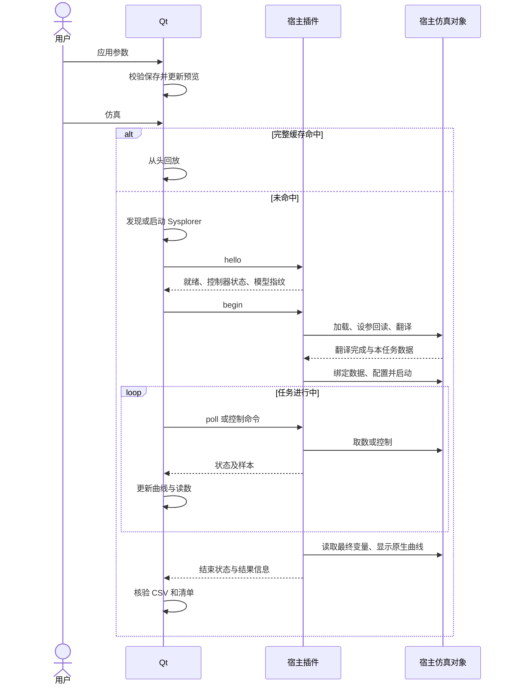
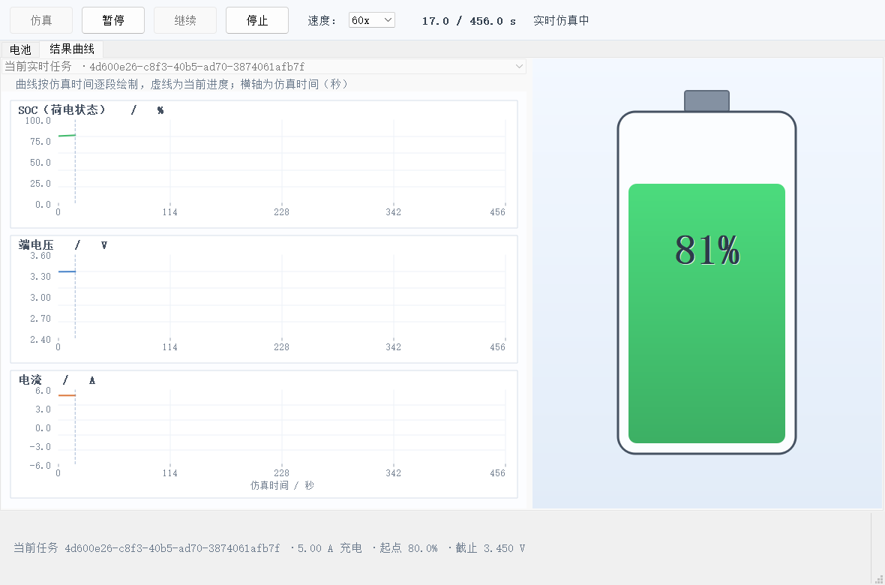
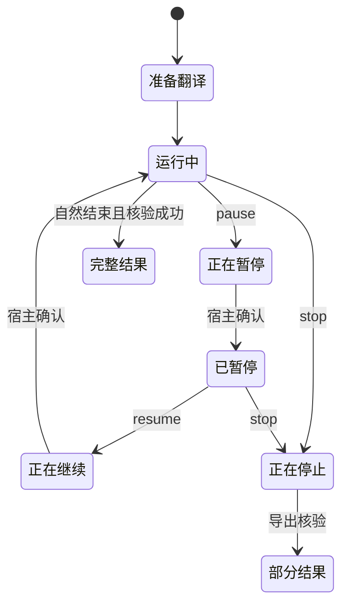
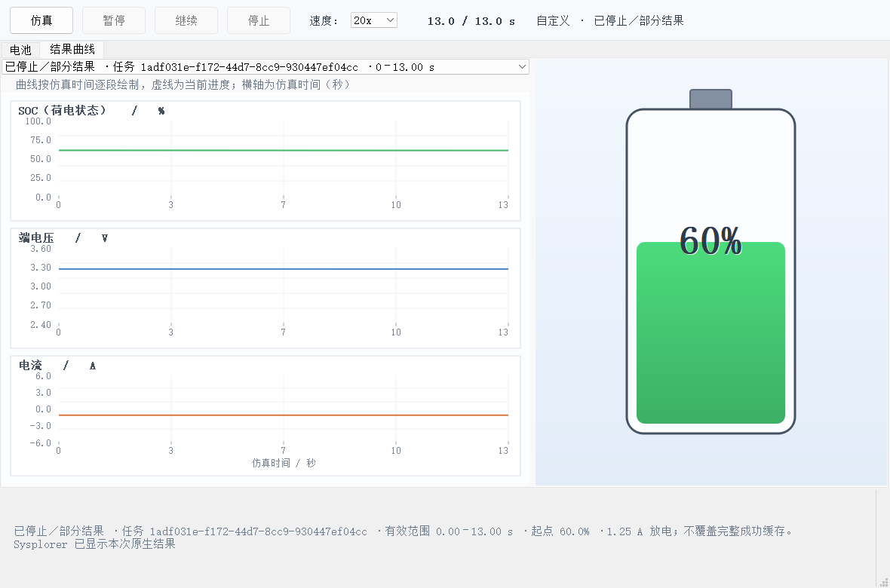
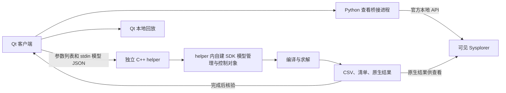

# UDP 架构设计、开发经验与 helper 方案对比

| 文档元信息 | 内容 |
|---|---|
| 版本 | 1.0，架构复盘稿；不是软件版本号 |
| 日期 | 2026-11-05，Asia/Shanghai |
| 读者 | 项目负责人、客户端开发、插件开发、联调测试及后续维护人员 |
| 目标 | 说明当前架构为何这样设计、如何工作、经历了哪些关键修正，并与上一版 helper 方案比较 |
| 状态 | 按现有源码及 2026-11-04 验收证据整理；本次仅编写文档，未修改产品代码或重新执行仿真 |
| 关联文档 | [任务协议](UDP任务协议.md)、[开发与验收记录](UDP正式接入开发记录.md)、[运行说明](../app/ui/UDP运行说明.md) |

## 目录

1. [背景、目标与边界](#背景目标与边界)
2. [必要术语](#必要术语)
3. [当前架构与责任划分](#当前架构与责任划分)
4. [Qt 侧设计](#qt-侧设计)
5. [宿主插件与仿真对象](#宿主插件与仿真对象)
6. [通信与任务生命周期](#通信与任务生命周期)
7. [实时绘图、缓存与控制语义](#实时绘图缓存与控制语义)
8. [与上一版 helper 方案对比](#与上一版-helper-方案对比)
9. [架构决策与开发经验](#架构决策与开发经验)
10. [验证证据与未覆盖范围](#验证证据与未覆盖范围)
11. [后续演进建议](#后续演进建议)
12. [验收清单与文档分工](#验收清单与文档分工)

## 背景、目标与边界

上一版已经通过独立 C++ helper 实现真实计算、Qt 回放和 Sysplorer 原生查看。随后需求进一步明确：Qt 应通过本地 UDP 控制可见 Sysplorer 内的现有仿真对象；新任务运行中实时绘图，暂停和继续应作用于实际求解器；主动停止保留部分结果，并继续沿用完整成功缓存。

本轮选择宿主内插件，主要原因是控制对象和交互需求发生变化。不能把这次演进概括为“helper 不能真实计算”或“UDP 天然更可靠”。

本文范围包括当前 Qt、插件、SDK 与宿主对象的边界，任务和结果生命周期、方案比较及经验沉淀。非目标是复制完整协议字段、完整故障案例、UI 入门教程、全部测试步骤或重新制定开发排期。相关细节采用交叉引用。

事实分为三类：当前能力以源码和最终验收记录为依据；历史行为以留存 helper 源码、查看脚本及历史文档为依据；演进建议明确标注为尚未实施。没有可比性能基准、故障率或开发工时数据，不给出数值优劣结论。

## 必要术语

| 术语 | 本文含义 |
|---|---|
| 宿主 | 用户可见的 Sysplorer 主程序 mworks.exe |
| SDK | 插件或 helper 使用的开发接口及相关库，不是第三个独立应用程序 |
| 宿主插件 | 加载到 Sysplorer 进程内的 battery_udp_control.dll |
| 仿真对象 | 模型管理器、仿真面板、控制器、数据和实时服务等 C++ 对象 |
| 顶层模型 | 当前固定使用 BatterySim.SingleRun，其内部 cell 为 BatteryCell |
| 完整缓存 | Qt 当前进程中最近一次核验通过的完整成功结果 |
| 部分结果 | 主动停止任务已经产生并核验的有效数据，不等同完整缓存 |
| 任务身份 | 会话、客户端和任务编号等标识；对象归属还要另行检查 |

## 当前架构与责任划分

两个主要进程不代表 Windows 进程总数固定为二：宿主仍可能启动编译器、求解器等子进程。当前正式路径不再启动独立 SDK helper 或常驻 Python 查看桥接。

| 层次 | 负责 | 责任边界 |
|---|---|---|
| Qt 界面 | 参数编辑、保存、任务发起、绘图、回放、结果选择 | 不使用近似算法替代 Sysplorer 计算 |
| SysplorerRunner | 发现或启动宿主、请求与重试、样本及文件核验 | 不创建宿主仿真控制器 |
| UDP 插件 | 验证任务、调用 SDK、采集、导出和原生查看 | 不自行实现电池数值求解器 |
| SDK | 提供访问宿主对象的接口 | 不是网络消息接收程序，也不是单独进程 |
| 宿主仿真对象 | 模型管理、翻译、控制求解和提供结果 | 不管理 Qt 的缓存播放时间 |

通信有三种载体：发现记录用于定位端口，UDP JSON 用于控制与实时样本，本地文件用于最终结果交接。这是一套同机方案，并非仅靠 UDP 传输全部结果。

## Qt 侧设计

工程使用 Qt Widgets、C++11、QtNetwork；当前验证环境为 Qt 5.14.2、MSVC 2017 x64。界面通过 C++ 布局代码组织，没有把业务控制写入 Modelica 模型。

| 模块 | 代码入口 | 职责 |
|---|---|---|
| 应用入口 | [main.cpp](../app/ui/src/main.cpp) | QApplication、主窗口、事件循环 |
| 主窗口 | [main_window.cpp](../app/ui/src/main_window.cpp) | 按钮编排、缓存判断、状态及结果选择 |
| 电池视图 | [battery_view.cpp](../app/ui/src/battery_view.cpp) | 参数输入、预览及 QPainter 电池图形 |
| 曲线视图 | [plot_widget.cpp](../app/ui/src/plot_widget.cpp) | 实时样本追加、进度与三条曲线绘制 |
| 通信适配 | [sysplorer_runner.cpp](../app/ui/src/sysplorer_runner.cpp) | QUdpSocket、发现、启动、核验 |
| 回放与数据 | [replay_player.cpp](../app/ui/src/replay_player.cpp)、[replay_data.cpp](../app/ui/src/replay_data.cpp) | 定时推进播放时间、样本读取及线性插值 |

MainWindow 用信号槽连接按钮和业务操作；Runner 的 samplesArrived、stateChanged、finished、stopped 信号则把通信事件送回主窗口。网络等待和回放使用事件与定时器驱动，避免在按钮处理函数中同步等待完整计算。

关键数据分开维护：已应用设置存于 uiVoltage/uiCurrent 等字段；完整结果保存自己的参数与 samples；实时样本存于 m_liveSamples；停止结果存于 m_partials。新任务尚未成功时，不能覆盖旧完整缓存。

当前 m_display 区分 preview、live、cache、complete、partial；这是现有字符串实现，并非已重构为强类型状态机。Runner 的 isRunning() 表示任务仍忙碌，包括准备和暂停阶段，不能仅按名字理解为“求解器正在推进”。

## 宿主插件与仿真对象

插件继承 MwPlugin，initialize 创建本地 UDP Socket 并读取内嵌模型资源，extensionsInitialized 取得宿主对象，aboutToShutdown 停止定时器、关闭通信并移除监听。

图中箭头主要表示访问路径，不是完整内存所有权图。插件不新建另一套 MwApp、MwClassManager 或 MwSimControl。它取得宿主现有对象，持有控制器、面板和数据对象的观察指针，并检查控制器当前数据仍属于本任务。观察指针不能单独证明对象业务归属。

### 具体计算对象

源文件为 [model/BatterySim.mo](../model/BatterySim.mo)，插件从资源 :/battery/BatterySim.mo 加载模型包，顶层翻译对象固定为 BatterySim.SingleRun，内部 cell 为 BatterySim.BatteryCell。它不是自动选择宿主当前打开的任意模型。

Qt 输入映射到 runMode、runCurrent、runVoltage、socStart。插件使用 SetParamValue 写入、GetParamValue 回读；TranslateModel 完成后取得数据并 RebindSimData，再配置终点、输出间隔与倍速并启动。

BatteryCell 为 2.5 Ah、0.01 Ω 的 Rint 简化模型，使用 OCV–SOC 表和电流积分计算 SOC，包含截止保护。当前 OCV 为工程示意数据，未覆盖完整极化、温度和老化。真实求解表示执行了模型方程，不代表已完成实物精度标定。

模型编入两端资源。修改磁盘 .mo 文件不会自动改变已部署二进制，须重建部署并检查模型指纹一致。

## 通信与任务生命周期

插件绑定 127.0.0.1 动态端口，每 2 秒原子更新当前用户目录下的发现记录。Qt 核对更新时间、PID 存活及实际可执行文件路径，完成 hello 后核对模型指纹。可用宿主不存在时启动本机 mworks.exe；忙碌宿主不被接管。

begin 是组合异步业务命令。收到 ok 代表被接受，不能代替翻译、启动或完成确认。按钮依据宿主确认状态启用，并限制重复在途控制。

UDP 的可靠性由应用层补足：请求编号、会话、任务归属、相同请求重发、有限响应缓存和连续样本游标。当前每 1.5 秒无响应时重发同一报文，最多 6 次发送尝试；不是“初次加 6 次重试”。这些机制降低重复执行风险，不构成无限重试或任意故障下严格一次执行的承诺。

协议完整字段、命令和错误码只在[任务协议](UDP任务协议.md)维护。令牌不对外分发；loopback、令牌与归属检查不代表已建立远程服务安全体系，也不隔离同用户恶意进程。

## 实时绘图、缓存与控制语义

### 两条数据路径

实时路径为：宿主 MwAniService → BatteryListener → 插件 live 缓冲 → poll 响应 → Runner 校验 → samplesArrived → PlotWidget 追加与电池读数更新。跨进程是客户端轮询，不是主动推送。

最终路径为：宿主变量结果 → 插件校验、时间对齐和导出 → CSV 与清单 → Qt 检查任务、参数、模型、哈希、点数和时间范围。实时样本与最终原生结果采样网格不同，点数不要求相同。

### 时间与倍速

界面“当前 / 总时长 s”使用仿真秒，不是墙钟耗时。实时任务分母为配置终点；回放分母为结果终点；部分结果分母为有效结果末时间。客户端依据容量、电流、SOC 和方向估算时长并限制为 120–20000 秒，零电流固定 120 秒。截止保护会使电流归零，不必使求解立即结束。

真实任务倍速映射 SDK 减速因子 1/speed，并在启动后重设以避免宿主覆盖；缓存模式推进本地播放时间。Qt 调度间隔 50 ms、插件采集调度 100 ms、配置输出间隔 1 秒，各有不同用途，不等于固定求解步长、固定渲染帧率或硬实时承诺。

### 暂停、停止与缓存边界

| 情形 | 当前行为 |
|---|---|
| 暂停真实任务 | 调用 PauseSimulate，确认后显示暂停 |
| 继续真实任务 | 调用 ResumeSimulate，恢复原任务 |
| 停止真实任务 | 记录有效停止范围，StopSimulate 后裁剪并核验部分结果 |
| 暂停缓存回放 | 暂停 Qt 播放定时器，未向求解器发命令 |
| 停止缓存回放 | 保留当前画面和完整数据，禁用继续 |
| 停止后再仿真 | 重新查完整缓存；未命中从设定起始状态重算 |
| 新计算自然完成 | 保留最终画面并更新完整缓存；再次仿真命中时从头回放 |
| 新任务失败 | 保留上一次完整成功缓存 |

完整缓存键包含模型指纹、方向、电流、截止电压与起始 SOC，不含播放倍速。缓存只有最近一条，非多参数历史数据库。部分结果独立保存并显示任务编号、有效范围，不覆盖完整缓存。两类索引与缓存仅属于当前 Qt 进程；落盘产物不等于已实现重启恢复。

## 与上一版 helper 方案对比

### 历史架构

上一版 helper 在自己的进程内创建 MwClassManager 和 MwSimControl。可见 Sysplorer 主要承担原生查看，不是由 Qt 控制的同一套计算对象。历史最终模型交接已采用资源、stdin JSON/Base64、指纹核对和 NewModel(text)，不能用早期失败的临时 .mo 文件读取路径代表最终 helper 方案。

### 比较矩阵

| 维度 | 上一版 helper 实现 | 当前 UDP 插件实现 | 判断与代价 |
|---|---|---|---|
| 真实计算 | 有，调用 SDK 编译求解 | 有，调用宿主对象编译求解 | 两版均为真实模型计算 |
| 仿真对象所在位置 | helper 进程内自建 | 可见 Sysplorer 内现有对象 | 核心架构变化是对象归属 |
| 主要程序关系 | Qt、helper、查看桥接、可见宿主 | Qt、带插件的可见宿主 | 均可能另有编译器/求解器子进程 |
| Qt 通信方式 | QProcess 参数、stdin、退出状态及文件 | UDP 控制/样本与本地最终文件 | 不能只按“管道 vs UDP”解释能力差异 |
| 新任务显示 | 本版先计算，完成后回放 | 运行中采样绘图，完成后核验 | 描述留存实现，不代表 helper 技术上不能流式输出 |
| 暂停与继续 | 已交付按钮主要控制本地回放 | 实时阶段控制求解；缓存阶段控制回放 | 实时控制是本轮新增能力 |
| 停止语义 | 回放停止保持画面；未形成当前实时部分结果闭环 | 实时停止保留部分结果，与完整缓存隔离 | 停止不等于暂停或完整完成 |
| 原生查看 | Python API 打开同次计算产物 | 直接使用宿主结果对象绘图 | 消除正式路径中的查看桥接 |
| 故障隔离 | helper 异常较易限制在独立进程，Qt 可按进程结果判错 | 插件与宿主同进程，崩溃可能影响用户宿主 | UDP 不隔离进程内插件故障；未做崩溃注入比较 |
| 依赖与兼容 | 可为 helper 单独组织依赖，但要处理环境和退出 | 必须兼容宿主加载环境及对象接口 | 当前 SDK/宿主小版本差异需逐项验证 |
| 部署升级 | 更新独立运行文件及查看依赖 | 安装到宿主插件目录，更新 DLL 需解除占用和管理员权限 | 插件部署更受宿主生命周期约束 |
| 模型更新 | 内嵌模型经管道发送，修改后需重建资源 | 两端内嵌资源，修改后须重建并保持指纹一致 | 当前都不是任意模型热加载产品 |
| 缓存 | 最近完整成功内存结果 | 沿用完整缓存，新增独立部分结果集合 | 并非全面重写已有有效设计 |
| 并发与宿主干预 | 计算对象与桌面宿主较分离 | 共享宿主，需防忙碌、换对象和误控 | 当前不提供多客户端并发任务系统 |
| 性能与稳定性 | 无同口径比较基准 | 有当前流程的局部验证 | 不能宣称 UDP 更快、更省内存或故障率更低 |

### 选择依据

若核心需求是独立批量计算、失败隔离、计算环境与桌面分离，helper 仍是值得考虑的架构。若核心需求是控制可见宿主当前仿真过程、实时交互并使用宿主原生结果对象，宿主插件更贴合本次目标。

helper 可以演进出实时通道和控制协议；插件也可以使用其他 IPC。实现实时控制需要可达的正确仿真对象、状态机和控制接口，UDP 只提供消息传递。当前没有开发第二套实时 helper，也没有进行两版并行性能测试。

## 架构决策与开发经验

以下是依据实际演进整理的决策，不宣称每项都曾在编码前单独评审。

| 决策 | 依据 | 代价或重评条件 |
|---|---|---|
| 复用宿主现有对象 | 需求明确要求控制可见 Sysplorer | 增加宿主状态干预及版本耦合；批处理需求需重新评估 |
| 本地动态 UDP 端口 | 同机通信，避免固定端口冲突 | 必须维护发现、会话和有效性检查；本次未论证优于所有 IPC |
| 单个活动任务与归属检查 | 降低误控和状态混淆 | 暂不支持任务队列、多租户或并发调度 |
| 事件驱动的异步阶段 | 翻译和求解耗时，宿主要继续处理事件 | 必须正确处理同步回调、超时和过渡状态 |
| 实时显示与最终核验分开 | 在线数据服务与原生结果采样不同 | 需要两条数据路径和完成核验 |
| 完整成功后提交缓存 | 失败、停止不可冒充完整成功 | 同时维护输入、请求、实时和结果快照 |
| 资源模型与内容指纹 | 历史外部模型读取曾出现进程环境差异 | 修改模型需要重建；指纹不是签名或物理精度证明 |
| 实际窗口按钮验收 | 独立 API 成功曾不能证明桌面链路 | 自动化较复杂，但不能省略最终用户入口 |

### 本次问题提炼出的经验

| 实际问题 | 定位与修正要点 | 后续可复用经验 |
|---|---|---|
| SDK 与宿主小版本不一致 | 相关内联访问有对象布局风险，改用当前宿主真实导出符号并验证对象身份 | 先核对 ABI 和对象来源，不能仅凭产品年份相同推定兼容 |
| 60x 请求仍慢速，首次测试超时 | 倍速与减速因子互为倒数，启动还会覆盖配置；使用 1/speed 并运行期重设 | 参数赋值成功不等于行为生效，要测时间推进 |
| 默认结果输出过密 | 显式设定 1 秒输出，在线显示仍走实时服务 | 区分求解步长、输出间隔、采集和渲染频率 |
| 继续状态被覆盖 | 宿主确认信号可能同步返回，先写 Resuming 再调用接口 | 外部调用可能重入，过渡状态要先建立 |
| 停止后时间跳到计划终点 | 停止前记录有效范围，结果导出按范围裁剪 | 有效数据时间必须来自数据及停止边界，不能只信状态栏时间 |
| DLL 更新反复失败 | 分别定位文件占用、普通权限、UAC 和脚本策略；脚本打印明确失败与哈希 | 构建成功、安装成功、宿主加载新版本是三项独立证据 |
| SDK 单精度值与精确断言不一致 | 使用合理浮点容差，保留真实结果 | 依据数值来源定义断言，不为通过测试修改计算数据 |
| 旧 helper 外部模型读入反复报编码错误 | 最终证据指向进程读取字节受透明加密环境影响，采用资源与文本交接 | 先记录原始字节、哈希、编码和进程环境，不能无限重复“另存 UTF-8” |

最后一项是历史经验；完整案例参见[历史错误总结](交付文档/03_错误总结文档.md)。当前 UDP 架构沿用了资源模型思路，不代表通过 UDP 本身解决了文件读取环境问题。

### 应避免的做法

- 用“命令发送成功”“接口返回 true”代替宿主状态与结果验证。
- 仅有正确任务编号，就不再检查宿主控制器关联的数据对象。
- 把计算、回放、查看混成同一状态，导致“暂停”语义随实现漂移。
- 新任务开始即删除完整缓存，或把停止结果写成 complete=true。
- 用诊断脚本成功代替正式客户端实际按钮验收。
- 把当前导出符号适配当成跨版本稳定承诺，或据一次测试推导长期可靠性。

## 验证证据与未覆盖范围

| 层次 | 证据 | 已证明内容 |
|---|---|---|
| 插件级 | [阶段报告](../tools/sysplorer_udp_plugin/artifacts/20261104_165458/verification.json) | 充电暂停/继续/部分停止、完整放电、60x 案例 |
| Qt 集成 | [日志](../logs/udp_ui_acceptance.txt)、[业务结果](../logs/udp_ui_artifacts_final/ui_verification.json) | 实际控件流程、实时数据、缓存、部分结果、失败保护及零电流 |
| 实际桌面 | [桌面报告](../logs/udp_desktop_acceptance/verification.json) | 正式运行包按钮、复用宿主、无宿主时自动启动 |

Qt 日志的 3 passed 是初始化、一个综合业务函数和清理，不是三个独立业务测试函数。

桌面验收用 65%、2.30 A、3.430 V：暂停保持 361 秒，继续后推进至 750 秒，停止保留 1083 秒和 1084 个点；随后无宿主时通过按钮自动启动，完整任务产生 1571 个点，参数及 CSV 哈希通过。记录中的 PID 只属于当次测试，不能作为当前运行实例标识。

最终完整任务完成时窗口被最小化，未取得该时刻桌面截图，结论依据客户端 verified 事件和结果核验；本文插图来自已保存的 Qt 集成验收，不冒充该桌面任务截图。

指定环境的宿主文件版本为 26.3.0.749，SDK build_info 为 26.2.0.1197，差异及当前二进制哈希见[开发与验收记录](UDP正式接入开发记录.md)。历史[宿主探针报告](UDP插件宿主验证记录.md)仅证明当时探针阶段，不能用其中端口、插件路径及旧结论覆盖正式版本。

尚未证明：跨机器部署、其他宿主版本、长期稳定性、并发压力、所有参数组合、任意模型、外部同名模型编辑、宿主手工干预和故障注入恢复。没有持久缓存恢复、通用模型选择器或远程服务。nativeResult 当前为配置结果根目录，不是具体 MSR 文件名；原生绘图使用宿主结果对象。

## 后续演进建议

以下均为建议，尚未实施或承诺排期。

| 优先关注方向 | 建议 | 决策前提 |
|---|---|---|
| 宿主安全与兼容 | 加入版本能力检查和更清晰的宿主操作冲突策略 | 明确支持版本及用户手工操作边界 |
| 状态可维护性 | 显式任务对象及状态枚举，区分求解与显示状态 | 更多模型或恢复需求已使现有组合复杂 |
| 可恢复与可追溯 | 持久结果索引、缓存版本及容量管理 | 用户确需重启恢复和多参数比较 |
| 模型扩展 | 模型描述、参数元信息、变量映射及更新验证 | 先明确可加载模型范围和接口契约 |
| 通信可靠性 | 丢包、乱序、客户端失联、宿主退出及重启专项测试 | 定义期望降级与恢复语义，不能只增加重试次数 |
| 交付部署 | 兼容矩阵、签名、回滚和正式安装流程 | 明确目标机、权限及 SDK/许可再分发条件 |

是否保留 helper 作为未来隔离计算后端，应由批量计算、故障隔离及许可约束决定；当前不同时维护两条正式运行路径，不引入未经验证的自动回退。

## 验收清单与文档分工

- [x] 区分 Qt、UDP 插件、SDK、宿主对象与模型方程。
- [x] 图示标明进程边界及 UDP、文件两条交接路径。
- [x] 解释实时绘图、最终核验、完整缓存和部分结果。
- [x] 分别说明真实求解与缓存回放的暂停、继续、停止。
- [x] 对比实际两版实现，明确两者均真实计算。
- [x] 写出故障隔离、兼容、部署和性能证据的取舍。
- [x] 引用最终验收，不把探针、历史截图或建议当成当前证明。
- [ ] 正式审签人、跨机器兼容范围和后续优先级：待补充/需确认。

本文主责为架构及演进比较。[任务协议](UDP任务协议.md)负责字段、命令、错误码及通道契约；[开发记录](UDP正式接入开发记录.md)负责阶段、部署锚点与详细验收；[运行说明](../app/ui/UDP运行说明.md)负责使用入口。历史六篇交付文档及原 ZIP 继续作为 helper 阶段快照，不在本文中复制重写。
