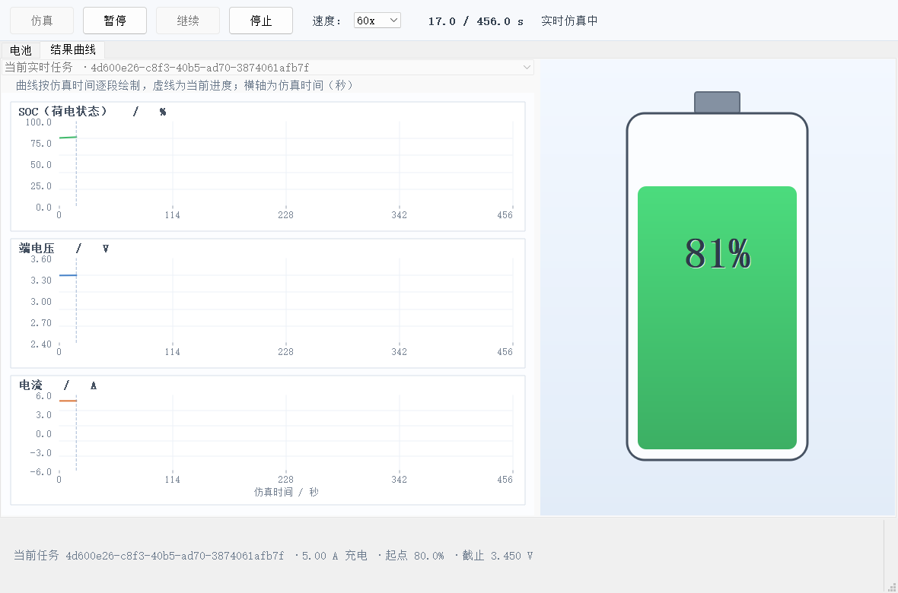
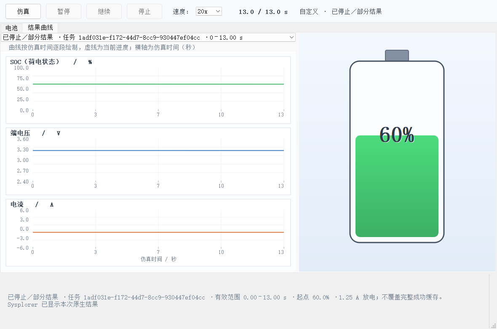

# UDP 正式接入开发与验收记录

日期：2026-11-04。状态：本机固定电池模型的分阶段开发、部署和验收完成。
读者：项目负责人、后续开发及联调人员。范围为本轮 UDP 改造；历史 helper 问题见原交付文档。

架构职责、开发经验及与上一版 helper 方案的系统比较，参见[UDP架构设计与开发经验及helper方案对比](UDP架构设计与开发经验及helper方案对比.md)（2026-11-05 整理，不改变本记录的验收日期）。

## 当前架构

~~~mermaid
sequenceDiagram
    actor U as 用户
    participant Q as Qt 客户端
    participant P as Sysplorer 内的 UDP 插件
    participant S as 宿主模型管理与仿真控制对象
    U->>Q: 应用参数
    Q->>Q: 校验、保存并更新预览
    U->>Q: 仿真
    alt 完整成功缓存命中
        Q->>Q: 从头回放内存结果
    else 缓存未命中
        Q->>Q: 发现宿主；无可用宿主则启动 Sysplorer
        Q->>P: UDP hello / begin
        P->>S: 加载模型、设参回读、翻译、启动
        loop 运行中
            Q->>P: poll / pause / resume / stop
            P->>S: 查询数据或控制求解
            P-->>Q: 状态与实时样本
            Q->>Q: 绘制曲线并更新数值
        end
        P->>S: 导出结果并显示原生曲线
        P-->>Q: 完整或部分结果清单
        Q->>Q: 核验；完整结果提交缓存，部分结果独立保存
    end
~~~

正式路径没有独立 SDK helper 或常驻 Python 桥接。编译器、求解器仍可能由宿主启动子进程。协议详见[UDP任务协议](UDP任务协议.md)，用户操作详见[UDP运行说明](../app/ui/UDP运行说明.md)。

## 分阶段交付

| 阶段 | 实现 | 验收结果 |
|---|---|---|
| 1 宿主插件 | 本地动态端口、发现、鉴权、任务归属、宿主对象绑定、真实仿真及在线取数 | 三个插件级案例通过 |
| 2 Qt 接入 | UDP 请求及重试、自动启动/复用宿主、实时曲线、真实暂停/继续/停止 | 可见窗口 QTest 集成流程及实际桌面按钮验证通过 |
| 3 结果语义 | 完整缓存、部分结果独立选择、失败保留缓存、停止后禁用继续 | 集成流程通过；桌面停止结果保持不变 |
| 4 部署 | 专用插件目录、管理员部署、QtNetwork 依赖 | 正式运行包与已安装 DLL 哈希已核对 |

## 关键文件

| 位置 | 职责 |
|---|---|
| tools/sysplorer_udp_plugin/control_plugin.* | 宿主插件、命令处理、SDK 调用与原生结果展示 |
| tools/sysplorer_udp_plugin/deploy.ps1 | 管理员部署与哈希记录 |
| app/ui/src/sysplorer_runner.* | Qt UDP 客户端、发现、启动、重试、结果核验 |
| app/ui/src/main_window.* | 交互编排、完整缓存与部分结果隔离 |
| app/ui/src/plot_widget.* | 实时样本追加与曲线绘制 |
| app/ui/src/replay_player.* | 完整缓存回放 |
| app/ui/tests/udp_integration_test.cpp | 当前集成测试；旧 helper 测试源码保留回溯 |

## 测试证据

### 插件级验证

[验证报告](../tools/sysplorer_udp_plugin/artifacts/20261104_165458/verification.json)的 ok=true。覆盖充电暂停/继续/停止并导出部分结果、放电自然完成、60x 推进验证。120 秒任务在 60x 下活动运行及结果完成约 4.219 秒，未计翻译时间；不作为通用性能承诺。

### Qt 按钮集成流程

[最终日志](../logs/udp_ui_acceptance.txt)：3 passed、0 failed，耗时 82344 ms。三个通过项是初始化、一个综合业务测试函数和清理，不是三个独立业务案例。

综合流程覆盖应用参数不启动任务、真实充电及实时曲线、缓存复用、回放暂停/继续/停止、真实放电暂停/继续/停止、部分结果与完整缓存切换、失败保留缓存，以及零电流/SOC 为零的真实 120 秒任务。详见[机器可读记录](../logs/udp_ui_artifacts_final/ui_verification.json)。

### 实际桌面验收

本节由 Computer Use 操作正式运行包的实际控件，不以直接发送 SDK/UDP 命令代替。日志和文件仅作只读核验。

| 操作 | 已观察结果 |
|---|---|
| 设置充电、65%、2.30 A、3.430 V 并应用 | 预览为 65.0%、1.625 Ah、待仿真；未启动任务 |
| 点击仿真，复用宿主 PID 9876 | 任务 63ba44b5-c447-48dc-83de-594c2f407024 真实运行 |
| 点击暂停并重复观察 | 保持 361.0 秒 |
| 点击继续 | 推进至 750.0 秒 |
| 点击停止并重复观察 | 保持 1083.0 秒，1084 个点，complete=false；继续不可用 |
| 关闭授权测试宿主后再次点击仿真 | Qt PID 3460 自动启动宿主 PID 18600，进程父子关系已核对 |
| 自动启动任务自然完成 | 任务 2b486d40-d9dd-4a95-9f8c-bc560904e0b6，1571 个点，末时间 1566.521728515625 秒，complete=true |

两次任务参数及 CSV 哈希均核验一致。[桌面报告](../logs/udp_desktop_acceptance/verification.json)为 ok=true，同目录保留 UI 状态树及任务清单、客户端日志。最终完成时窗口被最小化，未取得该时刻桌面截图；完成依据为客户端 verified 事件及结果核验。

## 联调问题与处理

| 问题 | 已采用处理及验证 |
|---|---|
| SDK 与宿主小版本不同，旧头文件内联访问有偏移风险 | 相关访问改用宿主真实导出符号，绑定现有控制器；当前安装版本验证通过 |
| 初始倍速被启动覆盖，且与 SDK 减速因子相反 | 使用 1/speed，同时设置配置及数据并在运行期重设；60x 案例和 Qt 流程通过 |
| 默认输出过密 | 显式设定 1 秒输出，在线显示仍使用 SDK 实时服务 |
| 继续状态被同步信号覆盖 | 先写过渡状态再调用控制接口；暂停/继续验证通过 |
| 停止后宿主时间跳至配置终点 | 预先记录有效停止范围，结果裁剪；桌面保持 1083 秒 |
| DLL 占用或 Program Files 权限不足 | 只关闭授权测试实例；管理员部署脚本打印具体原因及成功哈希 |
| SDK 单精度初值与精确比较不一致 | 测试使用合理浮点容差，保留实际求解数据 |

## 交付锚点与部署

- 正式客户端：[battery_console_ui.exe](../app/ui/runtime/battery_console_ui.exe)，SHA-256：37889E59F85E3DC43BFAD06CE38500C23E8D2C900B045301B8FE9A92C60B4311。
- 安装插件：C:/Program Files/MWORKS/Sysplorer 2026a/Bin64/addins/BatteryUdpControl/battery_udp_control.dll，SHA-256：C1180E54598640E4DF622ABC39B50C97FD22B865996EC2E086FA287C0C242CB5。
- 模型资源 SHA-256：4670d908273243caa2996f708ce1e2692b4012eac5c3107a4209eeea16f6feb9。
- 部署顺序：构建插件 → 关闭授权测试宿主解除占用 → 管理员部署插件 → 构建及部署 Qt → 从正式入口按钮验收。命令见插件 README 和运行说明；修改模型须重建两端资源。

## 验收清单与限制

- [x] 应用参数只保存并更新预览。
- [x] 缓存未命中通过宿主对象真实求解并实时绘图。
- [x] 实时暂停、继续、停止符合确认状态。
- [x] 停止保留部分结果、有效范围和任务身份，继续不可用。
- [x] 部分结果不覆盖完整缓存，失败保留完整缓存。
- [x] 缓存命中只回放，不新建任务或重复打开原生结果。
- [x] 复用现有宿主及无宿主时自动启动均已验证。
- [ ] 跨机器部署、其他宿主版本、长期运行、并发压力及全部参数组合：需另行验收。
- [ ] 任意模型、同名模型被外部编辑、用户在宿主同时操作：不属于本轮完整验收范围。

nativeResult 当前记录宿主配置的结果根目录，不是具体 .msr 文件；原生展示通过结果对象完成。未来如需精确原生文件导出，应另行实现和验证，不应直接把此字段当文件打开。

旧六篇交付文档及 ZIP 是 helper 阶段历史快照，当前行为以本文、UDP 协议及运行说明为准。

## 2026-11-05 运行中调参验证

新增模型顶层 liveCurrent/liveVoltage/liveMode/liveVMin/liveVMax/liveIMax 输入，通过现有 UDP 任务的 tune 命令修改。
电池状态和求解器保持同一个实例，不重新翻译、不重启、不覆盖初始 SOC。运行中请求暂停后批量暂存，自动继续；已暂停时保持暂停，用户继续后确认。

本机 SDK 的 SetInputReals 会将修改用于后续求解步，紧接着 GetReals 仍读到旧步值。
因此确认依据改为实际模型流中的六项输入采样；全部匹配才生成 tuneHistory 记录。
记录 time 为暂停边界，confirmedAt 为首次模型确认采样时刻，另含 socBefore/socAfter 与实际输入。
任务完整结果包含全部修改历史；动态轨迹不能作为静态起始参数的成功缓存复用。

真实验证证据：tools/sysplorer_udp_plugin/artifacts/20261105_135052/runtime_tuning.json，ok=true。
同一任务完成 0–90 s 原生计算，92 个原生结果点，九项行为全部通过，写入前后 SOC 最大差值 0。
逐对检查原生 SOC 差值不超过 5 A 电流所允许的积分变化量（另含 2e-6 数值容差），时间不倒退；实时输出与原生结果采样交叉一致。

| 验证 | 真实结果 |
|---|---|
| 电流指令 | 1 A 改为 2 A，实际电流 2 A |
| 电流上限 | 改为 0.4 A，实际电流 0.4 A |
| 恒流放电 | 实际电流 -2 A |
| 暂停时提交静置 | 暂停时间保持不变，继续后实际电流 0 A |
| 恒压模式 | 端电压 3.275 V |
| 修改恒压目标 | 端电压 3.280 V |
| 充电上截止 | 实际电流归零 |
| 放电下截止 | 实际电流归零 |
| 解除截止条件 | 实际电流恢复 -2 A |

Qt 真实按钮回归进程退出码 0，覆盖运行中提交（同一任务、-0.5 A 实际输出）、暂停/继续/停止、静态成功缓存、部分结果隔离、失败保留旧结果、零电流任务。
原有流程汇总 tools/sysplorer_udp_plugin/artifacts/ui_runtime_tuning/ui_verification.json 为 ok=true；截图同目录。

首次安装目录部署因 Windows 管理员授权取消而未完成，真实行为验证先使用英文临时目录 `%TEMP%/BatteryConsoleRuntime` 的隔离宿主。
插件副本与编译产物 SHA256 一致。中文宿主路径会被原生编译脚本错误解码，故隔离根目录必须使用英文。
隔离入口 app/ui/run_runtime_tuning.bat，客户端部署目录 app/ui/runtime_tuning。
模型 SHA256：e03bd3634004ca82bb190521c214ec5fae25713120db83caf016aeac8b7472cd。

最终显示修正后再次执行 runtimeTuningButtons，退出码 0；截图位于 artifacts/ui_runtime_tuning_final/runtime_tuning.png。
截图确认在 4.000 s 由模型采样回读，底部显示实际电流 -0.500 A、端电压 3.255 V 和当前 SOC 50.03%。
app/ui/runtime_tuning/battery_console_ui.exe 与最终 build/release 产物哈希一致。

用户随后确认管理员授权，正式部署已完成：deployment.json 为 ok=true、administrator=true，安装目录插件 SHA256 与已验证产物一致，为 F44EC16CD115A717B2D6B42BDA659054CBA364912FB3D2FDCE917F37E54A3112。
正式 app/ui/runtime 客户端也已按最终产物更新并校验，入口 app/ui/run_ui.bat。九项行为验证在上述隔离宿主完成；正式部署核验为二进制哈希一致，未额外重跑整套求解。

### 当前工作树连接修复与最终回归

上述部署为此前操作记录。按用户后续要求，本轮只修改当前工作树，不再更新主目录或安装目录，尚未提交或合并。当前验证入口为 app/ui/run_runtime_tuning.bat。

客户端发现宿主有其他运行或暂停任务时跳过该宿主，必要时创建独立实例；每个新实例使用独立工作目录，避免并发编译互相覆盖。
busyHostIsSkipped 真实回归：原任务 8eba1641-6c15-4a35-b19d-75356b2cea1e 保持暂停；第二任务 01d11571-10b9-4712-8400-4a8f12ac11d4 在独立宿主完成 0–6 秒计算，8 个结果点，随后测试正常停止自己创建的原任务。证据位于 Temp/BatteryConsoleUDP 对应任务目录的 client.log。

当前版本再次执行 runtimeTuningButtons，退出码 0。任务 ea46ebdd-44c9-4c3b-9e1a-ebe8052ecf0b 在 3 秒处提交电流 2 A、放电模式、限流 0.5 A，4 秒处实际模型采样确认；写入前后 SOC 均为 0.5003316666666667。同一任务结果保留 tuneHistory，实际输出为 -0.5 A。
截图：tools/sysplorer_udp_plugin/artifacts/ui_runtime_tuning_connection_fix/runtime_tuning.png。
当前工作树 runtime_tuning/battery_console_ui.exe 与 build/release 产物 SHA256 一致：0C1E87EFEFD0A71D4FDB9E9963412224399ED74324B3A74D0765D76BCFCF8535；隔离插件与工作树编译产物哈希仍一致。

### 截图任务模型版本不一致修复

失败任务 98916482-16dd-43d3-985a-6b652dd99a70 在 hello 阶段连接 PID 16568，模型哈希不一致，尚未执行 begin。用户仍打开工作树 app/ui/runtime/battery_console_ui.exe；该旧入口默认连接安装目录宿主，而隔离入口通过环境变量指定宿主。

新增随包 sysplorer.ini 的 Host/Home 配置，直接启动新版 exe 也能选择正确宿主；显式 SYSPLORER_HOME 仍优先。部署通过插件哈希校验后保存宿主配置。工作树 run_ui.bat 统一转到 run_runtime_tuning.bat，使用已更新的 runtime_tuning 包。用户打开的旧 runtime exe 被占用，未关闭用户窗口或强行替换该文件。
发现的现有实例若模型不匹配则跳过；新启动实例仍不匹配则保留失败保护，报告宿主路径及两端哈希；日志新增 hostExecutable、host_model_mismatch，便于定位。

移除测试进程 SYSPLORER_HOME，仅依赖 exe 旁配置，再执行 runtimeTuningButtons，退出码 0。任务 830a9030-655b-4e4e-97aa-5faca2ffab5d 通过模型校验并完成运行中调参，4 秒回读确认，实际电流 -0.5 A，写入前后 SOC 连续。证据及截图：tools/sysplorer_udp_plugin/artifacts/ui_host_config_fix/verification.json、result.json、result.csv、client.log、runtime_tuning.png。
最新 runtime_tuning 客户端 SHA256 与 build/release 一致：15E062E2B6F92A7C436F7578FC5969778289A8017E85C94FAB2526AB31359117。本次未修改主目录或安装目录，未提交或合并。
