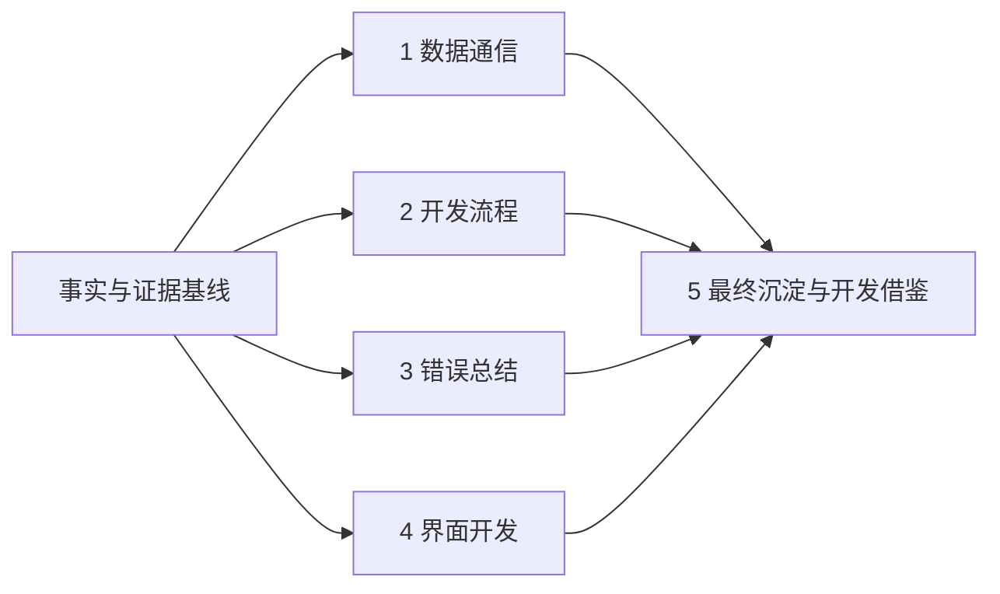

# 文档编写基线与交付索引：事实清单、大纲与去重矩阵

> **UDP 改造后的版本说明（2026-11-04）**：本文是此前独立 helper 架构的历史快照，文中的“当前/最终”指当时版本。现行软件已改为 Qt → 本地 UDP → Sysplorer 宿主插件，支持真实计算期间暂停/继续/停止及部分结果。现行实现与验收请参见[UDP正式接入开发记录](../UDP正式接入开发记录.md)和[UDP任务协议](../UDP任务协议.md)。原交付 ZIP 未重新打包，仍属历史快照。

| 元信息 | 内容 |
|---|---|
| 文档版本 | 1.0，已确认规划与交付索引；不是软件发布版本号 |
| 日期 | 2026-11-04，Asia/Shanghai |
| 读者 | 项目负责人、客户端开发、测试、技术文档评审人员 |
| 目标 | 保存事实基线、已确认的五篇规划和新增第六篇的职责 |
| 状态 | 用户已确认文档 1—5 规划，并要求新增文档 6；全文已形成 |
| 范围 | 当前实现、开发演进、已复现问题、验证证据、文档规划 |
| 非目标 | 本轮不改程序；本稿不代替正式正文，不把建议写成已实现功能 |

## 交付文件索引

| 顺序 | 文档 | 主责 |
|---|---|---|
| 1 | [数据通信文档](01_数据通信文档.md) | 通信机制、协议、错误码、用户介绍话术 |
| 2 | [开发流程文档](02_开发流程文档.md) | 实际阶段、完整功能清单、测试、部署 |
| 3 | [错误总结文档](03_错误总结文档.md) | ERR-01—ERR-12 完整复盘及排查方法 |
| 4 | [界面开发文档](04_界面开发文档.md) | 组件、布局、状态、交互与入门练习 |
| 5 | [最终文档/开发借鉴文档](05_最终文档与开发借鉴.md) | ADR、模式/反模式、质量体系和演进 |
| 6 | [提示词评价与后续建议](06_提示词评价与后续建议.md) | 可见用户提示逐项评价与未来协作模板 |

本套包含六篇正文、事实基线、两张历史故障截图及[交付检查记录](交付检查记录.json)。包内不包含 SDK、许可证、完整源码或原始大型日志；技术路径按项目根目录说明，证据长期归档仍应与工程一起保存。

## 目录

1. [证据口径](#证据口径)
2. [项目事实清单](#项目事实清单)
3. [缺失信息与待确认项](#缺失信息与待确认项)
4. [五份文档大纲](#五份文档大纲)
5. [去重矩阵](#去重矩阵)
6. [引用与图示规则](#引用与图示规则)
7. [规划验收清单](#规划验收清单)

## 证据口径

- **当前行为**：优先依据当前调用路径、构建配置及最终验收记录。历史文件、代码注释或旧截图与当前代码矛盾时，不将其描述为现有能力。
- **历史过程**：依据对话、已有复盘、实际日志与调试记录还原；按可证明的阶段顺序编排，不虚构排期、工时、人员分工或精确发生时间。
- **验证结论**：分别表述“独立 helper 验证”“离屏 Qt 回归”“实际桌面按钮验收”“用户确认跑通”，不互相替代。
- **缺失信息**：统一标注“待补充/需确认”。建议、推断和厂商内部实现与已实现事实分开。
- **版本锚点**：当前客户端 SHA-256 为 `B5312B5253368D74900CAB2B43D391090F7EE6E52D41EF446000ADBF7C4AB9E7`；helper 为 `B6150DC3BE622479F01A3E1FF1D6BD53F344A52A6712FDE59348D07C8CAD78CC`；查看脚本为 `54ABCB49D5A96687FB00416A7EA373F699FE16D4CB2BDAAE4FFEB1623973F5B6`。正式软件版本号待补充。

### 主要证据入口

| 编号 | 来源 | 用途 |
|---|---|---|
| E01 | `app/ui/src/main_window.cpp`、`.h` | 当前业务入口、参数应用、缓存比对、暂停停止、成功结果提交 |
| E02 | `app/ui/src/sysplorer_runner.cpp`、`.h` | 子进程、参数与模型交接、校验、超时、查看桥接 |
| E03 | `tools/sdk_probe/main.cpp`、`sdk_probe.pro` | SDK 初始化、模型加载、参数回读、编译求解、结果导出、退出码 |
| E04 | `app/ui/sysplorer_view.py` | 发现/连接/启动 GUI、结果就绪通知、原生绘图、状态记录 |
| E05 | `app/ui/src/battery_view.*`、`plot_widget.*`、`replay_player.*`、`replay_data.*` | UI 组件、绘图、插值和回放时钟 |
| E06 | `app/ui/models.qrc`、`model/BatterySim.mo` | 实际打包模型、模型参数与保护逻辑 |
| E07 | `app/ui/ui.pro`、`build.cmd`、`deploy.ps1`、`run_ui.bat` | 构建、依赖部署、启动 |
| E08 | `app/ui/tests/integration_test.cpp`、`tests.pro`、`run.ps1` | 回归内容与测试环境边界 |
| E09 | `logs/ui_integration.txt`、`logs/single_custom_cache_verified.json` | 最终回归结果、缓存无外部调用的核验记录 |
| E10 | `SDK链路失败原因与修复说明.md`、`SDK现场检错_20261104.md`、`SDK界面故障根因与按钮验证.md` 及其关联日志 | 历史阶段与故障证据；不是当前行为的唯一依据 |
| E11 | 本次对话、用户附件截图及实际窗口操作记录 | 需求演进、现场现象、按钮级验收及用户确认 |

## 项目事实清单

| 编号 | 已核实事实 | 证据 | 说明边界 |
|---|---|---|---|
| F01 | 当前产品是本机电池充放电仿真客户端，只保留自定义充放电；预设场景入口及其本地近似计算分支已从运行构建移除。 | E01、E07 | 旧源码/数据文件留存不等于现有入口；完整功能清单归文档 2。 |
| F02 | 客户端使用 C++11、Qt 5.14.2 Widgets、MSVC2017 x64，工程采用 qmake/nmake。 | E07 | 不描述为 Qt Quick、网页前端或已迁移 CMake。 |
| F03 | 当前交互提供充电/放电方向、截止电压、电流幅值及起始 SOC；边界分别为 2.50–3.45 V、0–5 A、0–100%。 | E01、E02、E06 | 输入电压是截止边界，实际端电压由模型求解；不是独立电压源设定。 |
| F04 | “应用参数”校验并保存设置，立即更新电池图、SOC、剩余 Ah 和待仿真设定电流，不启动计算或回放。 | E01、E05、E08、E11 | 参数预览与已计算结果不是同一状态。 |
| F05 | “仿真”先确认输入已应用，再按上一次成功结果的模型指纹、方向、电压、电流、起始 SOC 比对内存缓存。 | E01 | 当前只有上一条成功结果，不是多组参数历史缓存。 |
| F06 | 缓存命中从头回放内存数据，不再启动 SDK 或查看桥接；缓存不跨客户端进程重启保留。 | E01、E09 | 磁盘存在结果文件不代表启动时会自动恢复缓存。 |
| F07 | 缓存未命中才通过独立 `sdk_probe.exe` 调用本机 Sysplorer SDK 2026a 编译并求解。Python 查看桥接不承担计算。 | E02、E03、E04 | 打开 Sysplorer GUI 是产品查看能力，不是 SDK 求解必须依赖 GUI 的证明。 |
| F08 | 当前模型为打包资源 `:/models/BatterySim.mo` 中的 `BatterySim.SingleRun`，容量 2.5 Ah；修改源模型后必须重建并部署界面。 | E03、E06 | 不声称运行时热加载外部 `.mo`；模型物理精度/实物标定未验证。 |
| F09 | GUI 通过命令行传递运行参数，以标准输入管道传递带版本、Base64 模型和 SHA-256 的 JSON；关闭写通道后 helper 读取完整请求。 | E02、E03 | Base64 是编码、SHA-256 用于完整性比对，不能写成加密或身份认证。 |
| F10 | helper 使用 SDK 公开 `NewModel(text)` 加载模型，设置并回读参数，显式配置 VC 和 64 位编译/运行目标，再求解。 | E03 | 保留的文件模式和早期验证模式不等于正式 GUI 当前通道。 |
| F11 | helper 输出原生 `Result.msr`、客户端使用的 `result.csv` 和请求/结果清单 `result.json`；客户端核对退出状态、参数、模型指纹和数据约束后才提交结果。 | E02、E03 | helper 启动或文件存在，单独都不足以判定计算成功。 |
| F12 | 每次新计算使用 UTC 时间加 UUID 的独立任务目录，默认在系统临时目录 `BatteryConsole` 下；仿真工作路径要求 ASCII。 | E02 | 目录名的时间不能直接当作北京时间；长期存储/清理政策待补充。 |
| F13 | 新计算时查看桥接可连接同安装路径的已有 GUI，或启动 Sysplorer；收到已校验结果通知后，使用 `CreatePlot(resultFile=...)` 显示三幅原生曲线。 | E02、E04、E11 | 当前不再使用会产生重复打开提示的 `OpenResult`；缓存命中不发起打开请求。 |
| F14 | GUI 与 helper 使用 Qt 事件和进程信号；GUI 与查看桥接通过任务目录中的就绪 JSON 和状态文件交接；官方 API 负责与 Sysplorer 本地连接。 | E02、E04 | 不虚构统一网络服务、固定端口、硬件总线或私有线协议。 |
| F15 | 计算完成后才回放；回放时钟为 50 ms Qt 定时器，可选速度为 0.5、1、5、20、60 倍。 | E01、E05 | 回放速度不改变已求得结果，也不是 SDK 仿真实时速度控制。 |
| F16 | 暂停、停止冻结当前回放时间、进度标记、电池读数和曲线；暂停后继续从当前位置播放，再次点击仿真从头回放匹配的缓存。 | E01、E08、E11 | 按钮控制的是客户端结果回放，不是正在进行的 SDK 求解。 |
| F17 | SDK 计算失败不覆盖上一条成功曲线；Sysplorer 查看失败与计算成功分别记录，客户端可继续使用有效结果。 | E01、E02、E04、E08 | 没有已实现的自动重试策略；超时、人工重试与缓存需分别描述。 |
| F18 | 当前新任务只允许一个 SDK 请求在途；求解过程中计算和回放控制、参数编辑被禁用。 | E01、E02、E08 | 不声称支持多任务并发求解或任务队列。 |
| F19 | 真实计算时长由程序估算并限制在 120–20000 s，helper 仿真等待计时器为 120 s，GUI SDK 任务监控为 300 s；查看桥接另有等待和进程时限。 | E01、E02、E03、E04 | 仿真时间与墙钟超时是不同概念；最大时长不保证所有条件下都充满或放空。 |
| F20 | 最终 Qt 日志为 3 passed、0 failed、89188 ms，主体测试包含多组实际 SDK 计算；实际桌面另验证了缓存回放不改动 helper/查看日志和原生结果。 | E08、E09、E11 | “3 passed”包含初始化、主体流程、清理，不能写成仅有或恰有三个独立业务用例，更不能宣称穷举全部参数。 |
| F21 | 已复现并修正的关键问题涉及编译器配置、位数、中文路径、本地通信环境、许可线程清理、进程级模型读取差异、Qt 部署依赖、重复打开结果及停止状态。 | E10、E11、当前代码 | 每个案例按证据标明根因确定程度；不将所有历史 SDK 错误归结为同一原因。 |
| F22 | 资源模型与管道的最终方案来自实际桌面进程读取外部模型得到加密封装的证据；仅加 BOM 或仅换管道均未解决源头读取差异。 | E06、E10、E11 | 完整定位过程只在文档 3 详述；没有关闭防护、修改加密策略或调用私有解密。 |
| F23 | 当前交付为本机运行目录和构建/部署脚本；部署按字节复制并校验哈希，文件相同则跳过复制。 | E07 | 尚无已验收的独立安装包、跨机器一键部署或自动升级证据。 |
| F24 | helper 的 Release 配置仍保留 `/Od /Zi /RTC1` 等诊断选项；许可计时器清理警告仍有历史记录。 | E03、E09、E10 | 功能闭环已跑通，不等于已完成生产优化、消除所有警告或厂商线程问题已获答复。 |

## 缺失信息与待确认项

| 编号 | 待补充/需确认 | 当前写作处理 |
|---|---|---|
| U01 | 正式产品名称、软件版本号、文档批准人/责任人、版权与对外口径 | 暂用“电池充放电仿真客户端”，文档版本与软件版本分开。 |
| U02 | 原始完整立项材料、实际人员分工、阶段工时和正式排期 | 还原已证实的开发阶段；不编造周计划、工期或团队职责。 |
| U03 | 对外部署授权、Sysplorer/SDK 许可类型及再分发边界 | 记录本机依赖和许可前提，不将本机可用推导为可任意分发。 |
| U04 | 目标机器矩阵、Windows 最低版本、跨机器安装验收 | 标明已验证本机 Windows 环境；其他平台/机器列后续验收项。 |
| U05 | 性能指标、长时间稳定性、全参数覆盖和多任务能力目标 | 只列真实测试结果，不生成虚构 SLA、覆盖率或成功率。 |
| U06 | 电池模型来源的正式说明、实物数据、标定记录和物理精度标准 | 将“真实调用求解器”与“真实电池物理精度”分开表述。 |
| U07 | 任务文件保留周期、磁盘清理策略、崩溃恢复及隐私脱敏要求 | 当前磁盘产物和内存生命周期按实现说明；治理政策列待补充。 |
| U08 | 第三方 SDK/API 私有通信报文、协商机制及网络安全保证 | 说明本项目可控协议和官方 API 接口；未核实内部细节不展开、不编造。 |
| U09 | 许可线程计时器警告的厂商结论、生产构建方案 | 保留未闭环项，放入文档 3 遗留问题与文档 2 后续计划。 |
| U10 | 可公开发布的最终界面截图及截图版本 | 旧截图用于历史现象，当前教程仅使用与最终版本一致的素材；不足处标注待补充。 |

## 五份文档大纲

### 文档 1：《数据通信文档》

计划文件：`01_数据通信文档.md`。

- **读者**：客户端开发、联调人员、了解通信机制的用户/售前。
- **目标**：回答“谁与谁、通过什么通道、传什么、何时结束、失败如何判断”，并提供产品介绍口径。
- **范围**：本地通信拓扑、项目协议、SDK/API 适配边界、典型业务时序、日志与安全边界。
- **非目标**：开发排期、控件实现教程、完整故障复盘、UI 内部状态机。

正文目录：

1. 元信息、背景与目标、范围与非目标、必要术语。
2. 角色与边界：用户、Qt 客户端、C++ helper、编译器/求解器、Python 查看桥接、Sysplorer GUI。
3. 通信拓扑与通道清单：Qt 事件、命令行、标准输入、标准输出/错误、任务文件、官方本地 API。
4. 连接建立、任务启动、EOF/进程结束、故障断开与客户端退出。
5. 项目协议：参数、模型消息、CSV、结果清单、查看请求及状态字段表、单位与约束。
6. 请求—响应与事件通知：说明哪些是 Qt 事件、哪些是文件轮询，不笼统称为网络推送。
7. 典型业务时序：应用参数、缓存命中、新计算与并行 GUI 连接、计算/查看分别失败。
8. helper 退出码、SDK/求解器错误与 GUI 错误的分层；超时、人工重试、重复请求处理。
9. 日志定位入口与完整性/权限边界；明确 Base64、哈希的能力边界。
10. 用户介绍话术：定位、能力、通信特点、使用注意事项。
11. 验收清单与交叉引用。

图表：通信拓扑图、缓存命中/未命中时序图；接口字段表、错误码表、文件与日志表。

### 文档 2：《开发流程文档》

计划文件：`02_开发流程文档.md`。

- **读者**：项目经理、后续开发者、评审人员。
- **目标**：还原真实开发顺序、成果和验收依据，完整列出功能与部署步骤。
- **范围**：需求演进、选型结果、实际阶段、依赖、功能清单、联调、验证和发布。
- **非目标**：协议字段手册、控件教学、逐项故障案例全文、虚构工期。

正文目录：

1. 元信息、背景与目标、范围与非目标、必要术语。
2. 需求拆解与最终范围：自定义场景、参数应用、真实计算、缓存、回放、原生查看；历史需求的取舍记录。
3. 技术选型与本机依赖清单；决策依据引用文档 5。
4. 实际阶段与里程碑：理解需求 → helper 最小闭环 → Qt 接入 → 实际按钮复现 → 模型交接修正 → GUI 查看 → 单一场景/缓存与状态收敛。
5. **唯一完整功能表**：模块—功能—状态—依赖—验收口径—证据。
6. 联调流程与产物：参数、模型指纹、任务目录、结果核验；字段细节引用文档 1。
7. 测试与验收：独立验证、离屏回归、桌面按钮验收、用户确认及覆盖边界。
8. 构建、部署、启动、版本指纹核对；模型资源更新流程。
9. 遗留项及后续计划：安装包、跨机验证、诊断构建优化、模型精度验证等均区分建议和承诺。
10. 验收清单与交叉引用。

图表：实际阶段依赖流程图、里程碑表、完整功能表、测试矩阵、发布检查表。

### 文档 3：《错误总结文档》

计划文件：`03_错误总结文档.md`。

- **读者**：开发、测试、运维、后续维护者。
- **目标**：让维护者从现象找到证据、区分根因并复用排查方法。
- **范围**：真实故障、定位过程、修复验证、预防措施和未解决项。
- **非目标**：完整功能清单、UI 入门、协议全文和无证据归因。

正文目录：

1. 元信息、背景与目标、范围与非目标、必要术语。
2. 问题索引：编号—分类—现象—影响—根因确定程度—方案—验证—预防。
3. 分类：环境/编译、依赖与打包、通信与进程、数据/模型、并发与生命周期、UI 状态、验收方法。
4. 已复现案例，统一采用“现象—定位过程—根因—方案—验证—预防”：
   - ERR-01：独立 helper 编译器配置不完整。
   - ERR-02：中文仿真工作路径与编译响应文件。
   - ERR-03：编译与运行位数不一致。
   - ERR-04：沙箱/本地通信限制与进程创建方案差异。
   - ERR-05：许可后台线程退出异常及尚存计时器警告。
   - ERR-06：模型明文/加密封装读取差异、错误的编码归因、资源模型方案。
   - ERR-07：Qt 依赖部署不一致与运行中文件锁。
   - ERR-08：结果参数不一致、旧产物与缓存误用的防护。
   - ERR-09：全局错误跨旧场景显示、回调中对话框、参数显示不更新。
   - ERR-10：Sysplorer 重复打开结果的弹窗与误报。
   - ERR-11：停止时内部时间、可见读数、进度不一致。
   - ERR-12：仅直接调用 helper/离屏测试造成的验证缺口，以及测试环境恢复问题。
5. 各层排查决策树与可复用检查清单。
6. 未解决项、证据限制及需要厂商确认的事项。
7. 验收清单与交叉引用。

图表：问题索引表、故障分层决策树、ERR-06 的读取证据对比图、修复前后验证表。ERR-04 中不同机制须分别说明，不能合并为单一根因。

### 文档 4：《界面开发文档》

计划文件：`04_界面开发文档.md`。

- **读者**：Qt 界面初学者、后续 UI 开发者。
- **目标**：解释控件、布局、状态和事件如何组合成当前客户端，并给出可上手练习。
- **范围**：工程结构、组件、绘图、状态与数据流、交互、异步接入、UI 调试和学习路径。
- **非目标**：通信协议全貌、项目排期、完整故障复盘。

正文目录：

1. 元信息、背景与目标、范围与非目标、必要术语。
2. 技术栈与工程导航：从 `main.cpp` 找到窗口、组件、数据和调度类。
3. 页面/组件：工具栏、参数与电池页、曲线与同步电池页、提示/错误区域。
4. 布局与样式：布局管理器、大小约束、QSS、字体和 `QPainter` 绘图；解释为何不用固定屏幕坐标布局。
5. **唯一详细 UI 状态说明**：输入/已保存参数/成功结果/回放位置/显示预览分别存储，状态不是仅靠按钮文字判断。
6. 状态转换：待设置、待仿真、计算中、回放中、已暂停、已停止、已结束和错误提示叠加。
7. 信号槽与事件：应用参数、缓存比对入口、暂停继续停止、单个 tick 同步所有视图。
8. 异步接入：UI 如何调用 `SysplorerRunner`、接收完成/查看状态、更新按钮；协议引用文档 1。
9. 调试：`objectName`、控件树、断点、日志、离屏测试与实际窗口的区别；完整案例引用 ERR 编号。
10. 初学者学习路径与小练习：静态布局 → 参数预览 → 内存回放 → 异步结果接入；不得将练习的假数据混入正式计算路径。
11. 验收清单与交叉引用。

图表：组件树、UI 状态图、单个回放 tick 的视图更新图；类职责表、事件—状态变化表、练习验收表。

### 文档 5：《最终文档/开发借鉴文档》

计划文件：`05_最终文档与开发借鉴.md`。

- **读者**：后续项目负责人、架构师、核心开发者。
- **目标**：沉淀可迁移的思路、方案选择依据与演进条件，而不是再次汇总前四篇全文。
- **范围**：目标与约束、架构决策、原则、模式/反模式、质量与排障体系、演进建议。
- **非目标**：协议字段、完整功能表、控件教程、构建操作手册和故障全文。

正文目录：

1. 元信息、背景与目标、范围与非目标、必要术语。
2. 项目目标与真实约束：本地安装/许可、模型、编译环境、进程读取环境、初学者可维护性。
3. 总体职责划分；通信拓扑引用文档 1，组件和状态引用文档 4。
4. 架构决策记录：上下文—备选—选择—依据—代价—重新评估条件。
5. 核心决策：进程隔离、计算/查看分离、资源模型与内容指纹、上一成功结果缓存、异步 UI、证据驱动验收。
6. 可复用模式与反模式：两套参数、结果验证后提交、故障分层、真实入口验收、单一路径责任归属。
7. 质量和排障体系：将文档 2 的验证流程与文档 3 的排障索引组合使用，不复制操作清单。
8. 后续演进：多结果缓存、任务管理、正式协议版本、部署治理、模型热更新/标定等均标注建议及触发条件。
9. 产品表达原则：准确说明计算、回放和查看的区别；用户介绍话术引用文档 1。
10. 文档索引、按角色推荐阅读顺序、知识维护方式。
11. 验收清单与交叉引用。

图表：架构决策表、模式/反模式对照表、演进决策流程图、按角色阅读索引；不重画文档 1 的通信时序或文档 4 的状态图。

## 去重矩阵

### 新增文档 6 的边界

文档 6《提示词评价与后续建议》的读者为需求提出者、AI 协作开发者和评审者，目标是评价本次可见提示词的有效点、歧义、责任归属及可复用表达方式。范围为可见的 14 组任务与反馈，非目标为个人评价、无依据量化评分、技术案例重述或售前话术。正文覆盖范围说明、评价维度、逐项评价、表达改进、六组模板、协作流程、验收和引用。

| 新增/交叉主题 | 唯一详述位置 | 文档 6 的边界 |
|---|---|---|
| 用户提示词逐项评价 | 文档 6 | 按可见对话逐项评价，附件更早历史不声称完整覆盖 |
| AI 协作模板与需求表达 | 文档 6 | 面向下一轮开发任务，不重复产品介绍话术 |
| 售前产品介绍 | 文档 1 | 文档 6 仅引用用途区别 |
| 技术错误全过程 | 文档 3 | 文档 6 只分析提示/验证要求和责任，引用 ERR 编号 |
| 架构决策和技术模式 | 文档 5 | 文档 6 不重写 ADR，只评价需求如何提出 |

原五篇矩阵已获用户确认。新增文档 6 的唯一主责为“提示词/需求表达与 AI 协作”：不复制技术错误案例、架构 ADR 或售前话术，分别引用文档 3、5、1。其评价依据为可见对话，附件内更早聊天的逐条评价范围待确认。

**主责**表示唯一详细讲解位置；其他位置只说明与本主题的关系，并通过文档名和章节引用。

| 主题 | 文档 1 通信 | 文档 2 流程 | 文档 3 错误 | 文档 4 界面 | 文档 5 借鉴 |
|---|---|---|---|---|---|
| 通信拓扑、通道与连接 | **主责：拓扑/生命周期/事件** | 联调使用，引用 1 | 按故障层定位，引用 1 | 只讲调用入口/回调，引用 1 | 只解释责任划分依据，引用 1 |
| 协议字段、文件格式、退出码 | **主责：完整字段/单位/约束** | 作为验收产物引用 1 | 只列案例涉及的码，指向 1 | 不列完整字段表 | 不列协议表 |
| 完整功能清单 | 定位和代表流程，引用 2 | **主责：模块—功能—状态—验收** | 只列受影响功能 | 只讲相关交互如何实现 | 不再列清单 |
| 开发阶段与里程碑 | 不写 | **主责：真实顺序/阶段产物** | 仅标案例发生阶段 | 不写项目排期 | 只总结验证策略的选择理由 |
| 完整错误案例 | 错误契约与入口，引用 3 | 风险/验证引用 ERR | **主责：完整复盘与预防** | 调试入口引用 ERR | 提炼反模式并引用 ERR |
| UI 组件、布局、样式 | 不写实现细节 | 仅用逻辑模块划分功能 | 仅写案例必要现场 | **主责：控件/组件/绘制** | 只提可维护性原则 |
| UI 状态与数据流 | 仅业务通信时序，引用 4 | 仅验证状态结果 | 只讲缺陷形成过程 | **主责：状态存储/转换/同步** | 提炼状态分离原则，引用 4 |
| 缓存 | 解释命中后没有外部通信 | 列功能与验收证据 | 解释历史误用案例 | **主责：内存状态与比对入口** | 提炼缓存键/提交原则及演进代价 |
| 部署与发布 | 配置的通信作用，引用 2 | **主责：命令/目录/依赖/核对** | 只讲部署故障案例 | 给入门准备入口，引用 2 | 解释可复现部署原则 |
| 测试与验收 | 本协议验收检查 | **主责：完整验证矩阵与发布验收** | 案例修复证据 | 仅 UI 练习/组件验收 | 只提质量体系设计 |
| 初学者学习路径 | 仅解释通信必要术语 | 不写 UI 教程 | 不写教程 | **主责：步骤/练习/判断依据** | 不重复学习步骤 |
| 用户介绍话术 | **主责：唯一成套话术** | 不复制 | 不复制 | 不复制 | 只讲表达原则并引用 1 |
| 架构原则与决策依据 | 说明事实，不展开通用 ADR | 记录选型结果，引用 5 | 解释案例选择依据，不建通用决策集 | 解释局部 UI 做法，不复制架构 ADR | **主责：ADR/模式/反模式/演进** |

### 最容易重复的边界

1. **文档 1 的状态是通信状态，文档 4 的状态是 UI 状态。** 前者讲请求、EOF、进程完成、结果就绪；后者讲控件是否可用、读数和回放位置如何保存。
2. **文档 2 说明做了什么、按什么顺序做、如何验收；文档 5 说明为何这样选、什么条件下应改变。** 阶段记录不能直接复制成架构总结。
3. **文档 3 详细展开问题，其他文档只引用 ERR 编号。** 例如资源模型方案在文档 1 说明当前传输，在文档 3 展开形成过程，在文档 5 讨论收益与限制。
4. **缓存是跨主题事实，不复制成三份教程。** 文档 1 只讲它省去了哪些外部调用，文档 4 详述内存状态，文档 5 提炼原则。
5. **部署操作只写一遍。** 文档 4 的初学者准备工作直接引用文档 2，不另写一套命令。

## 引用与图示规则

- 五篇统一包含：元信息、背景与目标、范围与非目标、必要术语、正文目录、图表、验收清单、交叉引用。
- 在其他篇章需要同一事实时，最多给一至两句本主题所需摘要，然后写“参见《文档名》对应章节”；不复制完整表格、案例或图。
- 每个关键结论尽量附代码符号、配置文件或日志入口。关键错误以 ERR 编号贯穿；正式文档的事实项可追溯到本稿 F/E 编号。
- 最终代码路径和当前界面优先；旧截图必须标“历史界面/问题现场”，不用于证明预设场景仍存在。
- Mermaid 分工：文档 1 负责通信拓扑/时序；文档 2 负责开发流程；文档 3 负责诊断树/故障对比；文档 4 负责组件/状态；文档 5 负责决策/演进。
- 第三方细节未核实就写“待补充/需确认”，不自行定义不存在的消息、重试、认证或服务端。

图表示编写依据与提炼方向，不代表程序运行时通信。

## 规划验收清单

- [x] 已分开当前行为、历史过程、验证证据和待确认项。
- [x] 每篇已指定读者、目标、范围、非目标和正文结构。
- [x] 协议、功能、案例、UI 细节、架构原则、用户话术均有唯一详述位置。
- [x] 连接/断开、异常/重试、安全边界、发布、初学者练习和演进建议均已安排章节。
- [x] 已明确缓存不重开查看器、停止冻结、单一场景等最终行为。
- [x] 已明确本机回归通过不等于跨机器、全参数或物理精度已经验收。
- [x] 用户确认上述大纲与边界。
- [x] 按文档 1—5 顺序完成全文，并新增文档 6。
- [x] 完成交叉链接/目录锚点、表格、代码围栏、必要章节和重复段落检查，结果见交付检查记录。
- [x] 人工复核现有/历史/建议边界及六篇主责，未发现跨文档大段复制。
- [x] Mermaid 结构检查完成；本机未找到渲染器/解析器，不声称已完成逐图语法解析或渲染验收。
- [ ] 在最终采用的 Markdown 阅读器中逐图确认 Mermaid 渲染效果。

规划结论：结构层面的详述归属无冲突。正文按主责分配内容并使用交叉引用；交付检查以实际文件为准，不以预先声明替代检查。
