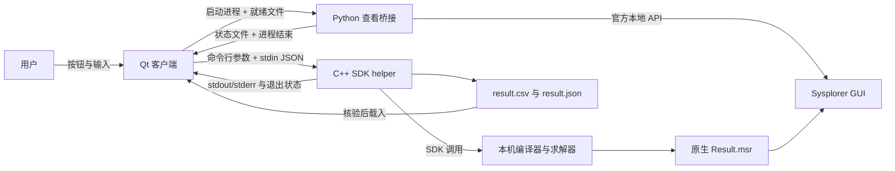
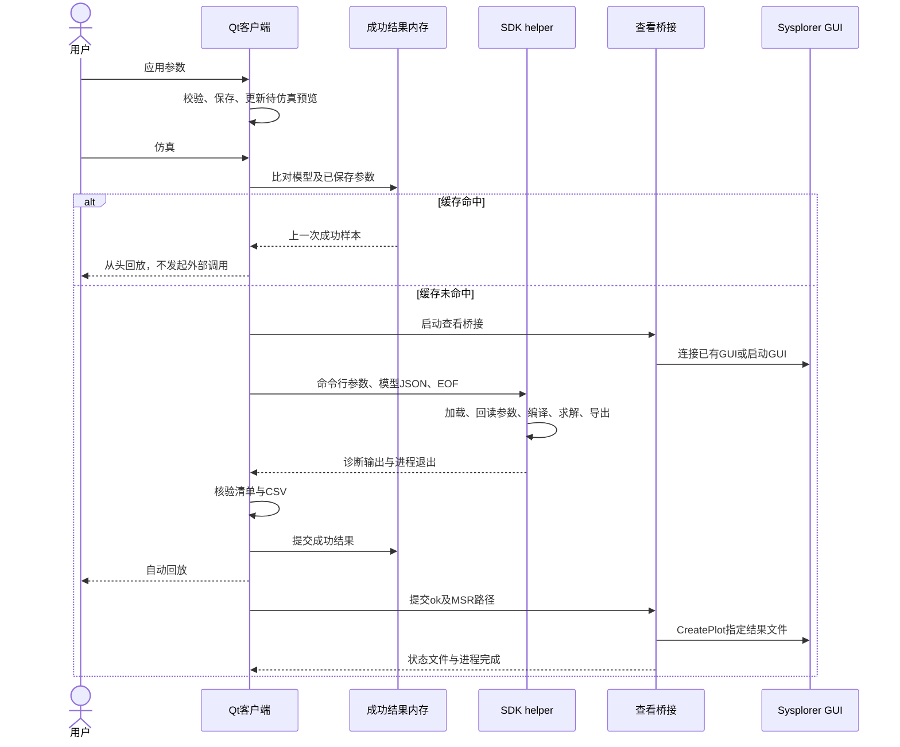

# 数据通信文档

> **UDP 改造后的版本说明（2026-11-04）**：本文是此前独立 helper 架构的历史快照，文中的“当前/最终”指当时版本。现行软件已改为 Qt → 本地 UDP → Sysplorer 宿主插件，支持真实计算期间暂停/继续/停止及部分结果。现行实现与验收请参见[UDP正式接入开发记录](../UDP正式接入开发记录.md)和[UDP任务协议](../UDP任务协议.md)。原交付 ZIP 未重新打包，仍属历史快照。

| 元信息 | 内容 |
|---|---|
| 文档版本 | 1.0，交付稿；软件正式版本号待补充 |
| 日期 | 2026-11-04，Asia/Shanghai |
| 读者 | 客户端开发、联调人员、用户与售前 |
| 状态 | 按当前代码及最终联调记录核对；正式审签人待补充 |
| 关联文档 | [开发流程](02_开发流程文档.md)、[错误总结](03_错误总结文档.md)、[界面开发](04_界面开发文档.md)、[开发借鉴](05_最终文档与开发借鉴.md) |

## 目录

1. [背景与目标](#背景与目标)
2. [范围与非目标](#范围与非目标)
3. [术语表](#术语表)
4. [角色、拓扑与生命周期](#角色拓扑与生命周期)
5. [接口与消息格式](#接口与消息格式)
6. [典型业务时序](#典型业务时序)
7. [异常、超时与重试](#异常超时与重试)
8. [日志与安全边界](#日志与安全边界)
9. [如何向用户介绍客户端](#如何向用户介绍客户端)
10. [验收清单与交叉引用](#验收清单与交叉引用)

## 背景与目标

本客户端把电池参数输入、真实模型计算、结果回放和 Sysplorer 原生查看连接起来。这里的“通信”主要是**同一台计算机上的事件、进程管道、任务文件与官方本地 API**，不是用户通过网络向一个自建仿真服务器提交任务。

本文给出项目实际使用的通信约定，回答数据从哪里来、经过哪些环节、如何确认属于本次请求，以及失败后哪些结果仍然有效。产品完整功能清单参见《开发流程文档》“功能清单”。

## 范围与非目标

范围包括当前正式 GUI 的管道模型通道、SDK 计算结果交接、查看桥接与用户介绍口径。独立 helper 保留的文件模式仅作为兼容诊断入口说明，不把它当作正式 GUI 当前路径。

非目标：开发排期、控件实现教程、错误案例全过程、第三方私有协议逆向、硬件 BMS/串口/CAN 通信。本项目没有已实现的远程任务服务或硬件控制链路。

## 术语表

| 术语 | 含义 |
|---|---|
| SOC | 电量比例；内部为 0–1，界面显示百分数 |
| helper | 独立 C++ SDK 子进程 `sdk_probe.exe` |
| 任务目录 / job | 一次新计算的独立目录，包含日志、求解产物和查看交接文件 |
| MSR | Sysplorer 原生结果文件，本项目为 `solver/Result.msr` |
| 查看桥接 | `sysplorer_view.py`，只连接/启动 GUI 并显示原生结果 |
| 模型指纹 | 模型字节的 SHA-256，用于一致性比对，不是签名 |
| EOF | 标准输入写通道关闭后的结束标记，供 helper 判断请求已经传完 |

## 角色、拓扑与生命周期

### 角色边界

| 角色 | 负责 | 不负责 |
|---|---|---|
| 用户 | 编辑、应用参数，启动计算或缓存回放，控制回放 | 直接构造 SDK 私有报文 |
| Qt 客户端 | 校验、缓存判断、调度、结果核验和显示 | 用近似公式替代正式 SDK 计算 |
| C++ helper | 模型加载、参数回读、编译、求解和结果导出 | 操纵用户桌面上的 Sysplorer 窗口 |
| SDK/求解器 | 执行模型编译与数值计算 | 保存客户端控件状态 |
| Python 查看桥接 | 发现/连接/启动本机 GUI，载入并绘制结果 | 重新仿真或生成另一套计算结果 |
| Sysplorer GUI | 供用户查看原生参数、变量和曲线 | 驱动客户端回放时钟 |



### 通道清单

| 通道 | 方向与内容 | 边界 |
|---|---|---|
| Qt 信号槽 | 控件动作、回放 tick、计算完成和查看完成 | 进程内事件，不是网络推送 |
| 命令行 | GUI → helper：数值参数、路径和期望模型哈希 | `QProcess` 参数列表传递，不拼接 shell 命令 |
| 标准输入 | GUI → helper：一个紧凑 JSON 模型消息 | 写入后关闭写通道，以 EOF 结束 |
| 标准输出/错误 | helper → GUI：诊断文本 | 合并记录到 `helper.log`，不是结构化结果协议 |
| 结果文件 | helper → GUI：CSV 与清单；SDK → GUI 查看器：MSR | 文件存在本身不代表成功 |
| 查看请求文件 | GUI → 桥接：结果已验证或计算失败 | `QSaveFile` 提交；桥接每 0.3 s 检查一次 |
| 查看状态文件 | 桥接 → GUI/维护者：连接、打开、失败阶段 | GUI 在桥接结束时读取，不是持续轮询所有中间状态 |
| 官方本地 API | 桥接 → Sysplorer | 使用动态发现的端口；私有帧格式不是项目定义的协议 |

### 建立与结束

新计算经参数检查后创建 `UTC时间_UUID` 目录。GUI 启动查看桥接及 SDK helper：helper 启动后接收模型 JSON，输入结束后开始处理；查看桥接可以先连接 GUI，等待本次计算结果就绪。

helper 正常结束后，GUI 检查退出状态、清单和数据，再写入查看请求。桥接随后绘图并输出状态。缓存命中没有上述外部进程交接，直接使用本进程内存。

客户端退出时停止自己的回放及桥接子进程；若 SDK 仍在运行，则结束本次 helper 进程树。不会主动关闭用户的 Sysplorer GUI。官方 API 连接在桥接结束后不再由本客户端持续维护；其内部释放机制属于第三方实现，细节需厂商资料确认。

## 接口与消息格式

### 运行参数

`SysplorerRunner::start(voltage, current, mode, soc0, duration)` 生成 helper 参数。以下列正式 GUI 实际使用项：

| 项目 | 传递位置 | 含义与约束 |
|---|---|---|
| 模型路径 | 第 1 个位置参数 | 保留兼容位置参数；正式 `--model-stdin` 模式不从这个路径读取模型 |
| 输出目录 | 第 2 个位置参数 | `<job>/solver`，新任务不复用旧编译产物 |
| `soc0` | 第 3 个位置参数 | 无量纲 0–1；GUI 百分数先转换 |
| `current` | 第 4 个位置参数 | 电流幅值，0–5 A；放电方向不靠输入负数表达 |
| `vc` | 位置标志 | 选择本机 VC 配置，helper 还会显式设置编译器信息 |
| `--mode` | 选项 | 1=充电，2=放电 |
| `--voltage` | 选项 | 2.50–3.45 V；充电上限或放电下限 |
| `--duration` | 选项 | 仿真时间，单位 s；由 GUI 估算，不是用户直接输入项 |
| `--model-stdin` | 标志 | 启用管道模型通道 |
| `--model-sha256` | 选项 | 期望的模型 SHA-256，当前为小写十六进制字符串 |

GUI 计算时长为：

```text
delta = 充电时 1-soc0；放电时 soc0
duration = clamp(delta × 9000 / max(current, 0.05) × 1.1 + 60,
                 120, 20000)
```

这里的 9000 C 对应模型容量 2.5 Ah。估算时长上限可能先于充满/放空到达；截止保护也可能使实际电流归零，不能把输入电流当作全程必然保持的结果。

### 模型 JSON

| 字段 | 类型 | 约定 |
|---|---|---|
| `schema` | 整数 | 当前为 1 |
| `sha256` | 字符串 | 原始模型字节摘要，须同时匹配命令行期望摘要 |
| `modelBase64` | 字符串 | 资源模型字节的 Base64 编码；不是加密 |

消息结构示意如下，**占位文本不是可运行报文**：

```json
{
  "schema": 1,
  "sha256": "<实际模型字节的SHA-256>",
  "modelBase64": "<同一份模型字节的Base64>"
}
```

GUI 限制模型不超过 1 MiB；helper 读完输入后检查 JSON 载荷不超过 2 MiB、解码模型不超过 1 MiB且非空，并检查协议、哈希及编码。它不是按流逐段限流。正式资源为 UTF-8，随后经 SDK `NewModel(text)` 加载。模型更新流程参见《开发流程文档》“发布与部署”。

### CSV 与结果清单

CSV 表头固定为：

```csv
time,SOC,I_act,V_term
```

| 列 | 单位 | 说明 |
|---|---|---|
| `time` | s | 非递减；事件可能带来额外采样点，不能假定点数恒等于时长加一 |
| `SOC` | 1 | 0–1；显示时乘以 100 |
| `I_act` | A | 实际电流，充电非负、放电非正；保护触发时允许为零 |
| `V_term` | V | 模型实际端电压，与输入截止电压含义不同 |

helper 以 SOC 时间网格导出，电流、电压按时间取值插值。`ReplayData` 可跳过无效行；之后由 runner 的点数、时间与数据约束校验把关，不能描述为严格逐行解析遇错立即退出。

| `result.json` 字段 | 类型 | 含义 |
|---|---|---|
| `schema`、`source` | 数字、字符串 | 当前 1、`sysplorer-sdk` |
| `model` | 字符串 | 正式场景为 `BatterySim.SingleRun` |
| `modelSha256` | 字符串 | 本次原始模型字节指纹，GUI 据此比对 |
| `sdkInputSha256`、`sdkInputEncoding` | 字符串 | 交给 SDK 的文本指纹及编码 |
| `modelTransport`、`sdkLoadMethod` | 字符串 | 正式路径为 `stdin`、`NewModel(text)` |
| `mode`、`soc0`、`current`、`voltage`、`duration` | 数字 | 回显请求参数；不是 UI 当前未应用的编辑值 |
| `initialSOC`、`initialCurrent`、`finalSOC` | 数字 | 求解结果摘要，允许正常浮点误差 |
| `points` | 数字 | 导出 CSV 的有效样本数 |

GUI 要求请求参数差异小于 `1e-8`；初始 SOC 差异小于 `1e-6`；结束时间差异小于 `0.01 s`；SOC 容差为 `[-1e-5, 1.00001]`，实际电流幅值不超过设定值加 `1e-4 A`，并检查有限数值、方向及非递减时间。校验通过后才替换上一条成功结果。

### 查看请求与状态

`sysplorer_view_request.json` 由 GUI 在完成判断后提交：

```json
{
  "ok": true,
  "result": "<本次任务目录>/solver/Result.msr"
}
```

`ok=false` 表示本次计算未通过，不应显示本次结果。状态文件 `sysplorer_view.json` 的字段如下：

| 字段 | 说明 |
|---|---|
| `stage` | `connecting`、`connected`、`opened`、`cancelled` 或 `failed` |
| `reused` | 已连接后记录是否复用了 GUI；早期阶段可能没有此字段 |
| `result` | 绘图完成时的原生结果路径 |
| `plots` | 完成时三幅曲线的布尔结果，分别为 SOC、电压、电流 |
| `error` | 异常时的诊断堆栈；不是用户需要自行执行的命令 |

桥接使用临时文件加替换写入状态。GUI 还检查桥接进程正常退出、退出码为零和 `stage=opened`；`cancelled` 不作为一次新的查看故障提示。

## 典型业务时序



计算失败时不提交成功结果，只通知查看桥接取消本次显示。查看连接或绘图失败时，已经验证的计算结果仍可在客户端回放。这两个结果不能合并成单一“仿真失败”。

## 异常、超时与重试

### helper 自定义退出码

| 码 | 阶段/含义 |
|---|---|
| 0 | helper 正常完成；GUI 仍需校验产物 |
| 2 | 参数数量不足 |
| 3 | 数值参数无效 |
| 4 | 输出目录含旧编译产物，拒绝复用 |
| 10 | SDK 模型处理对象不可用 |
| 11 | 模型输入、完整性、解码、文件交接或加载失败；必须看具体日志 |
| 12 | 目标模型类型查找失败 |
| 13 | 参数写入/回读核验失败 |
| 20 | 模型编译失败 |
| 21 | 仿真实例初始化失败 |
| 22 | 启动求解失败 |
| 23 | 等待结束、求解错误或结束时间检查失败 |
| 24 | 变量结果读取失败/为空 |
| 25 | CSV 无法打开供写入 |
| 26 | helper 结果约束校验失败 |
| 27 | 创建仿真控制对象失败 |
| 28 | 许可后台线程未在等待期限内停止 |
| 29 | 结果清单写入/提交失败 |

这些是**本项目 helper 的返回码**。SDK 日志号、求解器状态、Windows 异常码及 `QProcess::FailedToStart` 属于其他层；不能仅凭“11”或“非零”就断言编码或许可故障。案例参见《错误总结文档》。

| 时限 | 当前设置 | 范围 |
|---|---|---|
| helper 仿真等待计时器 | 120 s | 启动求解后的等待，不等于整个编译任务 SLA |
| GUI SDK 任务监控 | 300 s | 超时结束本次 helper 进程树 |
| 桥接等待就绪文件 | 330 s | 连接后等待结果；不是实时数据推送 |
| 桥接进程监控 | 420 s | GUI 超时结束桥接进程，不主动关闭 Sysplorer |

当前没有自动重试。用户可检查日志、修正原因后重新应用/仿真；是否新建计算取决于缓存比对。重复点击在 SDK 计算期间被界面禁用，runner 也有忙状态保护。

## 日志与安全边界

| 文件/标记 | 用途 |
|---|---|
| `GUI_MODEL`、`MODEL transport`、`DECODE` | 追踪模型来源、字节数、摘要及解码状态 |
| `PARAM`、`COMPILE`、`STOP`、`RESULT` | 按阶段查看参数、编译、求解与导出 |
| `helper.log`、SDK 构建/求解日志 | 计算通道排查 |
| `result.json`、`result.csv`、`Result.msr` | 请求对应关系、客户端数据、原生数据 |
| `sysplorer_view.log`、`sysplorer_view.json` | GUI 连接与结果显示排查 |

任务目录名使用 UTC，日志展示或故障复述需要转换为北京时间，不能直接据目录数字排定本地开发时刻。个别历史 `RESULT` 日志仍使用 `SOC600` 标签，即使实际时长不是 600 s；最终 SOC 和时长应以清单及数据为准。

安全边界：模型按本项目资源加载；数值及摘要多层检查；不修改机器防护策略或安装许可配置。Base64、哈希与任务隔离不提供身份认证、防恶意篡改或传输加密保证。临时目录访问、产物保留、第三方许可、日志对外脱敏政策待补充。本文只说明本业务的本地路径，不代表已经审计第三方 GUI 所有网络行为。

## 如何向用户介绍客户端

### 简短介绍

> 这是一个面向本机电池模型的充放电仿真客户端。您设置方向、电流、起始电量和截止电压，应用参数后即可看到起始状态。点击仿真时，程序会复用匹配的上次结果，或调用本机 Sysplorer SDK 重新计算。新计算结果既能在客户端回放，也能在 Sysplorer 中查看原生曲线。

### 演示时的说明

> “应用参数”用于保存设置和预览，不会启动计算。首次计算或参数变化后会进行模型编译和求解，请等待完成。结果准备好后，播放速度只影响回放快慢。暂停和停止会保留当前画面；同样的参数再次仿真会直接使用本次程序运行中的内存结果，不重复打开结果窗口。

### 使用注意事项

> 输入电压是充电上限或放电下限，实际端电压由模型计算。电流也可能受截止保护而归零。结果是当前模型的数值计算，不代表已经完成实物电池精度标定。使用前需要本机安装和许可满足要求；关闭客户端后内存缓存不会自动恢复。

## 验收清单与交叉引用

- [x] 明确计算路径与查看路径，不把 Python 描述为计算引擎。
- [x] 明确命令行、管道、文件、Qt 事件和官方 API 的区别。
- [x] 给出字段、单位、EOF、结果校验、退出码与超时口径。
- [x] 解释缓存命中为什么没有新的外部调用。
- [x] 分开计算失败、查看失败、回放控制与安全边界。
- [x] 提供唯一成套用户介绍话术。
- [ ] 第三方许可/再分发、产物治理与正式安全要求待确认。

本文详述通信与介绍口径。开发阶段/部署操作参见《开发流程文档》；故障完整过程参见《错误总结文档》；控件及状态实现参见《界面开发文档》；方案选择依据参见《最终文档/开发借鉴文档》。证据入口：`app/ui/src/sysplorer_runner.cpp`、`tools/sdk_probe/main.cpp`、`app/ui/sysplorer_view.py`，路径均相对项目根目录。
