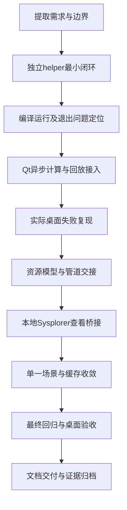

# 开发流程文档

> **UDP 改造后的版本说明（2026-11-04）**：本文是此前独立 helper 架构的历史快照，文中的“当前/最终”指当时版本。现行软件已改为 Qt → 本地 UDP → Sysplorer 宿主插件，支持真实计算期间暂停/继续/停止及部分结果。现行实现与验收请参见[UDP正式接入开发记录](../UDP正式接入开发记录.md)和[UDP任务协议](../UDP任务协议.md)。原交付 ZIP 未重新打包，仍属历史快照。

| 元信息 | 内容 |
|---|---|
| 文档版本 | 1.0，交付稿；软件发布版本号待补充 |
| 日期 | 2026-11-04，Asia/Shanghai |
| 读者 | 项目经理、后续开发者、评审人员 |
| 状态 | 按真实开发顺序与现有证据整理；人员/工时/正式审签待补充 |
| 关联文档 | [通信](01_数据通信文档.md)、[错误](03_错误总结文档.md)、[界面](04_界面开发文档.md)、[借鉴](05_最终文档与开发借鉴.md) |

## 目录

1. [背景与目标](#背景与目标)
2. [范围与非目标](#范围与非目标)
3. [术语表](#术语表)
4. [需求拆解与技术选型](#需求拆解与技术选型)
5. [实际开发阶段](#实际开发阶段)
6. [功能清单](#功能清单)
7. [联调与验收](#联调与验收)
8. [发布与部署](#发布与部署)
9. [遗留项与后续计划](#遗留项与后续计划)
10. [验收清单与交叉引用](#验收清单与交叉引用)

## 背景与目标

开发从理解历史需求开始，先验证本机 SDK 能否接受新参数并真实求解，再接入 Qt。随后根据用户实际桌面报错修正模型交接、增加 Sysplorer 原生查看，并最终收敛为单一自定义场景、上一成功结果内存复用和暂停/停止冻结。

本文记录实际过程与可执行交付步骤。阶段顺序来自对话和日志，**不是事后补造的项目排期**；起止日期、人员分工、工时和投入成本待补充。

## 范围与非目标

范围：需求变化、已采用技术、阶段依赖、唯一完整功能表、联调与测试口径、构建部署和后续事项。

非目标：协议字段全文、控件教学、错误案例全过程、未验收功能的实施承诺。方案取舍依据参见《最终文档/开发借鉴文档》。

## 术语表

| 术语 | 本文含义 |
|---|---|
| 最小闭环 | 新参数输入 → 真实求解 → 读回可核对结果 |
| 里程碑 | 有具体产物和验证依据的阶段结论，不等于计划日期 |
| 离屏回归 | 使用 Qt offscreen 平台运行真实界面逻辑测试 |
| 桌面验收 | 操作实际发布窗口的按钮，并核对原生结果和日志 |
| 发布目录 | `app/ui/runtime`，不是独立安装包 |

## 需求拆解与技术选型

### 最终范围如何形成

| 需求演进 | 最终处理 |
|---|---|
| 先理解文档和流程 | 将历史材料与当前指令分开，提取可验证需求 |
| 先验证 SDK，不做完整 UI | 形成独立 C++ helper 最小闭环 |
| 接入 Qt，应用参数只保存 | 保存/预览与真实计算分离 |
| 在真实窗口复现错误 | 增加逐段证据，修正实际进程环境差异 |
| 调用本地还要打开 Sysplorer | 增加官方 API 查看桥接，不替换计算路径 |
| 删除预设，缓存优先 | 最终仅保留自定义充放电与上一成功结果 |
| 暂停停止保留结果，避免重复提示 | 冻结回放状态；缓存不再打开结果，查看接口改为按文件绘图 |

早期预设场景和“缓存回放时重开 Sysplorer”曾存在，已被后续明确指令替代，不能写进当前功能承诺。

### 已采用技术及依赖

| 部分 | 已采用方案 | 验证/配置入口 |
|---|---|---|
| 客户端 | C++11、Qt 5.14.2 Widgets、QPainter | `app/ui/ui.pro`、`src` |
| 编译 | MSVC2017 x64、qmake/nmake | `app/ui/build.cmd`、helper 构建脚本 |
| 模型 | Modelica，资源打包 `BatterySim.SingleRun` | `models.qrc`、`model/BatterySim.mo` |
| 标准库 | helper 明确加载 Modelica 4.0 | SDK 安装中的库须可用，加载结果写入日志 |
| 计算适配 | 独立 C++ Sysplorer SDK 2026a helper | `tools/sdk_probe` |
| 原生查看 | 已安装 Sysplorer 的 Python 与官方 API | `app/ui/sysplorer_view.py` |
| 验证 | Qt Test、实际按钮操作、日志与产物核对 | `app/ui/tests`、`logs` |

## 实际开发阶段



| 阶段 | 实际工作 | 产物/里程碑 | 依赖 |
|---|---|---|---|
| S1 需求提取 | 区分参数应用、计算、回放和查看；明确先 SDK 后 UI | 需求基线、最小验证目标 | 历史材料与用户指令 |
| S2 SDK 闭环 | 加载模型、修改并回读参数、编译求解、导出 | 两组独立参数得到不同且可核验的结果 | SDK、许可、VC、模型 |
| S3 环境排障 | 编译器、位数、路径、本地通信与线程退出 | 正常求解并退出的 helper | S2 的完整日志 |
| S4 Qt 接入 | QProcess 异步启动、错误显示、结果校验、回放 | 界面按钮可触发实际计算 | helper 可独立工作 |
| S5 现场复现 | 对比终端与用户桌面进程读取结果 | 明确外部模型读取差异的证据 | 用户任务目录和实际窗口 |
| S6 输入方案修正 | 模型资源化、管道校验、SDK 文本加载 | 实际桌面按钮下成功求解 | S5 根因与 SDK 公开接口 |
| S7 原生查看 | 启动/复用 GUI，显示同一 MSR | 用户可在两处查看同次计算 | 已验证计算产物 |
| S8 范围收敛 | 删除预设与近似分支，缓存只回放，停止冻结 | 当前单一自定义版本 | 用户最新行为定义 |
| S9 验收交付 | 回归、真实窗口操作、哈希与日志检查 | 当前运行目录及本套文档 | 代码/配置/证据一致 |

错误细节统一参见《错误总结文档》ERR-01—ERR-12，不在此重述定位案例。

## 功能清单

这是六篇文档中唯一完整功能表。“已验证”指现有本机证据，不代表跨机器或穷举验收。

| ID | 模块 | 功能 | 状态 | 依赖/验收口径 |
|---|---|---|---|---|
| F-01 | 范围 | 仅自定义充放电，无预设选择入口 | 已验证 | 实际窗口无场景下拉框；构建不含近似模拟分支 |
| F-02 | 参数 | 方向、电压、电流、SOC 编辑及边界检查 | 已实现并覆盖主要边界 | 约束参见通信文档；非法值不启动计算 |
| F-03 | 参数 | 应用后保存并更新待仿真预览 | 已验证 | SOC、剩余 Ah、设定电流和电池图同步，无 helper 启动 |
| F-04 | 参数 | 未应用编辑时阻止仿真 | 已实现 | 与已保存参数不同则提示先应用 |
| F-05 | 模型 | 打包资源与内容指纹 | 已验证 | 使用实际资源字节；更新模型需重建 |
| F-06 | 计算 | 新任务独立目录、真实 SDK 参数设置/回读/编译/求解 | 已验证 | 新参数对应新产物；不是读取默认旧曲线 |
| F-07 | 计算 | 异步调度与忙状态保护 | 已验证 | 计算期禁用相关控件，重复点击不新建任务 |
| F-08 | 结果 | 清单、模型、参数、点数、时间与数据约束核验 | 已验证主要路径 | 核验后才能替换成功结果 |
| F-09 | 缓存 | 上一次成功结果按参数及模型匹配 | 已验证 | 匹配则无 SDK/查看调用；不跨重启 |
| F-10 | 回放 | 计算后自动播放、可选速度、同步电池和曲线 | 已验证 | 多视图取同一 tick 样本；速度不影响求解结果 |
| F-11 | 回放 | 暂停/继续 | 已验证 | 暂停保持，继续从当前位置走 |
| F-12 | 回放 | 停止保持全部当前显示与样本 | 已验证 | 时间、SOC、曲线、游标不归零、不清空 |
| F-13 | 回放 | 再次仿真命中缓存从头播放 | 已验证 | 只改变客户端播放进度，外部日志不变 |
| F-14 | 查看 | 自动连接同安装 GUI，必要时打开 GUI | 已验证本机 | 自动启动及复用均有按钮验收记录 |
| F-15 | 查看 | 显示本次原生 MSR 的三幅曲线 | 已验证 | 按指定文件绘图，不重复求解、不调用重复打开接口 |
| F-16 | 异常 | 计算失败保留上一成功结果 | 已验证 | helper 启动失败测试后曲线不被覆盖 |
| F-17 | 异常 | 查看失败与计算结果分离 | 已实现且有现场记录 | 有效客户端回放继续可用，查看日志单独定位 |
| F-18 | 异常 | 超时、结束子进程与许可线程清理 | 已实现，部分路径有验证 | 不把正常跑通扩大为全部异常注入已覆盖 |
| F-19 | 部署 | 按字节复制、哈希校验、相同文件跳过 | 已验证 | 运行目录产物与构建产物一致 |
| F-20 | 诊断 | 任务日志、结果清单、查看状态、验证脚本 | 已验证 | 能由一次任务关联全部产物 |

## 联调与验收

### 联调顺序

1. 确认本机 SDK、GUI、编译器和许可可用；保留实际安装路径。
2. 独立 helper 使用新参数、新输出目录验证计算；核对参数回读和实际结果。
3. Qt 界面从“应用参数—仿真”触发，检查确实启动 helper，不能仅证明按钮可点。
4. 验证成功结果提交、回放，以及失败时保留旧曲线。
5. 在用户实际桌面环境重做上述操作，覆盖与终端不同的进程环境。
6. 验证 Sysplorer 未打开/已打开、新结果/已有结果等查看路径。
7. 对缓存回放比较计算、查看日志和原生文件的摘要及修改时间。

字段、超时及消息判定参见《数据通信文档》；UI 状态变化参见《界面开发文档》。

### 验证矩阵与证据

| 层次 | 验证内容 | 证据与限制 |
|---|---|---|
| 独立 helper | 两组参数、实际求解、数值一致性、退出 | 早期 SDK 验证日志；不能替代桌面验收 |
| Qt 主体流程 | 放电、充电、电压保护、零电流、参数预览、缓存、失败保留、停止冻结 | `app/ui/tests/integration_test.cpp` |
| 最终 Qt 输出 | 3 passed、0 failed，89188 ms | `logs/ui_integration.txt`；含初始化/主体/清理，不是三个独立业务用例 |
| 实际桌面 | 0.10 A、SOC 53%、3.45 V 新计算，原生曲线成功 | 任务 `20261104_031826_d68460d3-800a-41d2-9ec3-a2d1d4c1ca7b` |
| 暂停/停止 | 1453 s、54.6%、1.365 Ah 均保持 | 最终按钮操作记录 |
| 缓存 | 再仿真直接回放，helper/查看日志、清单和 MSR 不变 | `logs/single_custom_cache_verified.json` |
| 用户确认 | 程序已跑通 | 对话记录；不能替代许可/跨机/物理精度验收 |

离屏脚本设置 `BATTERY_SYSPLORER_GUI=0`，只关闭查看桥接，真实 SDK 计算仍执行。因此自动打开/复用 GUI 必须另做桌面验收。

## 发布与部署

### 本机环境基线

| 项目 | 已使用位置/要求 |
|---|---|
| Qt Kit | `C:/Qt/Qt5.14.2/5.14.2/msvc2017_64` |
| VC | Visual Studio 2017 Professional 的 `VC`，路径写在构建/适配配置中 |
| SDK | `C:/Program Files/MWORKS/Sysplorer SDK 2026a(vs2017)` |
| Sysplorer GUI | `C:/Program Files/MWORKS/Sysplorer 2026a` |
| Python 查看依赖 | GUI 安装目录自带 Python、`mworks.sysplorer` 与 `psutil` |
| 工作目录 | 可写 ASCII 路径；默认系统临时目录下 `BatteryConsole` |

### 构建与验证命令

在项目根目录执行；不是要求在 Sysplorer 命令窗口执行：

```powershell
.\tools\sdk_probe\build.cmd
.\app\ui\build.cmd
powershell -NoProfile -ExecutionPolicy Bypass -File .\app\ui\deploy.ps1
.\app\ui\tests\build.cmd
powershell -NoProfile -ExecutionPolicy Bypass -File .\app\ui\tests\run.ps1
```

这些命令依赖本机已配置的安装布局，不是通用安装器。程序不同且仍被占用时需要先退出客户端；部署会跳过哈希相同的文件，避免无意义重写被占用但一致的依赖。

发布目录应包含客户端、helper、查看脚本、匹配 Qt DLL/插件及 `qt.conf`。默认使用 `app/ui/run_ui.bat` 启动；也可直接运行 runtime 中的 EXE。正式版本号、签名、独立安装包与升级流程待补充。构建产物指纹参见 [事实基线](00_事实清单与文档规划.md)。

### 配置项

| 环境变量 | 作用 |
|---|---|
| `SYSPLORER_HOME` | GUI 安装根目录，决定查看使用的 Python 与 `mworks.exe` |
| `SYSPLORER_SDK_BIN` | SDK `bin/win_msvc2017x64` 目录 |
| `BATTERY_HELPER_EXE` | helper 路径覆盖；默认 runtime 下 `helper/sdk_probe.exe` |
| `BATTERY_SIM_WORKSPACE` | 新计算任务的根目录，必须符合路径约束 |
| `BATTERY_SYSPLORER_GUI` | 为 `0` 时不启动查看桥接，主要用于离屏测试 |
| `BATTERY_TEST_ARTIFACTS` | 测试/诊断产物目录 |
| `BATTERY_PROJECT_DIR` | 启动/诊断保留的工程根目录设置；当前正式模型不从它热加载 |

GUI 与 SDK 子进程的 Qt 搜索环境分开配置；不要为了修正某个子进程而全局混合两套 Qt 路径。

### 更新模型与交付核对

1. 修改 `model/BatterySim.mo`，确认源文件是正确模型文本。
2. 重建界面和相关测试，使 `models.qrc` 的资源更新；只替换外部 `.mo` 不会改变运行模型。
3. 部署并重启客户端，核对日志中的实际模型指纹。
4. 用与变更相关的参数通过实际按钮验证结果，再记录产物指纹。

## 遗留项与后续计划

| 事项 | 当前事实 | 建议下一步，不构成已承诺排期 |
|---|---|---|
| 软件版本、责任人与发布审批 | 待补充 | 形成版本记录及发布签字 |
| 跨机器/系统矩阵 | 无完整验收证据 | 在干净目标机验证依赖、许可和路径 |
| 生产构建 | helper 仍保留诊断编译选项 | 建立独立诊断/生产配置并重新验证 |
| 许可计时器警告 | 尚无厂商闭环结论 | 携最小复现、日志与版本咨询厂商 |
| 产物治理 | 无清理/保留政策 | 明确保留周期、容量和脱敏要求 |
| 模型物理精度 | 未提供实物标定 | 建立标定数据与误差标准 |
| 自动重试、多任务、持久缓存 | 当前未提供 | 有明确需求后按文档 5 的演进条件评估 |

## 验收清单与交叉引用

- [x] 当前范围与历史方案分开，预设不再列为现有功能。
- [x] 开发顺序有产物和依赖，没有虚构工时/日期。
- [x] 提供唯一完整功能表及本机验证证据。
- [x] 区分独立、离屏、桌面和用户确认的证明范围。
- [x] 给出当前可执行构建部署步骤与模型更新要求。
- [ ] 正式软件版本、目标机矩阵、授权再分发和发布审批待补充。

本文详述过程、完整功能与发布操作。接口字段参见《数据通信文档》；故障按 ERR 编号参见《错误总结文档》；控件及学习路径参见《界面开发文档》；选型依据和后续架构取舍参见《最终文档/开发借鉴文档》。
