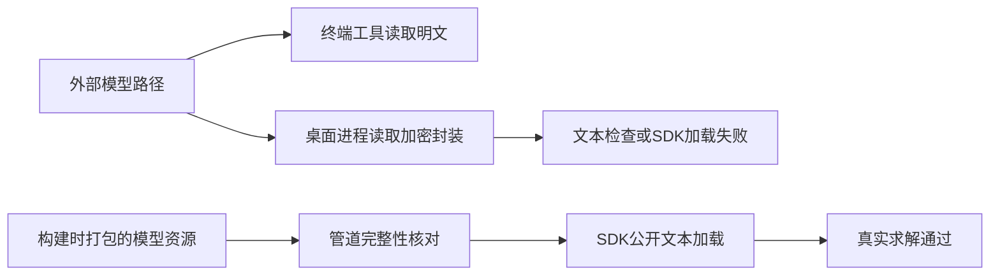
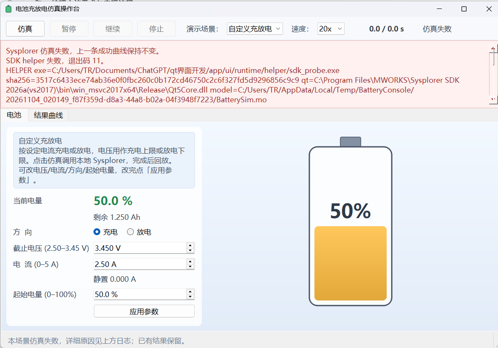
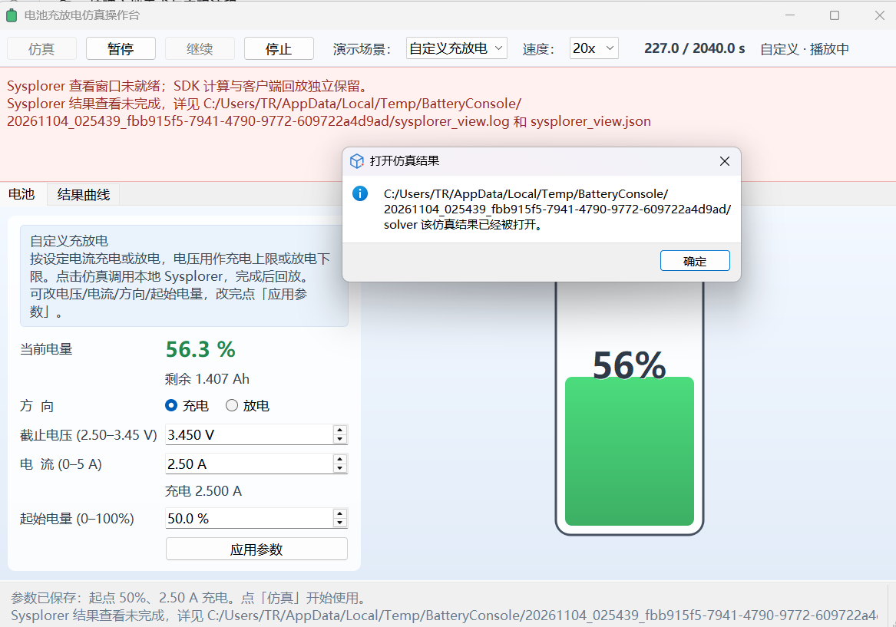
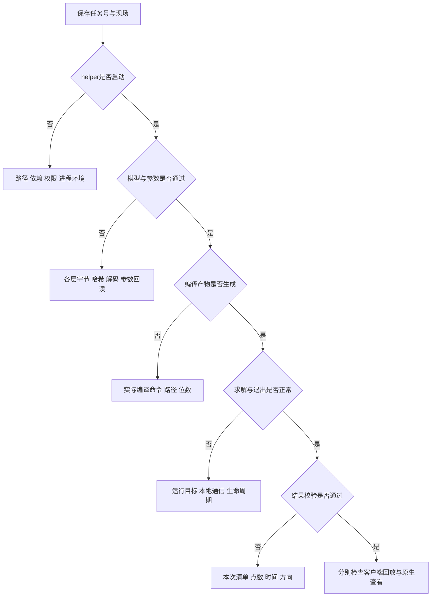

# 错误总结文档

> **UDP 改造后的版本说明（2026-11-04）**：本文是此前独立 helper 架构的历史快照，文中的“当前/最终”指当时版本。现行软件已改为 Qt → 本地 UDP → Sysplorer 宿主插件，支持真实计算期间暂停/继续/停止及部分结果。现行实现与验收请参见[UDP正式接入开发记录](../UDP正式接入开发记录.md)和[UDP任务协议](../UDP任务协议.md)。原交付 ZIP 未重新打包，仍属历史快照。

| 元信息 | 内容 |
|---|---|
| 文档版本 | 1.0，交付稿 |
| 日期 | 2026-11-04，Asia/Shanghai |
| 读者 | 开发、测试、运维与后续维护者 |
| 状态 | 已按已有案例和记录整理；未闭环事项单列，正式审签待补充 |
| 关联文档 | [通信](01_数据通信文档.md)、[流程](02_开发流程文档.md)、[界面](04_界面开发文档.md)、[借鉴](05_最终文档与开发借鉴.md) |

## 目录

1. [背景与目标](#背景与目标)
2. [范围与非目标](#范围与非目标)
3. [术语表](#术语表)
4. [问题索引](#问题索引)
5. [典型问题复盘](#典型问题复盘)
6. [可复用排查流程](#可复用排查流程)
7. [遗留项与证据限制](#遗留项与证据限制)
8. [验收清单与交叉引用](#验收清单与交叉引用)

## 背景与目标

开发中“SDK 链路失败”实际覆盖了输入、编译、启动、求解、数据核验、退出和原生查看等不同环节。单次成功、一个错误号或一条可见曲线均不足以完成归因。

本文按可追溯证据复盘，保留被后续证据纠正的判断，避免后续维护者重新沿用已经失效的解释。历史原文保存在项目根目录的 SDK 复盘文件中；本篇是统一案例入口。

## 范围与非目标

范围包括已发生问题的现象、定位、根因、修复、验证和预防；静态审阅关注点明确标为“需验证”，不冒充现场故障。

非目标：完整功能表、通信字段全文、UI 初学者教程、未经验证的第三方内部机制。消息和退出码定义参见《数据通信文档》。

## 术语表

| 术语 | 含义 |
|---|---|
| 直接证据 | 本次任务日志、字节/哈希、调用栈、代码路径或实际操作结果 |
| 根因确定程度 | 已复现定位、历史记录支持、尚待验证；不同级别不能混用 |
| 透明读取差异 | 同一路径在不同进程中得到不同内容，本次涉及明文与加密封装 |
| 原生查看失败 | GUI 连接/绘图失败，不自动等于数值计算失败 |

## 问题索引

| 编号 | 分类 | 现象与影响 | 根因/确定程度 | 解决与预防 |
|---|---|---|---|---|
| ERR-01 | 环境/编译 | 编译器无效、VC 路径为空，无法生成求解器 | 独立进程配置不完整，已定位 | 显式编译配置；核对实际命令 |
| ERR-02 | 环境/数据 | 文件存在却报找不到源文件 | 中文路径在生成响应文件中解码异常，已定位 | ASCII 任务目录；检查真实路径 |
| ERR-03 | 依赖/平台 | DLL 已生成但启动失败 | 编译/运行位数分别配置，曾不一致 | 两阶段显式 64 位 |
| ERR-04 | 通信/进程 | 本地 socket 或子进程创建失败 | 测试沙箱限制、Job 约束是不同问题 | 对比环境，保留进程启动证据 |
| ERR-05 | 并发/生命周期 | 计算正确但退出异常 | 许可线程未停止，调用栈支持 | 退出前等待；剩余计时器警告保留 |
| ERR-06 | 数据/环境 | 非法字符、编码检查拒绝有效源文件 | GUI 读取到加密封装，已在实际窗口定位 | 资源模型+管道+SDK 文本加载 |
| ERR-07 | 打包/依赖 | Qt 启动异常、部署被文件锁中断 | 依赖复制不一致/无意义覆盖运行文件 | 按字节校验，相同则跳过 |
| ERR-08 | 数据/一致性 | 新参数可能对应默认/旧曲线 | 旧产物及验证不足风险，历史记录支持 | 新任务目录、参数回读、结果校验 |
| ERR-09 | 界面/状态 | 错误跨旧场景、预览不更新、回调弹窗异常 | 状态归属和更新路径不完整 | 状态分离与非阻塞提示 |
| ERR-10 | 界面/接口 | 已打开结果提示被报成查看失败 | 重复调用 OpenResult，已定位 | 缓存不调用查看；按文件绘图 |
| ERR-11 | 界面/状态 | 停止后可见时间与内部进度不一致 | 旧停止逻辑重置内部时间 | 冻结时钟、游标和读数 |
| ERR-12 | 验证方法 | 测试成功，用户实际窗口持续失败 | 验证入口/环境不一致；另有测试恢复错误 | 分层验收，保留真实入口验证 |

## 典型问题复盘

### ERR-01：独立 helper 编译器配置不完整

- **现象**：默认尝试不存在的 GCC32 布局；切换 VC 后仍出现 `build_vc.bat -C ""`。
- **定位过程**：区分设置项文字和本次编译实际获得的类型、名称、路径，查看真实构建命令。
- **根因**：独立进程未完整建立编译配置，不能自动假设继承桌面 GUI 的设置。
- **方案**：构造 `MwCoreOption`，使用 `SetCompileInfo` 和编译平台设置，不依赖保存安装配置文件。
- **验证**：日志显示有效 VC 路径、`-x64`，生成模型 DLL 后继续完成求解。
- **预防**：部署前打印有效配置；不要只检查“设置过某个字段”。证据：`logs/trace_default.log`、`logs/trace_vc.log`、`logs/full_20261104_4_a.log`。

### ERR-02：中文工作目录与编译响应文件

- **现象**：`fatal error C1083: Cannot open source file`，但对应 C 文件确实存在。
- **定位过程**：对照 `build.log` 中传给编译器的路径，发现中文目录已经乱码。
- **根因**：本机生成/消费响应文件的路径编码链路不一致，不是电池方程错误。
- **方案**：任务输出使用 ASCII 路径，保留项目源代码目录与任务目录分离。
- **验证**：同模型、同参数换到英文任务目录后编译通过。
- **预防**：runner 在启动前检查工作路径；遇到文件不存在错误先核对命令里的实际字节/路径。历史证据：`runs/vc_core/build.log`，该目录长期保留状态待维护者确认。

### ERR-03：编译 64 位，运行却选了其他位数

- **现象**：模型 DLL 已生成，运行端仍加载失败，求解器曾报告 102。
- **定位过程**：比较生成 DLL 的位数与实际启动的求解器路径，不能止步于“编译成功”。
- **根因**：运行目标没有自动沿用编译目标。
- **方案**：创建仿真控制对象后明确 `SetTargetPlatform(PF_WIN64)`。
- **验证**：实际使用 `Simulator/Bin64/MWSolver.exe` 并完成计算。
- **预防**：编译平台、运行平台和依赖平台作为三项分别检查；该 102 不属于本项目 helper 自定义退出码。证据见最终独立成功日志。

### ERR-04：本地通信环境与进程约束

- **现象**：在工具沙箱中出现 ZeroMQ socket 错误；历史尝试还出现过子进程创建失败。
- **定位过程**：使用同一模型对比沙箱与普通本机进程；记录子进程创建返回及错误，而不是更改模型猜测原因。
- **根因**：已验证沙箱限制会影响本地控制通信。另一次带 `KILL_ON_CLOSE` 的 Job 约束尝试影响 SDK 子进程创建；它是独立机制，不能把所有失败归给沙箱。
- **方案**：真实 SDK 联调在允许本地通信的环境执行；取消妨碍 SDK 的 Job 约束，保留任务超时和结束本次进程树的处理。
- **验证**：同一链路在本机环境求解成功，终止本次任务与用户 GUI 分开处理。
- **预防**：记录进程身份、父子关系、可执行路径及环境差异；不把自动化权限拒绝当作软件本身缺陷。沙箱证据：`logs/run_existing.log`、`logs/run_existing_unsandboxed.log`；Job 试验详细原始证据入口需后续归档确认。

### ERR-05：求解成功但退出异常

- **现象**：已经打印正确结果，进程仍以 `0xC0000409` 退出。
- **定位过程**：获取异常子码、Qt 致命日志及调用栈。子码 7、`QThread: Destroyed while thread is still running` 和 `mw_license_ui.dll` 栈比单一异常码更有解释力。
- **根因**：许可后台线程还在运行时对象被销毁，不能仅按状态码认定为栈越界或缺少许可。
- **方案**：对本次 helper 的收集线程及运行中的激活队列调用 `quit`/`wait`，结束后再销毁应用。
- **验证**：计算结果有效且 helper 正常退出 0。证据：`logs/qt_fatal.log`、`logs/debug_stack2.log`、最终独立日志。
- **预防**：把求解完成与进程正常退出分别验收。`Timers cannot be stopped from another thread` 仍有记录，厂商闭环结论待补充，不能写成所有线程问题已清除。

### ERR-06：编码现象背后的进程读取差异

- **现象**：SDK 先报非法字符；加严格检查后 helper 以 11 拒绝“编码”。终端读取同一路径却得到合法 UTF-8。
- **定位过程**：先比较源文件和任务副本的哈希，再增加字节数、摘要、解码计数、实际 helper 和 Qt 路径。直接重跑和少量 GUI 诊断成功仍不能解释现场。最终在用户实际窗口点击仿真，重复得到 17292 字节二进制封装。
- **根因**：实际桌面进程加载 `TyEnc64.dll` 与 `intefsctrl64.dll`。GUI 读取外部模型就得到带厂商头的内容；终端工具得到 13196 字节明文。差异位于源模型读取，不是只有 helper 读取副本时才变化。厂商内部策略细节没有进一步逆向确认。
- **方案**：将本项目模型编入 Qt 资源，管道传递并核对摘要，使用 SDK 公开文本加载接口。不删除二进制头、不私自解密、不关闭防护。
- **验证**：实际窗口在原加密模块环境中成功。正式资源、管道接收和 SDK 文本均为同一明文指纹；两组真实参数计算及最终低电流计算均通过。
- **预防**：比较“各进程实际读到的内容”，不要只比较终端看到的磁盘内容。完整证据见根目录 `SDK界面故障根因与按钮验证.md`；下表概括关键转折。

| 步骤 | 证据 | 推论 |
|---|---|---|
| 磁盘工具检查 | 13196 字节、UTF-8 有效 | 排除该工具视角下的源文本损坏，不代表所有进程读到相同内容 |
| 实际按钮复现 | 17292 字节，含 NUL/大量非法编码，厂商头 | 应调查读取环境，而不是继续猜 BOM |
| 仅改为管道 | `GUI_MODEL` 已是 17292 字节，管道校验通过 | 管道没有改变二进制；问题在 GUI 读取源头 |
| 资源模型+文本加载 | 13196 字节、跨层摘要一致并求解成功 | 当前方案对已复现环境有效，模型更新代价是重建应用 |

图：用户提供的历史故障截图，仅作为 ERR-06 现场素材；其中旧布局和场景入口不代表当前版本。图片原样保留，包含本机路径，对外发布前的脱敏要求需确认。

### ERR-07：Qt 依赖复制和运行文件锁

- **现象**：部署后的 Qt 运行依赖曾出现尺寸/内容差异及入口异常；后续部署还因运行中的相同文件被覆盖而失败。
- **定位过程**：对比 Kit、构建与 runtime 文件的实际字节、哈希及加载路径，不只比较版本字符串。
- **根因**：部署产物不一致；复制链路为何产生差异没有足够证据归因给某一个工具。文件锁是另一确定原因。
- **方案**：从指定 Kit 按字节复制并核对 SHA-256；内容相同跳过复制，不同且被占用则退出相关程序后部署。
- **验证**：runtime 与构建产物指纹一致，实际桌面程序可启动；查看脚本也核对了源与部署副本。
- **预防**：把依赖校验纳入发布，不热覆盖正在运行的不同版本；不能把最终运行目录等同于跨机器安装器。

### ERR-08：参数与结果对应关系

- **现象**：历史记录出现请求新 SOC/电流却读到默认曲线，或旧产物可能掩盖参数未生效。
- **定位过程**：比较输入、SDK 回读、初始实际电流/电量以及时间序列，而不是看曲线“像不像”。
- **根因**：历史各次默认曲线没有全部逐一重现；旧目录/旧编译结果及校验不足是已发现风险，不能虚构每次相同根因。
- **方案**：新任务目录、参数回读、原始模型指纹、结果清单和数据约束共同核验；只提交验证通过的成功结果。
- **验证**：不同参数输出不同且可解析验证的结果；失效 helper 不覆盖成功曲线；缓存日志不变。
- **预防**：缓存键包含模型与所有实际输入，不能只按“场景名称”命中。接口约束参见通信文档。

### ERR-09：提示、预览与界面更新路径

- **现象**：旧多场景版本的全局错误框在切到预设后仍显示；应用参数只保存但读数未变；在进程回调里同步警告曾引起离屏异常。
- **定位过程**：分别追踪提示状态归属、应用后是否调用显示更新，以及错误回调是否进入嵌套事件循环。
- **根因**：错误控件是共享的，但没有恢复对应状态；保存逻辑与视图更新没有一起定义；回调里同步弹窗增加重入风险。
- **方案**：早期按场景保存错误，最终按新需求移除预设；加入明确“待仿真”预览；采用内联错误区域，参数警告延后异步打开。
- **验证**：应用后 SOC/Ah/电池图改变且不启动 helper，失败结果保留；最终窗口没有预设入口。
- **预防**：把已保存设置、已计算数据与可见读数分开；历史跨场景修复不是当前仍有多场景的证据。

### ERR-10：已打开结果被重复打开并误报

- **现象**：客户端回放正常，Sysplorer 提示“该仿真结果已经被打开”，客户端同时显示查看未完成。
- **定位过程**：确认计算已成功，检查缓存回放仍触发查看桥接，再追踪 `OpenResult` 调用。
- **根因**：重复请求同一结果，未区分“已加载”与真正无法加载；前面的缓存验收覆盖了关闭 GUI 后重开，却未覆盖 GUI 保持打开时重复请求。
- **方案**：按最终需求，缓存命中完全不调用查看桥接。新任务用 `CreatePlot(resultFile=...)` 加载或复用文件，不再调用 `OpenResult`。
- **验证**：官方绘图接口对未打开/已加载结果的试验均成功；最终实际按钮缓存回放前后查看日志和清单不变，无重复打开提示。
- **预防**：验证新结果、重复结果、GUI 未开/已开四种组合；不要只隐藏错误或把失败文字改成成功。

图：用户提供的历史“结果已经打开”弹窗与误报截图，仅说明 ERR-10；当前缓存回放不会再走这条打开路径。

### ERR-11：停止状态不同步

- **现象**：旧逻辑保留可见读数，却把内部时间和进度归零。
- **定位过程**：同时检查回放时间、标签、游标、已画范围和缓存，不能只观察电池数字。
- **根因**：将“停止保持结果”实现成 reset，而 UI 又没有同步刷新，形成不同状态来源。
- **方案**：当前 `MainWindow::onStop` 暂停时钟、记录停止状态并保存位置，不重置时间/曲线。
- **验证**：实际在 1453 s 暂停后停止，时间、54.6% 和 1.365 Ah 均保持；Qt 测试比较内部时间、读数和绘制范围。
- **预防**：停止、暂停、从头回放分别定义；不要因 `ReplayPlayer` 仍有旧 `stop()` 方法就认为按钮调用它。

### ERR-12：验证入口和测试自身的缺口

- **现象**：独立复跑及离屏测试成功，用户桌面仍失败；新增零电流测试首次失败却没有启动真正 helper。
- **定位过程**：对照 actual GUI 进程环境与终端；另对测试中的 helper 路径覆盖/恢复进行跟踪。
- **根因**：早期验证没有覆盖实际按钮运行环境；测试在模拟 helper 缺失后清除了原配置而非恢复，随后查找了错误路径。
- **方案**：增加实际窗口复现和逐层输入证据；测试保存、恢复原环境变量，再验证零电流。
- **验证**：实际 GUI 故障被复现并修复；测试主体包含真实零电流求解并最终通过。
- **预防**：测试基础设施错误和产品错误分开记录；“测试通过”必须声明入口、环境和范围，不承诺未覆盖条件。

## 可复用排查流程

排查清单：

- 保存参数、任务目录、软件指纹、截图及完整日志，不只截最后一句错误。
- 使用失败时同一窗口入口和进程环境复现，再做独立对照。
- 每次确认只针对当前层；编译成功、求解成功、退出正常、显示成功分别判断。
- 找到差异后一次改变一个变量；记录假设是否被后续证据否定。
- 修复后同时检查原故障、正常路径和相邻边界，避免只验证替代入口。

## 遗留项与证据限制

1. 许可计时器警告尚无厂商完整结论；不要将非致命警告归因给此前模型加载失败。
2. 旧 `MwApp` 初始化崩溃、历史每次 Python 翻译错误未全部逐一归因，本方案不依赖这些旧入口。
3. 退出清理、极端损坏产物、连接中途断开等异常注入未证明全部覆盖。
4. 静态审阅发现：启动前失败时任务目录标识的新旧关系、查看退出码与状态文件不一致时的提示口径，需补充专门测试；这不是已经复现的新现场故障。
5. 跨机器、全参数和实物精度验证参见流程文档遗留项。

## 验收清单与交叉引用

- [x] 每个索引问题包含现象、影响、确定程度、方案和预防。
- [x] 案例按六步展开，并保留被证据纠正的假设。
- [x] 没把沙箱、加密、许可或某个数字错误码当作万能解释。
- [x] 包含最终重复打开、停止冻结及验证方法缺口。
- [ ] 历史 Job 试验归档、厂商答复与专项异常测试待补充。

本文详述错误案例。错误码契约/排查文件格式参见《数据通信文档》；正式联调发布流程参见《开发流程文档》；正常 UI 实现参见《界面开发文档》；通用反模式提炼参见《最终文档/开发借鉴文档》。
