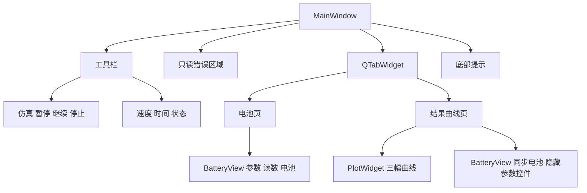
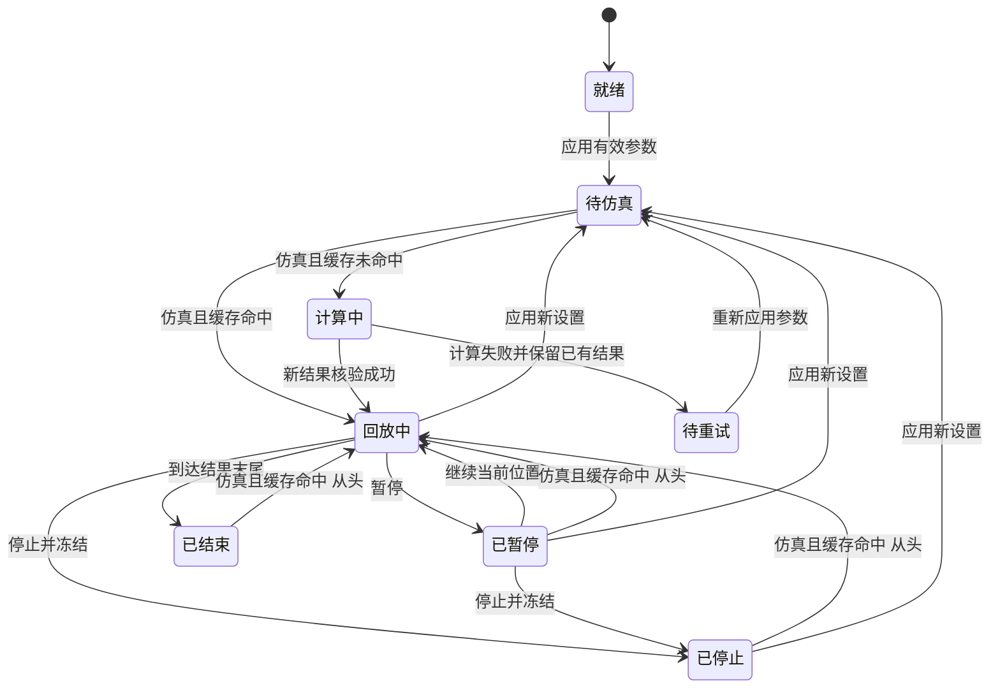
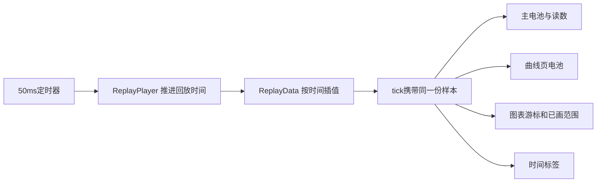

# 界面开发文档

> **UDP 改造后的版本说明（2026-11-04）**：本文是此前独立 helper 架构的历史快照，文中的“当前/最终”指当时版本。现行软件已改为 Qt → 本地 UDP → Sysplorer 宿主插件，支持真实计算期间暂停/继续/停止及部分结果。现行实现与验收请参见[UDP正式接入开发记录](../UDP正式接入开发记录.md)和[UDP任务协议](../UDP任务协议.md)。原交付 ZIP 未重新打包，仍属历史快照。

| 元信息 | 内容 |
|---|---|
| 文档版本 | 1.0，交付稿 |
| 日期 | 2026-11-04，Asia/Shanghai |
| 读者 | Qt 界面开发初学者、后续 UI 开发者 |
| 状态 | 与当前单一自定义版本核对；正式审签待补充 |
| 关联文档 | [通信](01_数据通信文档.md)、[流程](02_开发流程文档.md)、[错误](03_错误总结文档.md)、[借鉴](05_最终文档与开发借鉴.md) |

## 目录

1. [背景与目标](#背景与目标)
2. [范围与非目标](#范围与非目标)
3. [术语表](#术语表)
4. [技术栈与工程导航](#技术栈与工程导航)
5. [组件、布局与绘制](#组件布局与绘制)
6. [状态与数据流](#状态与数据流)
7. [交互与异步接入](#交互与异步接入)
8. [调试方法](#调试方法)
9. [初学者学习路径与练习](#初学者学习路径与练习)
10. [验收清单与交叉引用](#验收清单与交叉引用)

## 背景与目标

当前窗口用 Widgets 组织工具栏、参数、电池和曲线，用信号槽协调事件，用独立进程执行耗时计算。初学者应先理解“输入不是结果、绘制不是计算、暂停不是清空”，再追踪每个按钮调用了什么。

本文让读者从源码入口定位组件、理解显示状态并能完成小范围修改。当前可对外发布的最终截图素材仍待补充；以下组件图和状态图以代码为依据，旧多场景/错误截图只用于错误文档，不能充当当前操作示意。

## 范围与非目标

范围：工程结构、组件布局、样式、自绘、状态存储、交互、异步调用接入和学习练习。

非目标：SDK 协议全文、开发排期、模型物理建模教程、完整错误案例。环境安装和完整构建命令统一参见《开发流程文档》“发布与部署”。

## 术语表

| 术语 | 初学者说明 |
|---|---|
| QWidget | 可显示和接收事件的界面基础对象 |
| 布局管理器 | 根据窗口大小分配控件空间，减少手写坐标 |
| 信号槽 | 对象通知事件及响应事件的连接方式，不要求按钮直接知道所有处理细节 |
| tick | 回放定时器的一次更新，本项目统一更新多个视图 |
| 预览 | 展示已保存的起始设置，尚不是新计算样本 |
| 游标 / 已画范围 | 当前回放位置 / 曲线已经显示到的位置；概念相关但独立保存 |

## 技术栈与工程导航

```text
app/ui/
  ui.pro / models.qrc         界面工程与模型资源
  build.cmd / deploy.ps1      构建与部署入口
  sysplorer_view.py           原生查看桥接，非 UI 绘制模块
  src/
    main.cpp                 QApplication、字体图标、窗口入口
    main_window.*            业务交互与状态协调
    battery_view.*           参数控件与电池绘制
    plot_widget.*            三幅结果曲线绘制
    replay_data.*            样本读取与时间插值
    replay_player.*          回放时钟、速度、事件
    sysplorer_runner.*       异步计算与查看适配
  tests/                     Qt 主体流程回归
tools/sdk_probe/              外部 C++ 计算 helper
model/BatterySim.mo           构建时打包的模型来源
```

历史 `battery_simulator.*` 文件仍可能留在源码目录，但已从当前运行构建中移除，不能再次接回正式计算路径。

| 类 | 核心职责 | 初次阅读重点 |
|---|---|---|
| `MainWindow` | 组装 UI、应用设置、比对缓存、协调完成事件 | `buildUi`、`onApplyCustom`、`onPlay`、`onSysplorerFinished` |
| `BatteryView` | 输入与读数控件、电池外观 | `setInputs`、`setSavedPreview`、`setSoc`、`paintEvent` |
| `PlotWidget` | SOC/电压/电流图、游标与绘制范围 | `setSamples`、`setProgress`、`drawChart` |
| `ReplayData` | CSV 读取、样本保存、按时间取值 | `load`、`sampleAt` |
| `ReplayPlayer` | 定时器、进度、速度、tick | `play`、`pause`、`seek`、`onTick` |
| `SysplorerRunner` | QProcess 调度、日志、完成校验 | `start`、`processFinished`，字段细节引用通信文档 |

## 组件、布局与绘制



### 布局与样式

主窗口用纵向布局组合工具栏、错误区、选项卡和提示；工具栏横向排列按钮、速度和状态。电池页由 `BatteryView` 管理左侧参数区域和右侧电池；曲线页并排放置图表和隐藏控件的电池视图。布局由 Qt 随窗口尺寸重新分配。

按钮、边框和背景等使用 QSS；应用字体在 `main.cpp` 设置，图标通过绘制产生。控件的对象名供测试和调试定位，不承担业务状态。

为什么这样做：控件布局适合用布局管理器保持可读性，而电池外形和曲线适合自绘。把整个窗口按固定屏幕坐标摆放会在缩放、字体变化和不同窗口尺寸下失效。自动化测试点击的坐标只是测试输入，不是产品布局方案。

### 电池与曲线

`BatteryView::paintEvent` 根据可用区域计算电池轮廓、填充高度、颜色与百分数文字。`setSoc` 还同步更新文本和剩余 Ah；只改画笔颜色而不更新数据无法改变电量。

`PlotWidget` 持有完整样本，但按已画范围显示曲线；SOC 显示为百分比，电压与电流分别用对应单位。图表不调用 SDK，也不会因为一条线画出来就证明计算有效。

`update()` 请求 Qt 在后续绘制事件中刷新，不应在普通业务函数里强行反复即时重绘。耗时循环占用 UI 线程会导致绘制和输入一起停顿。

## 状态与数据流

### 五类数据不要混用

| 数据 | 当前承载 | 为什么分开 |
|---|---|---|
| 正在编辑的输入 | SpinBox/RadioButton | 用户可能还没应用，不应直接用于仿真 |
| 已保存设置 | `uiVoltage/uiCurrent/uiMode/uiSoc0` | 是下一次仿真的确定输入 |
| 上一次成功结果 | `samples`、计算时参数、`realSdk`、`modelHash` | 用于缓存比对和失败回退，不被未计算编辑覆盖 |
| 回放进度 | `ReplayPlayer` 时间、`position/drawn`、`m_stopped` | 决定继续、停止与绘制，不改变计算数据 |
| 提示/错误/预览 | `hint/errorText/savedPreview` 等 | 显示待仿真设置不能冒充新求解结果 |

代码仍使用 `ScenarioState` 和长度为 1 的状态容器，名字来自历史多场景实现，不表示界面仍存在预设选择。`m_stopped` 用来区分“暂停后可继续”与“已停止”。当前没有一个集中 enum 表达全部状态，以下状态图是行为模型，不是声称已实现了同名状态机框架。



查看失败的错误区域可以叠加在有效回放之上，它不是将样本清空的状态。计算期间通过忙状态禁用输入和控制；状态标签只是显示结果，不能靠读取标签文字决定程序行为。

### 一个 tick 更新所有视图



`ReplayData::sampleAt` 二分定位相邻样本并插值。定时器推进量为固定间隔乘速度；这是可视化回放，不是与墙钟严格同步的实时控制，也不是 SDK 持续推送样本。通信字段和单位参见通信文档。

## 交互与异步接入

| 交互 | UI 层处理 | 保持不变的内容 |
|---|---|---|
| 应用参数 | 校验、保存、`showSavedPreview`，标记待仿真 | 上一成功样本；不计算 |
| 仿真 | 检查输入已应用，再 `needsRecompute` | 命中时不发起外部任务 |
| 缓存未命中 | `startSysplorerRun` 暂停回放并调用 runner | 旧样本保留至新结果核验成功 |
| 计算成功 | 读取有效数据，`applyComputedCurve`，自动回放 | 不使用失败/不匹配结果覆盖缓存 |
| 暂停 | 停止定时器、保存位置 | 当前时间、曲线和显示值 |
| 继续 | 启动现有回放时钟 | 当前起点，不从头 seek |
| 停止 | `pause()`、设置停止标记、保存位置 | 时间、游标、曲线、读数、缓存 |
| 原生查看完成 | 按任务关联提示 | 不干预客户端有效播放 |

正确理解停止的调用路径：

先在 `MainWindow` 构造处看事件如何接入业务，而不是从绘图函数开始找计算：

```cpp
connect(m_batteryView, &BatteryView::applyRequested,
        this, &MainWindow::onApplyCustom);
connect(m_runner, &SysplorerRunner::finished,
        this, &MainWindow::onSysplorerFinished);
connect(m_player, &ReplayPlayer::tick,
        this, &MainWindow::onTick);
```

三条连接分别表示“保存参数”“接收计算完成”“更新回放视图”。它们不意味着应用参数立即执行 SDK。停止按钮的当前核心行为如下：

```cpp
// MainWindow::onStop 的当前核心行为
m_player->pause();
m_stopped = true;
saveActiveState();
```

`ReplayPlayer` 仍有历史 `stop()`/`resetTime()` 方法，部分旧注释也还描述归零；**当前停止按钮没有直接连接到旧 `stop()`**。初学者应追踪信号槽和调用者，而不是仅按方法名推断。完整缺陷复盘见 ERR-11。

异步接入的最小模式是“发起请求后立即返回事件循环—完成信号到达—校验/提交—刷新 UI”。不要在按钮槽里等待整个编译求解，不要用循环等待并不断强制处理事件。当前 runner 的数据协议、查看就绪文件与超时定义全部参见《数据通信文档》，不在 UI 层重新定义。

## 调试方法

1. 用 `objectName` 找控件，例如 `btnPlay`、`btnApply`、`displaySoc`、`displayAh`、`errorPanel`；对象名准确不等于状态正确。
2. 在 `onApplyCustom`、`onPlay`、`onSysplorerFinished` 和 `onTick` 观察输入、缓存键和样本来源。
3. 参数没有应用时先检查提示分支，不要误认为 SDK 没有响应。
4. 画面不动先区分定时器是否活动、是否有有效样本、绘制范围是否推进。
5. 比较暂停/停止前后的内部时间、标签、SOC 和游标，而不是只看一张截图。
6. 先用离屏测试覆盖逻辑，再以实际桌面按钮验证进程环境和原生查看。完整验证矩阵参见开发流程文档。

| UI 表现 | 先查哪里 | 完整案例 |
|---|---|---|
| 应用后仍显示旧电量 | 保存与 `setSavedPreview` 是否都执行 | ERR-09 |
| 结果有效但红色提示 | 计算/查看状态是否混用 | ERR-10 |
| 停止后位置跳动 | 是否错误调用 reset/旧 stop | ERR-11 |
| 测试通过但桌面失败 | 实际进程、读取内容和依赖路径 | ERR-06、ERR-12 |

## 初学者学习路径与练习

| 步骤 | 小练习 | 为什么练这个 | 验收 |
|---|---|---|---|
| 1 工程导航 | 从 main 找到窗口及四个主要显示组件 | 先知道谁管理谁，再修改代码 | 能解释各类职责，不改计算逻辑 |
| 2 静态布局 | 在练习窗口增加单位说明 | 理解布局管理器优于固定坐标 | 调整窗口仍可读，无遮挡 |
| 3 参数预览 | 在练习分支将 SOC 改为 40% 并应用 | 区分输入、保存和结果 | 显示 40%、1.000 Ah，未启动 helper |
| 4 内存回放 | 独立练习使用三点样本测试 pause/seek | 学会从数据驱动显示 | 暂停不前进、seek 更新视图 |
| 5 异步接口 | 阅读 runner 完成信号，增加一条测试日志 | 学会让 UI 保持响应 | 计算时窗口可刷新，无重复任务 |
| 6 回归保护 | 给暂停/停止前后增加断言 | 修改交互前固定语义 | 样本、时间、曲线和显示全部保持 |

练习数据仅用于独立测试/练习窗口，不得当作正式 SDK 计算失败后的兜底。不要一开始就修改第三方 DLL、仿真参数和 UI 布局三件事，否则难以定位回归。

以步骤 3 为例，可直接按以下顺序上手：按流程文档构建并打开客户端，设置起始 SOC 为 40%，点击应用参数，核对左侧 40.0%、剩余 1.000 Ah、右侧电池约 40%，以及“待仿真”提示；此时不应创建新的计算任务。随后阅读 `onApplyCustom → showSavedPreview → BatteryView::setSavedPreview`，把看到的每个变化对应到一次数据更新。若要继续验证计算，先明确当前是否已有相同参数缓存，再按实际入口核对新任务或缓存路径，不能仅凭点击按钮推断发生了计算。

## 验收清单与交叉引用

- [x] 从入口到组件的阅读路径明确。
- [x] 解释布局、绘制、输入/保存/结果/回放的区别和原因。
- [x] 状态图与当前按钮调用路径一致，不照搬旧停止注释。
- [x] 异步接入仅说明 UI 用法，协议定义引用文档 1。
- [x] 每个练习有原因和验收，练习数据与正式结果隔离。
- [ ] 最终可对外发布截图、高 DPI/更多屏幕尺寸矩阵待补充。

本文详述 UI 组件、状态和学习路径。完整功能与部署参见《开发流程文档》；通信协议参见《数据通信文档》；问题全过程参见《错误总结文档》；可复用架构决策参见《最终文档/开发借鉴文档》。
