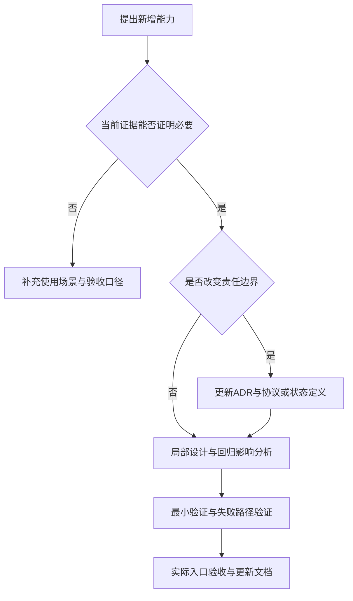

# 最终文档 / 开发借鉴文档

> **UDP 改造后的版本说明（2026-11-04）**：本文是此前独立 helper 架构的历史快照，文中的“当前/最终”指当时版本。现行软件已改为 Qt → 本地 UDP → Sysplorer 宿主插件，支持真实计算期间暂停/继续/停止及部分结果。现行实现与验收请参见[UDP正式接入开发记录](../UDP正式接入开发记录.md)和[UDP任务协议](../UDP任务协议.md)。原交付 ZIP 未重新打包，仍属历史快照。

| 元信息 | 内容 |
|---|---|
| 文档版本 | 1.0，交付稿 |
| 日期 | 2026-11-04，Asia/Shanghai |
| 读者 | 后续项目负责人、架构师、核心开发者 |
| 状态 | 当前方案与建议分开；正式审签待补充 |
| 关联文档 | [通信](01_数据通信文档.md)、[流程](02_开发流程文档.md)、[错误](03_错误总结文档.md)、[界面](04_界面开发文档.md)、[提示词评价](06_提示词评价与后续建议.md) |

## 目录

1. [背景与目标](#背景与目标)
2. [范围与非目标](#范围与非目标)
3. [术语表](#术语表)
4. [项目约束与总体思路](#项目约束与总体思路)
5. [架构决策记录](#架构决策记录)
6. [可复用模式与反模式](#可复用模式与反模式)
7. [质量与排障体系](#质量与排障体系)
8. [演进建议](#演进建议)
9. [产品表达与文档维护](#产品表达与文档维护)
10. [验收清单与交叉引用](#验收清单与交叉引用)

## 背景与目标

本项目的价值不只在于窗口能播放曲线，而在于形成了“可追溯输入—真实计算—验证结果—多处查看”的责任链。开发经历表明，局部验证成功不能证明整个用户路径成功；保留上一条有效结果也比失败时清空界面更符合分析工作。

本文提炼哪些选择值得迁移、付出了什么代价、未来什么条件下应重新选择。技术实现细节在前四篇已各有主责，本篇不重新复制。

## 范围与非目标

范围：目标与约束、架构取舍、可复用模式、验证原则、演进条件和文档索引。

非目标：字段表、完整功能表、控件教程、构建命令、错误案例全文。以下建议均不是已实现功能或已批准排期。

## 术语表

| 术语 | 含义 |
|---|---|
| ADR | 架构决策记录，保留上下文、备选、选择、代价和重评条件 |
| 责任边界 | 一个模块必须证明什么，以及不能替其他模块作什么结论 |
| 验证后提交 | 先核验新结果，成功后才替换当前有效结果的模式 |
| 反模式 | 在本次条件下造成歧义、缺陷或定位困难的做法，不宣称所有项目都禁止 |

## 项目约束与总体思路

约束包括：本机已安装 SDK/GUI 与许可；指定编译工具链；第三方进程与后台线程；实际桌面读取环境不同于终端；用户希望参数应用、计算、回放和原生查看职责明确；后续维护者包含初学者。

总体职责分为三层：**交互和回放、计算适配、原生查看适配**。交互层提供确定输入与连续显示；计算层对新结果负责；查看层只消费同一次计算的原生产物。通信拓扑参见文档 1，组件状态参见文档 4。

这种分法允许某个查看接口失败时仍使用已验证结果，也避免把“软件窗口已经打开”当作“参数已生效、模型已求解”的证明。

## 架构决策记录

| 决策 | 背景与备选 | 当前选择与依据 | 代价/限制 | 重评条件 |
|---|---|---|---|---|
| ADR-01 独立计算进程 | SDK 与客户端各自依赖 Qt、线程和生命周期；可选同进程或子进程 | 独立 C++ helper，隔离依赖与退出故障 | 有管道、文件及进程管理成本 | SDK 提供明确稳定的同进程集成契约且收益足够 |
| ADR-02 计算/查看分离 | 用户既要客户端回放也要 GUI 查看 | C++ 唯一计算，官方 Python API 只查看 | 多一个适配进程及独立错误状态 | 官方统一接口能同时满足隔离与查看需求 |
| ADR-03 资源模型 | 外部文件读取出现进程差异；可选文件交接、仅管道或打包资源 | 资源文本+完整性核对+公开文本加载，依据 ERR-06 | 改模型需重建；不能声称热更新 | 确有热更新需求，并建立授权/格式/环境验证方案 |
| ADR-04 上次结果缓存 | 重复参数不应反复编译/打开结果 | 单条成功结果按输入和模型匹配 | 重启清空；不保留多组历史缓存 | 用户确需跨参数历史比较或跨重启恢复 |
| ADR-05 验证后提交 | 新任务可能失败或产物不匹配 | 成功核验后替换，失败保留有效样本 | 需要同时保存编辑、请求和结果状态 | 未来任务并发时升级为显式任务/结果模型 |
| ADR-06 保存与计算分离 | 用户想先调整并看到初始状态 | 应用只校验保存/预览，仿真负责计算 | 显示必须标记待仿真，避免误读 | 有连续实时仿真需求且交互定义已重做 |
| ADR-07 异步 UI | 编译/求解耗时，不能冻结窗口 | QProcess、完成事件、单一在途请求 | 暂不支持队列和并发 | 明确的批处理需求及资源/许可并发预算 |
| ADR-08 原生查看幂等方向 | 重复打开提示影响体验 | 缓存不发请求；新任务按指定文件绘图 | 仍依赖第三方 GUI/API 行为 | 新 API 提供正式结果实例查询与复用契约 |
| ADR-09 真实入口验收 | 独立和离屏成功曾掩盖桌面失败 | 最终发布窗口按钮验收是独立一层 | 自动化成本更高，需保存环境证据 | 无法取消，只能改进可靠性和归档 |
| ADR-10 部署可核对 | 版本字符串不足以证明依赖一致 | 按字节复制、哈希核对，相同则跳过 | 仍不是安装器/许可分发方案 | 推广至多台机器时引入正式发布体系 |

这些记录总结本次可见取舍，不代表当时每项都先写过正式 ADR。完整开发阶段在文档 2，历史证据在文档 3。

## 可复用模式与反模式

| 可复用模式 | 为什么有用 | 应避免的反模式 | 参考 |
|---|---|---|---|
| 输入、已保存设置、请求快照、成功结果分离 | 编辑不会污染缓存或正在完成的任务 | 同一组变量既代表输入又代表结果 | UI 文档“状态与数据流” |
| 校验后更新有效结果 | 故障不会抹掉已完成分析 | 启动新任务即清空旧数据，或失败后伪造结果 | ERR-08 |
| 每次新计算独立产物目录 | 降低旧 DLL/旧结果混入风险 | 只按固定场景名读一个历史文件 | 通信文档、ERR-08 |
| 内容指纹贯穿输入和产物 | 可以追踪实际模型而不是路径文字 | 仅以文件名/版本字符串证明一致 | ERR-06、ERR-07 |
| 计算、退出、查看分别判定 | 明确故障属于哪一层 | 用一条“仿真失败”概括所有状态 | ERR-05、ERR-10 |
| 单个回放样本驱动多视图 | 避免图表、电池、标签各走各的时钟 | 每个显示组件独立更新进度 | UI 文档 |
| 验证入口与用户入口一致 | 能发现进程环境和交互差异 | 直接 API 成功就停止桌面排查 | ERR-12 |
| 官方公开接口优先 | 容易解释、维护和验证边界 | 私自解密、改变安全策略、忽略失败码 | ERR-06 |

哈希提升可追溯性，不替代可信发布；资源打包改善本次环境适配，不替代版本治理；局部禁用并发降低复杂度，不代表第三方不存在内部线程。

## 质量与排障体系

建议沿用三个不同问题：

1. **计算是否正确执行**：输入被回读、模型重新编译、求解完成、结果符合约束。
2. **产品是否按约定响应**：编辑/应用/仿真分开，缓存和暂停停止行为正确。
3. **用户是否在实际环境得到预期结果**：发布窗口、依赖、进程环境和原生查看均验证。

文档 2 的验证矩阵负责“怎么验收”；文档 3 的诊断树负责“失败后查哪里”；文档 1 的契约负责“期望收到什么”；文档 4 的状态说明负责“界面为什么这样显示”。四者组合比复制一份超长万能检查表更容易维护。

已确认闭环仍应保留未验证边界：全参数、长期稳定性、跨机器、正式再分发和实物标定。对外说明应描述证据范围，不把本机成功扩大为普遍保证。

## 演进建议

| 建议 | 何时值得做 | 需要先明确什么 |
|---|---|---|
| 明确 UI 状态枚举和任务对象 | 更多事件/恢复路径导致布尔组合难以维护时 | 状态转换与兼容行为，不只重命名字段 |
| 多结果/持久缓存 | 需要频繁对比多组历史或跨重启恢复时 | 缓存键、版本、失效、容量、文件校验和隐私 |
| 任务队列与取消计算 | 用户有批处理而非仅回放需求时 | SDK 取消契约、许可并发、资源上限、结果提交规则 |
| 模型更新管理 | 用户需要不重编客户端就更新模型时 | 来源、授权、格式、签名/校验、版本兼容与环境读取 |
| 更严格结果解析 | 对损坏输入/自动批处理可靠性要求提高时 | 坏行处理、事件重复时间、错误定位和兼容版本 |
| 正式安装/升级 | 计划交付其他机器时 | 依赖/许可再分发、目标机、签名、回滚、审批 |
| 模型标定与性能测量 | 要作工程决策或提出指标时 | 数据来源、误差定义、工况、机器和测量方法 |
| 诊断与生产构建分离 | 进入正式发布时 | 当前诊断选项的保留理由、运行差异及复测矩阵 |

优先级需结合业务影响和实际使用确认，本文不擅自承诺时间表或成功率。

## 产品表达与文档维护

产品表达遵循三条原则：说明什么是用户设置、什么是计算结果；分开计算、回放和查看；只承诺已验证范围。成套介绍话术只在文档 1，不在这里重写。

| 阅读者/任务 | 推荐顺序 |
|---|---|
| 用户/售前了解产品 | 1 的产品介绍 → 2 的相关功能/边界 |
| 新 UI 开发者 | 4 → 1 → 2 → 相关 ERR |
| 联调/维护 | 1 → 3 → 2 |
| 项目负责人/架构评审 | 2 → 5 → 相关协议/案例 |
| 改进 AI 协作方式 | 6 → 根据任务引用 1—5 |

功能变更先更新需求与验收，再更新唯一主责篇章；其他文档只调整引用。保留历史方案时标明适用版本/已废弃，不能让旧截图、旧注释和当前运行行为混为一谈。正式文档负责人和变更审批机制待补充。

## 验收清单与交叉引用

- [x] 决策包含依据、代价与重新评估条件，不只描述最终代码。
- [x] 模式/反模式有本项目来源，不把局部经验当绝对规则。
- [x] 建议与现有能力、建议优先级与承诺排期分开。
- [x] 没有复制协议表、完整功能表、故障全文、UI 教程或产品话术。
- [x] 给出按角色阅读索引和维护方式。
- [ ] ADR 正式负责人、生产发布与演进优先级需项目确认。

本篇主责为决策与借鉴。实际通信、开发流程、错误案例、UI 实现分别参见文档 1—4；需求如何表达和 AI 协作提示词参见《提示词评价与后续建议》。
