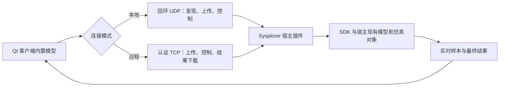

# 最终双模式版本合并记录

日期：2026-11-08。目标：以用户指定的 be10 目录最终代码为准，同步到当前主工作树，保留 Git 历史并提交推送。

## 来源和范围

- 来源：`C:/Users/TR/.codex/worktrees/be10/qt界面开发`，只读检查。
- 来源提交：`9e0bff4`，发布标识 `20261108-embedded-model-r5`。
- 目标：`C:/Users/TR/Documents/ChatGPT/qt界面开发`，分支 `main`。
- 远端：`origin`，`https://github.com/dfq-1104/Qt_with_Sysplorer.git`。
- 来源已跟踪文件与来源提交一致；额外同步两个未跟踪的启动诊断脚本。未同步未跟踪界面原型、运行包、SDK、私有绑定、凭据、日志和临时数据。

## 项目结构和最终设计

| 模块 | 最终职责 |
|---|---|
| `app/ui/src/main_window.*` | 三页签、连接设置、独立模型生命周期、仿真与回放控制 |
| `app/ui/src/sysplorer_runner.*` | 本地发现/启动、远程连接、模型上传、任务和结果核验 |
| `app/ui/src/runtime_environment.*` | 正式客户端运行环境处理 |
| `common/remote_link.*` | TCP 分帧、双向认证、消息完整性及序号 |
| `common/remote_server.*` | 宿主内 TCP 服务和配置状态 |
| `common/model_transfer.h`、`model_file.h` | 模型分块、重传、完整性及文本校验 |
| `tools/sysplorer_udp_plugin/` | 本地 UDP 与远程 TCP 业务调度、SDK 调用及真实计算 |
| `tools/deployment/` | 可移植客户端/服务器打包、配置、更新与诊断 |
| `model/BatterySim.mo`、客户端资源 | EXE 内置的固定电池接口模型 |

打开客户端不自动连接或启动宿主。两种模式均上传客户端资源中的模型文本；插件不再依赖内置模型与客户端一致，仍严格校验模型接口与完整性。远程失败不回退本地。远程使用认证与完整性保护，不等同 TLS 加密，跨不可信网络应使用受控 VPN。

详细使用以[可移植部署说明](可移植部署说明.md)、[模型上传协议](模型上传协议.md)和[TCP 远程协议](TCP远程任务协议.md)为准。来源历史两端实测见[内置模型交付报告](内置模型交付测试报告.md)，不记为本轮新实测。

## 合并策略

1. 当前主目录原有代码提交是来源的祖先，先快进到来源最终提交，产品代码保持与来源一致。
2. 远端 main 与本地历史没有共同祖先。采用保留当前代码树的历史合并，把远端历史接入本地，不强制推送、不以旧远端内容覆盖最终代码。
3. 更新并纳入项目级 `AGENTS.md`，纠正“仅本地 UDP、两端都内置模型”等旧约束。
4. 纳入来源的 `Check-Startup-BeforeConnect.cmd` 与 `Get-ClientLaunchContext.ps1`，保留诊断入口；不运行进程检查脚本采集用户数据。
5. 从跟踪索引移除 `.codex/environments/environment.toml`，本地文件保留；此项属于开发机配置，不作为产品交付。

## 本轮验证

所有构建、测试和打包输出留在当前工作树。未改来源、未安装服务器插件、未调整防火墙、未读取或更换服务器凭据。

| 项目 | 本轮结果 |
|---|---|
| 干净目录构建 | 客户端、插件、模型校验、模型传输、远程测试、启动夹具及原 UI 测试工程均编译成功 |
| 模型校验 | 17 passed，0 failed |
| 模型传输 | 15 passed，0 failed，3 个真实宿主用例跳过，不计通过 |
| TCP/界面模拟回归 | 最终 69 passed、1 failed、3 skipped；失败项为 closingClientSendsStop，详见下文，不标记整组通过 |
| 正式 EXE 启动 | 本地、远程空闲启动及忽略无效/不存在外部模型覆盖四项通过 |
| 两端 ZIP | 生成成功；清单、资源哈希、中文/空格解压路径及无私有绑定检查通过 |
| PowerShell | 脚本语法解析通过 |
| 产品源代码一致性 | `app`、`common`、`model`、正式插件代码与来源提交无差异 |

客户端构建 SHA-256：`C8FCCBE40F1A51B469D0C4D9C3FD43F578952335ABE7A4819ED4406D1FD027C1`。
插件构建 SHA-256：`8FC6EA19A154A129DEE4527222282681D7D390D0B0905041A6E4F0C06C6BDED4`。

本轮 ZIP 位于 `dist/merge-final-20261108/`，不提交 Git。完整构建位于 `build/merge-final-20261108/`，测试记录位于 `logs/merge-final-20261108/`，包验证记录位于 `logs/portable/`。这些路径为本轮本机产物，不保证克隆仓库后存在。

首次构建因执行环境无法运行 cl 失败，在允许工具链运行的环境中重新构建成功，未修改产品代码绕过。首次连接回归返回非零且报告被占用，原文件保留。

随后可读报告记录 69 passed、1 failed、3 skipped，失败为 unconfiguredLocalDoesNotUseSystemInstallation：测试继承用户级宿主收据，而防误连的测试 INI 又设置了不存在的宿主，均不满足“完全未配置”前提。仅修改本轮构建目录中的测试 INI，并将 BATTERY_LOCAL_CONFIG 指向本树空收据后，该项在最终整组中通过，未修改源代码或用户配置。

最终报告为 `logs/merge-final-20261108/final/remote-final.txt`，69 passed、1 failed、3 skipped。唯一失败为 closingClientSendsStop：窗口关闭后模拟宿主仍为 Running，未在测试等待期内变成 Stopped。此项对应来源交付报告已记录的关闭窗口停止时序不稳定边界；本轮保留最终来源代码，不把失败改称通过，也不声称已定位或修复底层根因。测试计数包含数据行、初始化及清理，不等于独立业务数量。

验证结论：来源产品代码同步、全部目标编译、模型及打包检查通过；模拟回归存在上述已知失败，实际两机本轮未重验。提交该版本不等于零缺陷验收。

## 边界

本轮尚未重新执行实际两机 Sysplorer 求解及用户普通双击完整操作。协议夹具和打包自检不替代这些实机验收。来源已记录远程认证偶发超时及关闭客户端停止时序边界，仍需先停止并等终态后退出，不因合并而视为修复。

不承诺跨版本、全参数、长期运行或不可信网络的完整验收。构建哈希与来源历史二进制可能因重建而不同，不能把来源 EXE 哈希当作本轮产物哈希。
