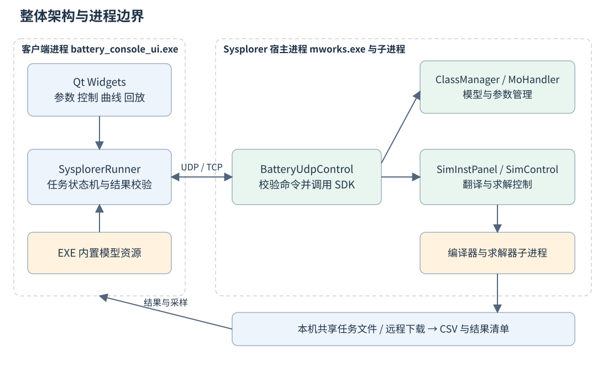
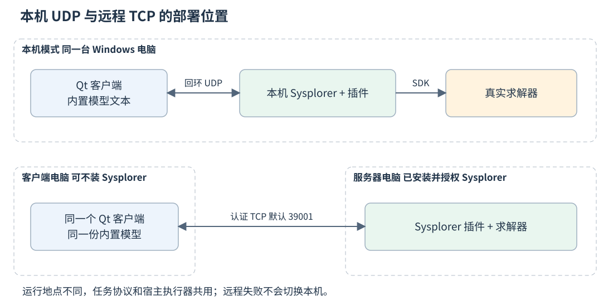
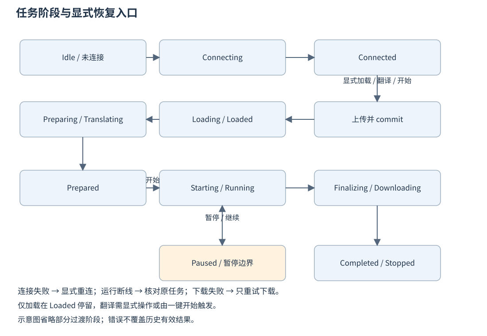
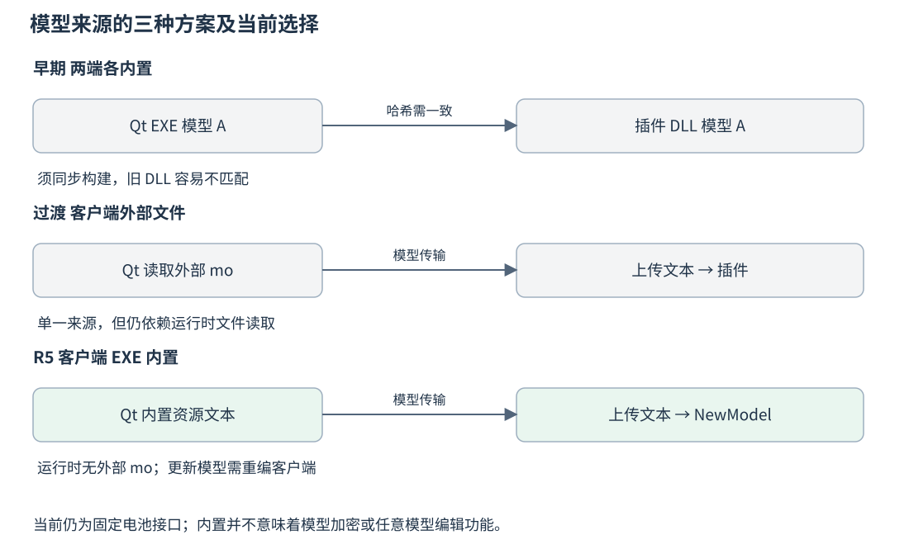
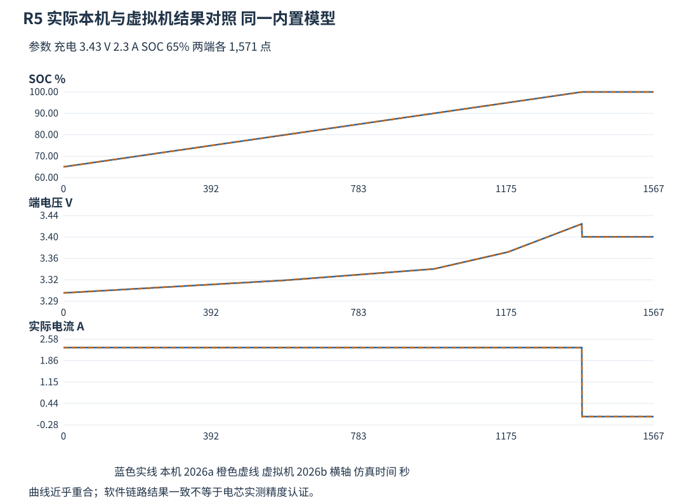

# 电池仿真操作台项目总览

本文以 **20261108-embedded-model-r5** 为基线，解释项目解决什么问题、各部分为什么这样划分，以及目前实际做到了什么。面向首次接触项目的使用者、开发者和部署人员。建议先读本文，再读《Qt 客户端设计与开发详解》和《Sysplorer 调用与部署详解》。

本项目将操作界面与数值求解分开：Qt 提供参数输入、任务控制、曲线和回放；Sysplorer 内的插件接收指令，调用宿主 SDK 加载、翻译和求解 Modelica 模型。**当前模型的发布来源只有客户端 EXE：客户端内置模型文本，本机通过 UDP、远程通过认证 TCP 上传；插件不维护另一份内置模型。**

## 一 项目解决的问题

直接使用 Sysplorer 可以编辑、翻译和计算 Modelica 模型，但固定业务流程需要用户反复选择模型、填写参数、寻找结果变量。项目把单体电池充放电的操作收敛到一个界面，同时允许计算发生在本机或另一台已安装并授权 Sysplorer 的电脑上。

本机和远程是同一套业务流程的两种通信方式。远程模式改变求解发生的位置，并不要求用户换用另一套 Qt 界面，也不让客户端自行代替求解器计算。正常启动 Qt 仅显示界面和读取用户配置，连接、模型加载与求解均由后续显式操作触发。

| 使用场景 | 客户端电脑 | 计算电脑 | 用户需要配置什么 |
| --- | --- | --- | --- |
| 本机计算 | Qt 和 Sysplorer 在同一台电脑 | 当前电脑 | 选择本机，首次准备插件和宿主安装位置 |
| 远程计算 | 只需运行 Qt 客户端 | 另一台已授权的 Sysplorer 电脑 | 服务器 IPv4、TCP 端口、服务器原访问凭据 |
| 结果回放 | 读取已经核验的结果样本 | 不重新调用求解器 | 选择完整或部分结果，设置回放倍速 |

## 二 从一张图理解整体架构



图中最重要的边界是进程边界。`battery_console_ui.exe` 通过网络消息控制 `mworks.exe` 内的 `BatteryUdpControl` 插件；Qt 客户端不直接跨进程调用 `MwSimControl`。SDK 的对象指针属于宿主进程，不能把它们当作可在另一台电脑使用的句柄。

Sysplorer 还可能启动编译器、求解器等子进程，因此这里的“两端”不是“整个系统永远只有两个进程”。插件 DLL 也不是独立运行的服务器 EXE：只有目标 Sysplorer 启动并成功加载插件，监听和模型处理逻辑才会运行。

| 层次 | 主要组成 | 负责的事情 | 不承担的事情 |
| --- | --- | --- | --- |
| 界面层 | MainWindow、BatteryView、PlotWidget | 输入、按钮编排、状态和曲线展示 | 不做正式 Modelica 数值求解 |
| 客户端任务层 | SysplorerRunner | 发现宿主、连接、上传、控制、校验、下载 | 不拥有宿主 SDK 对象 |
| 通信与契约层 | RemoteLink、RemoteServer、ModelTransfer | 帧、认证、上传、完整性与接口约束 | 不决定电池物理方程 |
| 宿主适配层 | BatteryUdpControl | 绑定宿主对象、模型管理、翻译、求解和采样 | 不预置第二份业务模型文本 |
| 模型层 | BatterySim.SingleRun、BatteryCell | 电流、端电压和 SOC 等状态的计算 | 不负责 UI、认证或文件下载 |
| 结果层 | CSV、JSON 清单、ReplayData、ReplayPlayer | 核验、展示和播放有效结果 | 回放不等于再次求解 |

## 三 为什么选择 Qt 界面加宿主内插件

Qt Widgets 适合当前 Windows 桌面操作台：表单、按钮、页签和自绘电池都可以在 C++ 内组织。项目使用 Qt Core、Gui、Widgets、Network；曲线通过 QPainter 绘制，没有在当前 UI 工程中引入 Qt Charts。当前界面由 C++ 直接构建，没有依赖一组 `.ui` 设计器文件。

宿主内插件可以使用 Sysplorer 已初始化的模型管理器、仿真面板、控制器和结果对象。若把这些 SDK 调用移到独立 Qt 进程，进程内对象的初始化、所有权和 ABI 问题仍然存在，不能靠包含头文件就得到可用的仿真引擎。当前正式链路通过插件接入真实宿主，没有常驻 Python 桥接服务，也没有自动切换到 Qt 内部的简化求解器。

仓库里保留了早期探针、SDK 验证和 `battery_simulator.*` 等代码。判断正式逻辑应查看 `app/ui/ui.pro` 的编译清单：当前 UI 工程没有把 `battery_simulator.cpp` 编入正式客户端。历史文件的存在不代表它会在远程失败时接替计算。

## 四 两种通信方式如何配合



本机 UDP 只绑定 `127.0.0.1`。插件选取动态 UDP 端口，并在当前 Windows 用户的 LocalAppData 发现目录写入记录。客户端核验 PID、宿主 EXE、协议和会话后发送命令。用户通常不需要手工填写这个动态端口。

远程 TCP 使用明确的服务器地址和端口，默认端口为 `39001`。客户端连接服务器上的插件，经过挑战响应认证后发送同一套任务命令。它不读取远端的 UDP 发现文件，也不要求把共享目录映射成客户端盘符。

| 比较项 | 本机 UDP | 远程 TCP |
| --- | --- | --- |
| 网络范围 | 仅本机回环 | 客户端到指定服务器 |
| 端口来源 | 插件动态绑定，发现记录提供 | 服务器配置，默认 39001 |
| 身份与会话 | 本机发现令牌、session、任务 owner | 共享凭据双向证明、签名帧、session、任务 owner |
| 请求可靠性 | 请求 ID、逐条确认、有限重传、去重 | TCP 字节流加应用确认、请求 ID 和去重 |
| 模型块大小上限 | 768 字节原始模型数据 | 48 KiB 原始模型数据 |
| 结果交接 | 同机任务文件 | 分块下载到客户端后核验 |
| 连接失败 | 明确失败，允许用户重试 | 明确失败，始终保留远程模式 |

保留 UDP 的原因是沿用已经建立的本机发现和控制路径；这不是“UDP 天然比 TCP 更适合仿真”的性能结论。UDP 需要显式处理丢包、重复和乱序。TCP 提供有序字节流，但仍需处理消息边界、权限、任务归属和应用重试。两者最终进入插件同一个命令执行器，避免维护两套求解逻辑。

## 五 一次仿真从点击到结果



1. 用户双击启动脚本。Qt 读取设置并校验内置资源，界面保持未连接状态。
2. 用户连接，或在本机点击加载、翻译、开始。客户端发现或按需启动本机宿主；远程只访问指定地址。
3. `hello` 查询生命周期能力、上传版本、固定模型接口和引擎就绪状态。连接成功并不表示模型已经加载或求解完成。
4. 客户端取得本次内置文本快照，计算 SHA-256，通过 `model.begin → model.chunk → model.commit` 上传。
5. 插件验证文本，检查宿主中是否存在冲突的同名模型，使用 SDK 从文本建立或复用模型类。
6. 仅加载入口到此返回；翻译入口继续写入起始参数、逐项回读，然后请求异步翻译。
7. 翻译完成进入 Prepared。只有显式开始，或一键开始流程的自动衔接，才调用真实求解器。
8. 运行期间插件采样，客户端按游标获取增量数据。暂停、继续和调参属于当前任务的控制操作。
9. 结束后插件核验并导出 CSV 与结果清单；远程客户端先下载，再核验文件与任务。
10. 通过校验的结果进入显示与回放；失败不覆盖此前的有效结果。

这个拆分解决了“加载”“翻译”“开始”混在一起、按钮成功但实际上还没有求解的问题。它也让错误能够定位到连接、上传、解析、写参、翻译、启动或结果处理，而不再把所有故障包装成“未能打开 Sysplorer”。

## 六 模型发布为什么最终采用客户端内置



项目经历过三种模型来源方案。早期两端各持一份时，Qt EXE 与插件 DLL 必须同步构建，旧插件容易产生能力和模型版本不匹配。随后改为客户端携带外部 `.mo` 并上传，解决了两端重复维护的问题，但普通用户进程在受管理的电脑上读取该外部文件时，出现与测试进程不同的文件表示。

R5 将项目模型通过 `.qrc` 编入 Qt EXE。运行时的 `:/models/BatterySim.mo` 是 Qt 资源地址，不是磁盘路径。正式 EXE 不接受 `BATTERY_MODEL_FILE` 覆盖，也不回退读取旁边的外部 `.mo`。插件接收本次上传的文本，以其哈希关联任务和结果，不要求 DLL 内置同一份文本。

这样获得了单一发布来源和较清楚的版本关系，代价是更新模型通常要重新构建并发布客户端。模型接口没有因此变成任意可编辑接口；当前仍只支持 `BatterySim.SingleRun` 及固定参数、输入和输出。内置也不等于模型加密或防提取。

Qt 资源系统的一般机制可参考 [Qt 官方资源文件说明](https://doc.qt.io/qtcreator/creator-how-to-create-resource-files.html)；本项目的具体嵌入关系以 `models.qrc` 和 `ui.pro` 为准，工程使用 Qt 5.14.2。

## 七 电池模型计算什么

当前 `BatteryCell` 使用 Rint 等效模型：开路电压 `OCV(SOC)` 与欧姆内阻 R0 形成端电压关系。电流符号约定为充电正、放电负。核心关系为：

```text
V_term = OCV(SOC) + I_act × R0
der(SOC) = eta × I_act / Q_rated
Q_rated = 2.5 × 3600 C
```

容量在模型中使用库仑，不能在积分公式里再额外除一次 3600。OCV 由 SOC 表线性插值得到；恒流模式按方向生成电流指令，恒压模式根据电压差和内阻生成指令，再受最大电流、SOC 和截止电压保护限制。SingleRun 将 UI 起始参数与运行期输入映射到 BatteryCell。

系统跑通与模型物理精度是两件事。当前 OCV 表是工程示意值，模型没有温度、老化和 RC 极化支路，不能把本轮软件验收解释为实测电芯精度认证。实际可调接口和模型限制在第三份文档展开。

## 八 结果为什么还要做双重校验

插件先检查结果变量、时间范围、初始 SOC、电流方向及数值有限性，再写 `result.csv` 和 `result.json`。客户端还要核对 taskId、模型哈希、参数、点数、CSV 哈希及数据范围。文件存在、网络收到数据、宿主报告停止，任何一个单独条件都不足以证明“这是本次完整成功结果”。

主动停止产生 `complete=false` 的部分结果，只保留真实已产生的时间范围。部分结果可以回放，但不能冒充完整求解成功。远程下载失败也不等于求解失败：系统保留 DownloadFailed 和重新下载入口，避免重复启动服务器计算。



图中曲线由 R5 实际两端 CSV 生成。两端参数均为充电、3.43 V、2.3 A、起始 SOC 65%，各 1,571 个采样点。微小数值差异符合本次比较阈值；图中的重合不能证明模型物理精度，只说明这次同模型、同参数的软件链路结果一致。

接近保护条件后，实际电流归零，端电压中的欧姆项 `I_act × R0` 随之消失，因此图中电压出现回落。这与当前 Rint 方程和保护判据一致，不能直接当成通信丢点；它也不是已经建立了真实电芯极化恢复模型的证明。

## 九 当前验证结果及证据范围

| 检查 | R5 结果 | 证据位置 |
| --- | --- | --- |
| 模型字节校验和内置资源 | 17 通过 | build/embedded-model-20261108-r5/validation-tests.txt |
| 模型传输回归 | 15 通过，3 个实机用例跳过 | 同目录 transfer-ascii-tests.txt |
| 连接及布局回归 | 70 通过，3 个实机用例跳过 | 同目录 remote-native-tests.txt |
| 正式 EXE 启动行为 | 4 项通过，无效外部路径不影响内置模型 | 同目录 startup-tests.txt |
| 普通双击本机 2026a | 加载、翻译、完整求解、回放通过 | logs/embedded-model-r5/ordinary-local/ |
| 实际虚拟机 2026b | 正式 EXE 认证、上传、求解、下载和校验通过 | logs/embedded-model-r5/product-remote-retry/ |
| 中文和空格路径 ZIP | 解压、清单、内置资源和启动通过 | 同构建目录 final-package-tests-retry.txt |

QtTest 数字包含 init 和 cleanup；跳过用例不计为通过。远程实测由工具调用正式 EXE 的显式诊断入口完成，没有在 R5 用户普通双击路径重新验收远程回放与调参。服务器恢复 READY 后还记录过一次 Qt 连接或认证超时，显式重试后成功，根因尚未确定。关闭窗口时停止任务也仍有时序边界，日常应先停止并等待终态再退出。

## 十 源码目录与阅读路线

| 路径 | 阅读目的 |
| --- | --- |
| app/ui/src/main.cpp | 启动、自检和显式诊断入口 |
| app/ui/src/main_window.cpp | 按钮如何串起任务，如何保护历史结果 |
| app/ui/src/sysplorer_runner.cpp | 任务状态、两种传输和结果校验 |
| common/model_file.h、model_transfer.h | 模型来源、严格字节校验和上传事务 |
| common/remote_link.cpp、remote_server.cpp | TCP 认证、帧和监听 |
| tools/sysplorer_udp_plugin/control_plugin.cpp | 真实 SDK 调用与宿主控制 |
| model/BatterySim.mo | 物理方程和固定业务接口 |
| tools/deployment/ | 首次配置、更新、检查与打包 |

接下来阅读 [Qt 客户端设计与开发详解](02_Qt客户端详解.md)，可以从一个按钮追踪到发出的消息；阅读 [Sysplorer 调用与部署详解](03_Sysplorer调用与部署详解.md)，可以继续追踪到宿主对象、模型和求解器。部署时以同目录之外的 `docs/可移植部署说明.md` 和 R5 交付包说明为准；历史探针和私有环境脚本不作为普通电脑的一键部署入口。

本文不运行仿真、不修改安装或保护策略。源码位置和行号依据 2026-11-08 当前工作树，后续代码变更时应重新生成图文文档。
