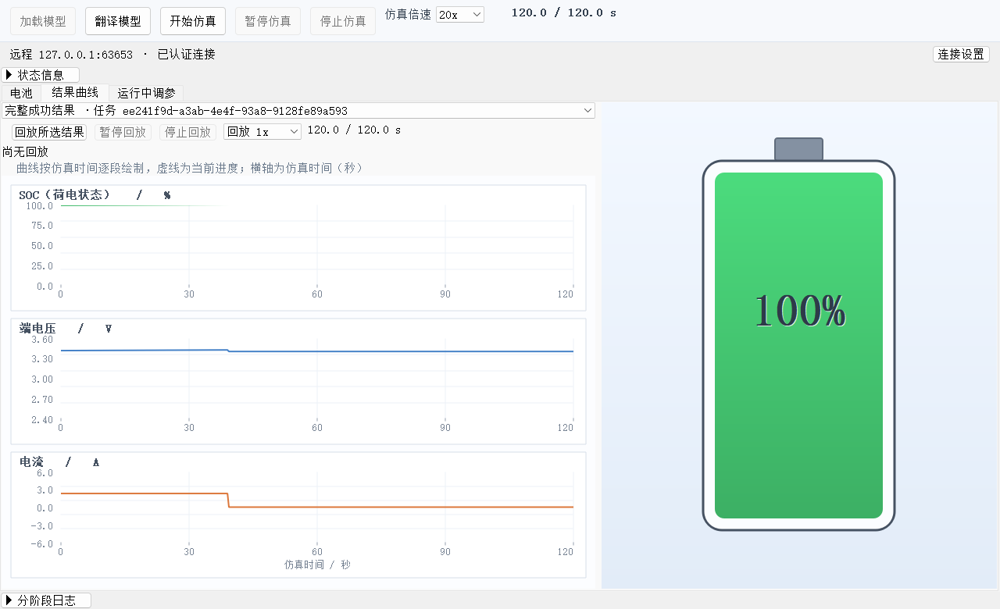
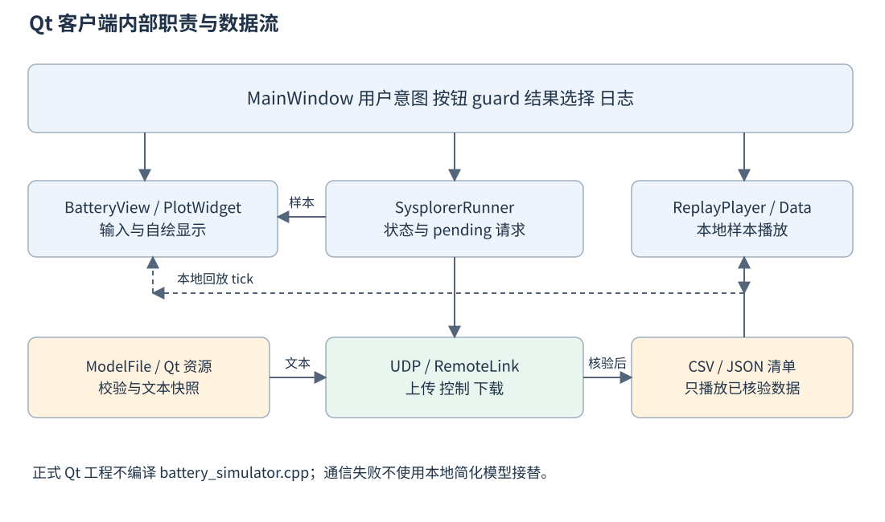
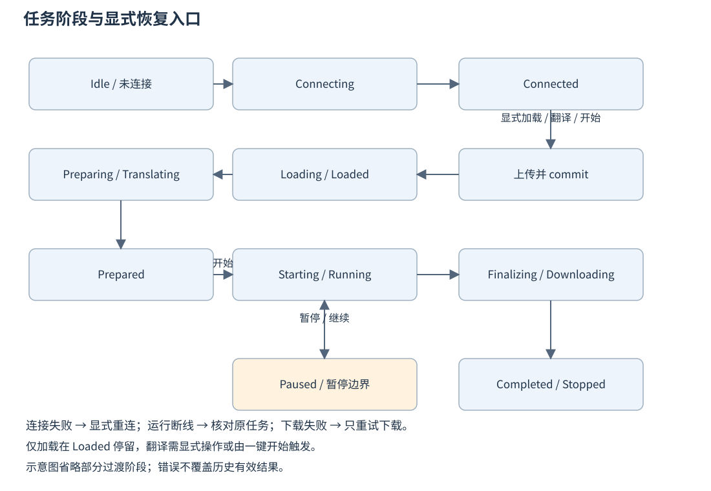
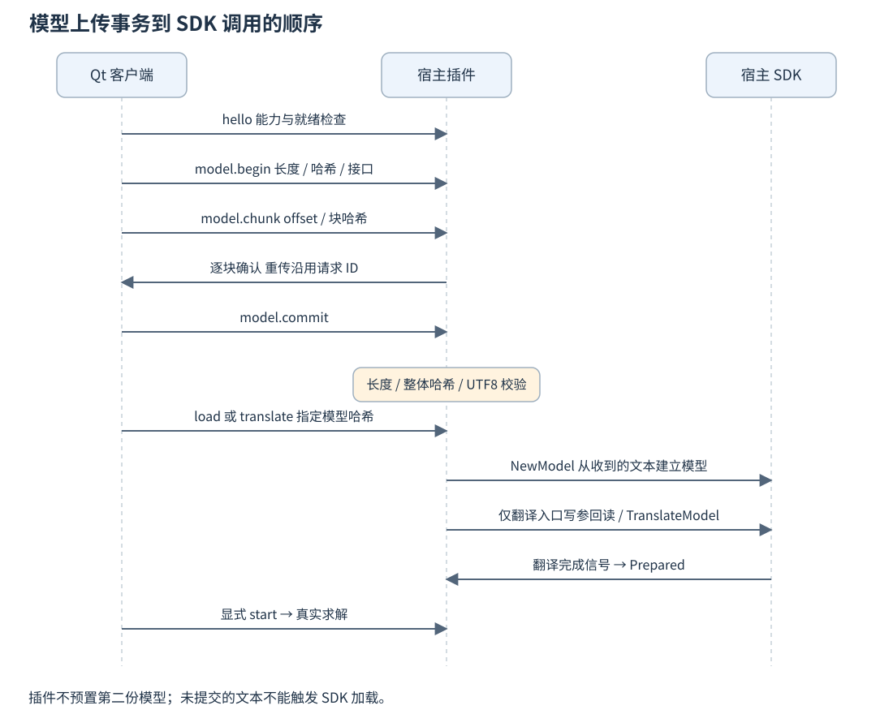
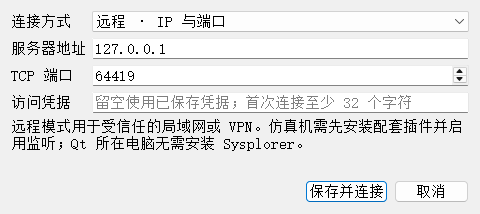

# Qt 客户端设计与开发详解

本文从界面、类之间的协作和关键函数三个层次解释 R5 Qt 客户端。重点是一个业务操作怎样被转换成可靠的模型上传和仿真任务，以及开发测试中曾经出现的问题如何被定位。源码片段来自当前工作树，不是重新设计的伪实现；少量示例消息使用占位符，不含实际访问凭据。

## 一 界面的四个工作区域


这张图来自 R5 实际 ZIP 的启动检查，展示启动后未连接、未启动宿主的界面。上方是加载、翻译、开始、暂停、停止和仿真倍速；其下是连接状态和连接设置；中间为电池、结果曲线、运行中调参三个页签；底部收纳分阶段日志。错误在独立的可见区域显示，详细状态可以展开。

| 区域或控件 | 作用 | 需要区分的含义 |
| --- | --- | --- |
| 保存参数 | 保存客户端设置并更新预览 | 不立即写入宿主，不启动仿真 |
| 加载模型 | 上传并确认目标模型能加载 | 不写起始参数、不翻译、不求解 |
| 翻译模型 | 必要时加载，写参回读，再异步翻译 | 成功后处于 Prepared，等待开始 |
| 开始仿真 | 复用有效翻译实例，或补齐准备步骤 | 不只是播放已有 CSV |
| 仿真倍速 | 修改宿主的实时仿真 slowdown 配置 | 不修改电池物理方程 |
| 回放倍速 | 修改客户端已有数据的播放步长 | 不控制服务器求解器 |

`ControlFlowLayout` 处理顶部按钮换行，`QVBoxLayout` 组织主窗口。电池页的左侧为 QFormLayout，右侧由 QPainter 绘制电池。结果页使用自绘 PlotWidget 展示 SOC、端电压、电流三幅图，避免引入另一套图表运行依赖。



这张结果页截图来自历史回环 TCP 实机测试，用于解释布局和显示来源；图中 `127.0.0.1` 与动态端口不是当前虚拟机部署地址，也不是 R5 实机验收证据。R5 实际两端 CSV 对照见总览文档。

## 二 客户端架构与职责边界



MainWindow 负责用户意图和界面状态，SysplorerRunner 负责一个任务如何推进。两者通过 signals 和 slots 协作，避免在按钮函数里直接堆放 socket、SDK 和结果读取代码。SysplorerRunner 这个名字不表示它内置数值求解器；它运行的是任务控制流程。

| 类或文件 | 输入 | 输出和职责 |
| --- | --- | --- |
| MainWindow | 用户操作、runner 信号 | 按钮编排、结果选择、日志、输入快照 |
| BatteryView | 用户参数、实时或回放样本 | 参数读取、输入预览、自绘电池 |
| PlotWidget | 样本、进度、绘制范围 | 三条物理量曲线与进度线 |
| SysplorerRunner | 参数和控制意图 | 状态机、通信、上传、下载、校验 |
| ModelFile | 固定 Qt 资源地址 | 原始模型字节、哈希和诊断 |
| RemoteLink | QTcpSocket 和共享凭据 | 认证完成的消息通道 |
| ReplayData | CSV 或已核验样本 | 数据容器、按时间插值 |
| ReplayPlayer | 已加载数据、播放命令 | 定时 tick，不产生求解指令 |

## 三 启动为什么不立即连接

`main.cpp` 创建 QApplication 后，处理 `--check-model` 等显式诊断入口，再建立主窗口。正式启动脚本使用包内相对路径、清理继承的开发环境绑定，并传入 `--startup-model-check`。模型检查发生在将要显示界面的 Qt 进程中，不委托 PowerShell 代读模型。

正常 MainWindow 构造只建立对象和信号连接、读取用户设置、构建布局。连接发生在“保存并连接”或本机四个按需入口触发之后。仅远程使用者无需安装本机 Sysplorer，因此启动 Qt 时也不能把缺少本机安装当作程序无法启动的理由。

测试开关如 `--verify-custom` 会显式调用连接和按钮流程，这是诊断行为。不能用诊断开关的自动连接现象描述正常启动行为，也不能把工具进程测试替代用户双击路径验收。

## 四 模型资源接口及关键代码

构建关系从 `app/ui/models.qrc` 开始。qmake 将资源交给 rcc 生成编译内容，最终与 Qt EXE 链接。项目源文件 `model/BatterySim.mo` 仍存在于开发仓库，但正式包不提供外部模型文件，运行时不从这个开发路径读取文本。

源码定位：`app/ui/models.qrc` 第 1—5 行。行首数字是文档添加的定位号。

```xml
   1  <RCC>
   2    <qresource prefix="/models">
   3      <file alias="BatterySim.mo">../../model/BatterySim.mo</file>
   4    </qresource>
   5  </RCC>
```

`alias` 决定资源文件名，`prefix` 决定资源目录。因此运行时地址为 `:/models/BatterySim.mo`。前面的冒号是资源系统标识，不能把它当作需要在 C 盘创建的文件夹。一般机制参考 [Qt 官方资源说明](https://doc.qt.io/qtcreator/creator-how-to-create-resource-files.html)。

源码定位：`common/model_file.h` 第 20—29 行。行首数字是文档添加的定位号。

```cpp
  20  inline QString embeddedPath(){return QStringLiteral(":/models/BatterySim.mo");}
  21  inline QString defaultPath(){
  22  #ifdef BATTERY_MODEL_TEST_OVERRIDES
  23      // Fixture-only override. This macro is never enabled in the client build.
  24      return qEnvironmentVariable("BATTERY_MODEL_FILE",embeddedPath());
  25  #else
  26      return embeddedPath();
  27  #endif
  28  }
  29  struct ReadResult {QByteArray bytes;QString error,diagnostic;QJsonObject record;bool ok=false;};
```

正式构建总是返回 embeddedPath；`BATTERY_MODEL_TEST_OVERRIDES` 只在特定测试工程定义，用于向上传链路注入非法或变化的模型。它不是交付客户端的隐藏模型编辑入口。R5 正式 EXE 已验证：设置一个无效或不存在的外部路径，仍读取同一内置模型。

源码定位：`app/ui/src/sysplorer_runner.cpp` 第 157—174 行。行首数字是文档添加的定位号。

```cpp
 157  QString SysplorerRunner::modelFingerprint() const {
 158      QFile f(ModelFile::defaultPath());
 159      if(!f.open(QIODevice::ReadOnly)||f.size()>ModelTransfer::Limit)return {};return hash(f.readAll());
 160  }
 161  bool SysplorerRunner::readModelSnapshot(){
 162      const auto base=qEnvironmentVariable("BATTERY_MODEL_DIAGNOSTICS",qEnvironmentVariable("BATTERY_SIM_WORKSPACE",QDir::tempPath()+"/BatteryConsoleUDP")+"/diagnostics");
 163      const auto result=ModelFile::read(ModelFile::defaultPath(),base);
 164      trace("model_read",result.record);
 165      if(!result.ok){const auto error=result.error;QTimer::singleShot(0,this,[this,error]{fail(error);});return false;}
 166      m_modelSnapshot=result.bytes;
 167      m_modelHash=hash(m_modelSnapshot);m_uploadId=uid();m_uploadOffset=0;m_uploadChunk=m_remote?ModelTransfer::TcpChunk:ModelTransfer::UdpChunk;return true;
 168  }
 169  void SysplorerRunner::nextModelChunk(){
 170      if(m_uploadOffset==m_modelSnapshot.size()){send("model.commit",{{"uploadId",m_uploadId}});return;}
 171      const auto bytes=m_modelSnapshot.mid(m_uploadOffset,m_uploadChunk);
 172      send("model.chunk",{{"uploadId",m_uploadId},{"offset",m_uploadOffset},{"data",QString::fromLatin1(bytes.toBase64())},{"sha256",hash(bytes)}});
 173  }
 174  void SysplorerRunner::sendPreparation(){
```

这里需要分清四件事：`modelFingerprint()` 是当前模型的身份；`readModelSnapshot()` 固定本次准备使用的字节；`m_uploadOffset` 表示上传进度；`sendPreparation()` 才发出加载或翻译任务。读到字节后立即严格校验并记录诊断，失败通过事件循环发出，不继续发送后续命令。

ModelFile 诊断记录资源地址、进程、发布标识、字节数、SHA-256、错误位置等，不记录模型全文或访问密钥。ModelTransfer 的 UTF-8 检查直接验证字节，拒绝 NUL、UTF-16、截断、非法延续字节、过长编码及非法码点；随后检查固定命名接口。真正的 Modelica 语法解析仍由宿主 SDK 完成，正则命名检查不能替代编译器。

## 五 从按钮追踪到任务

### 加载入口

MainWindow 的加载按钮调用 `SysplorerRunner::loadModel()`，由 loadOnly 标志复用任务准备基础设施。客户端仍需握手和上传，插件确认模型加载后返回 Loaded，客户端停止本次准备等待。加载成功不改变起始参数，也没有启动求解器。

### 翻译入口

`onPrepare()` 重新读取当前输入，先处理已有 Prepared 实例。相同参数可继续复用；参数变化则先 discard，再开始新准备。UI 不要求用户先点击“保存参数”，因为翻译和开始入口都会读取当时的输入。

### 开始入口

源码定位：`app/ui/src/main_window.cpp` 第 565—575 行。行首数字是文档添加的定位号。

```cpp
 565  void MainWindow::onPlay(){
 566      if(m_runner->isConnecting()||m_runner->controlPending()||m_player->isPlaying()||m_startAfterPreparation)return;
 567      if(m_runner->isPrepared()&&inputsMatchPreparation()){
 568          appendStageLog(QString::fromUtf8("仿真"),QString::fromUtf8("开始入口复用有效翻译实例，提交启动请求。"));
 569          m_runner->beginSimulation();refreshButtons();return;
 570      }
 571      if(m_runner->isRunning()&&!m_runner->isPrepared())return;
 572      m_startAfterPreparation=true;
 573      appendStageLog(QString::fromUtf8("仿真"),QString::fromUtf8("开始入口自动准备：加载/复用模型 → 写参回读 → 翻译 → 启动；任一步失败即终止。"));
 574      onPrepare();refreshButtons();
 575  }
```

第一层 guard 阻止连接中、控制命令未确认、回放中及已排队开始时重复提交。若已有有效 Prepared 且参数和模型指纹一致，直接开始；否则设置 `m_startAfterPreparation`，走同一准备流程，待 Prepared 信号再衔接开始。这样实现包含关系，而不是维护两套相似但不一致的加载逻辑。

### 时长估计和参数快照

`startSysplorerRun()` 保存 voltage、current、mode、soc0，切换显示到实时任务，并计算保护性的请求终点。当前代码的估计使用 `delta × 9000 / max(current, 0.05) × 1.1 + 60`，限制在 120 到 20000 秒，零电流使用 120 秒。9000 是 2.5 Ah 对应库仑数；额外比例和余量用于给到达保护状态留出时间，不能理解为精确电芯充满预测。

准备快照也用于结果核验和复用判断。相同数值的重复保存不应使准备实例失效；不同参数则不能偷用旧编译配置。模型在 R5 进程内固定，保留的模型指纹比较仍用于统一任务和结果身份。

## 六 状态机如何驱动界面



| 状态组 | 常见阶段 | 界面的处理重点 |
| --- | --- | --- |
| 连接 | Idle、Connecting、Connected、ConnectionFailed | 连接状态和任务状态分别解释，失败可显式重试 |
| 准备 | Loading、Loaded、Preparing、Translating、Prepared | 防止重复开始，翻译成功后才能求解 |
| 运行 | Starting、Running、Pausing、Paused、Resuming、Stopping | 控制按钮等待确认，不把请求发送当作完成 |
| 结果 | Finalizing、Downloading、Completed、Stopped | 下载后核验，区分完整与部分结果 |
| 异常 | Failed、ConnectionLost、DownloadFailed | 保留旧结果，按失败阶段恢复 |

runner 用 50 ms QTimer 推进泵函数；这只是客户端轮询和状态推进频率，不代表求解器每 50 ms 进行一次物理积分。事件循环处理 socket 和异步 SDK 状态，UI 不用同步等待整个仿真完成。

阅读代码时还要注意：当前 `isRunning()` 返回的是 m_busy，表示任务流程被占用，不只指物理求解阶段 Running。Prepared 或下载期间也可能处于 busy；需要精确判断求解状态时，应同时看 phase 和控制请求状态，而不是只看这个函数名。

`refreshButtons()` 综合 ready、busy、pending、prepared、replayActive 等条件决定可操作性。单看按钮灰色不能判断“程序卡死”，应查看连接状态、任务阶段及控制请求是否尚未确认。

## 七 模型上传怎样做到可靠



| 命令 | 关键参数 | 为什么需要它 |
| --- | --- | --- |
| model.begin | uploadId、bytes、sha256、chunkSize、接口版本 | 先声明一个受约束的完整文本事务 |
| model.chunk | uploadId、offset、Base64 data、块哈希 | 验证定位、长度、重复数据和损坏 |
| model.commit | uploadId | 缺块或整体哈希错误时禁止交给 SDK |
| model.abort | uploadId | 协议提供取消入口；不能据此声称 UI 对每个异常都必发 abort |

原始文本最多 1 MiB。UDP 每块最多 768 字节，TCP 每块最多 48 KiB。Base64 后的报文会更大，所以块大小不是整个 UDP JSON 包的字节数。当前 14,000 字节模型在 UDP 下需要 19 块，在 TCP 下通常为 1 块；元数据和 commit 另计。

客户端每次只保留一个待确认请求，收到块确认后才增加 offset。重发保留原请求 ID 和原字节。插件允许块乱序到达并校验重复块一致性，commit 才重组；每个 client 保存一份上传，最多八个 client，空闲 60 秒清理。上传缓存容量不代表宿主支持八个并发求解任务。

当前实现准备新任务时通常仍发送上传事务。可复用的主要是宿主中的模型类，以及参数和指纹未变的 Prepared 实例；不能把协议具有缓存能力理解成客户端每次都能跳过模型传输。

本机任务请求等待超过 1.5 秒会重传，最多 6 次尝试；单纯连接查询有单独的 3 秒发现重试处理。远程请求等待超过 10 秒最多尝试 3 次，连接或认证本身也有约 10 秒超时。不要把这些不同阶段合并成一个“统一重试次数”。

## 八 外部接口和消息字段

SysplorerRunner 暴露的接口分成四组：`configureConnection/connectHost` 配置通信；`loadModel/prepareSimulation/beginSimulation` 准备与开始；`pause/resume/stop/setSpeed/tune` 控制任务；`reconnectRemote/retryDownload/abandonRemoteTask` 恢复跟踪。重要信号为 stateChanged、samplesArrived、finished、stopped、tuneApplied、hostConnectionFailed。

一个任务请求的业务包络如下，实际 UUID、令牌和哈希应由程序生成，文中占位符不能作为可直接执行的请求：

```json
{"schema":1,"id":"<请求UUID>","session":"<宿主会话>",
 "client":"<客户端UUID>","taskId":"<任务UUID>",
 "command":"translate","args":{"modelHash":"<本次文本SHA256>"}}
```

| 字段 | 生命周期 | 防止什么问题 |
| --- | --- | --- |
| id | 一次请求及它的重传 | 重复执行 start、tune 等副作用 |
| session | 一次宿主插件会话 | 把旧宿主的命令误用于重启后的实例 |
| client | 一个客户端实例 | 区分任务归属，不等于 Windows 账户 |
| taskId | 一次加载或仿真任务 | 混入上一任务的状态和结果 |
| uploadId | 一次模型上传事务 | 混合不同文本的分块 |
| modelHash | 本次模型原始字节 | 模型与求解任务、结果之间不一致 |

UDP 在包络中还携带本机发现令牌；TCP 对外不分发该令牌，而在认证通道中签名传输业务包络。握手确认的是生命周期能力、`modelTransferVersion=1`、`modelInterface=battery-console/1` 和就绪状态，当前不要求插件先持有相同模型哈希。

## 九 连接设置与访问凭据



图为历史模拟协议测试中的连接设置截图，只用于说明控件；图中的回环地址和测试端口应替换为真实服务器地址。实际部署示例为虚拟机 IPv4 `172.19.15.159` 和 TCP `39001`，该地址不是其他电脑的通用固定值。

客户端使用 QSettings 保存连接模式、地址和端口。访问凭据先通过 Windows DPAPI 保护，再保存为 ProtectedKey；它与当前用户和电脑环境有关，不应把开发机的保存配置打进正式包。DPAPI 也不能保护已经获得当前账户运行权限的恶意程序，它不是服务器通信加密。

`configureConnection()` 中，凭据输入留空会复用旧值。因此留空不是“清除错误密钥并自动取得新密钥”。认证失败时需要从服务器原凭据文件重新完整填写。正常情况下保存一次后可复用，换电脑、Windows 用户或服务器凭据轮换后需要重新配置。

## 十 实时样本与在线调参

插件返回 status 中的 rows，单行约定为 `[t, soc, current, voltage]`。客户端只接受 `cursor == m_cursor` 的下一批，再检查 next 是否等于 cursor 加本批长度。这样，非 poll 确认附带的旧预览或重传响应不会使曲线重复追加。

客户端还检查有限值、时间递增、SOC、电流范围和方向；存在调参历史时按动态模式处理，不能把新电流方向误判为初始模式错误。收到异常数据会停止本次客户端任务处理，不用假样本填平曲线。

运行期调参提交六项完整参数：current、voltage、mode、vMin、vMax、iMax。插件将运行任务暂停，在通信边界写入顶层输入，必要时恢复；成功确认来自后续模型采样，而非 `SetInputReals` 返回 true 就立即显示“已生效”。开始前的 socStart 属于初始条件，不能在运行中作为普通输入重置。

## 十一 结果下载和校验的重点代码

远程完成后先下载 `result.json`，再下载 `result.csv`。每次只允许这两个白名单文件名，不把服务器路径拼接到客户端磁盘路径。下载按连续 offset 处理，单块最多 48 KiB，文件最多 128 MiB，并检查严格 Base64 和分块哈希。

源码定位：`app/ui/src/sysplorer_runner.cpp` 第 739—759 行。行首数字是文档添加的定位号。

```cpp
 739  void SysplorerRunner::consumeDownload(const QJsonObject& response){
 740      if(!m_downloading)return;
 741      setPhase("Downloading");
 742      if(!response["ok"].toBool()){downloadProblem(response["code"].toString());return;}
 743      const auto name=m_downloadIndex==0?QString("result.json"):QString("result.csv");
 744      const double size=response["size"].toDouble(-1),offset=response["offset"].toDouble(-1);
 745      const auto encoded=response["data"].toString().toLatin1();const auto bytes=QByteArray::fromBase64(encoded);
 746      if(response["file"].toString()!=name||offset!=m_downloadOffset||!std::isfinite(size)||size<1||size>128*1024*1024||size!=std::floor(size)
 747          ||(m_downloadSize>=0&&size!=m_downloadSize)||bytes.size()>48*1024||bytes.toBase64()!=encoded||hash(bytes)!=response["chunkHash"].toString()
 748          ||m_downloadOffset+bytes.size()>size||(!response["eof"].toBool()&&bytes.isEmpty())){
 749          downloadProblem(QString::fromUtf8("结果分块的标识、大小或哈希无效。"));return;
 750      }
 751      m_downloadSize=qint64(size);
 752      if(!m_downloadFile||m_downloadFile->write(bytes)!=bytes.size()){downloadProblem(QString::fromUtf8("本机结果写入失败。"));return;}
 753      m_downloadOffset+=bytes.size();emit downloadProgress(m_downloadOffset,m_downloadSize);
 754      if(response["eof"].toBool()){
 755          if(m_downloadOffset!=m_downloadSize||!m_downloadFile->commit()){downloadProblem(QString::fromUtf8("结果下载不完整或保存失败。"));return;}
 756          m_downloadFile.reset();++m_downloadIndex;m_downloadOffset=0;m_downloadSize=-1;
 757      }
 758      nextDownload();
 759  }
```

这里的 QSaveFile 在 commit 前写入临时文件，避免半份下载覆盖有效文件。项目使用方式可对照 [Qt 5.14.2 官方 QSaveFile 源码与说明](https://github.com/qt/qtbase/blob/v5.14.2/src/corelib/io/qsavefile.cpp)。这保证的是写入提交方式，应用仍必须额外核验身份、哈希和数据内容。

源码定位：`app/ui/src/sysplorer_runner.cpp` 第 555—567 行。行首数字是文档添加的定位号。

```cpp
 555  void SysplorerRunner::finalize(const QJsonObject&s){
 556      if(m_remote&&!m_downloadReady){if(!m_downloading)beginDownload(s);return;}
 557      QFile manifest(m_jobDir+"/result.json"),csv(m_jobDir+"/result.csv");
 558      if(!manifest.open(QIODevice::ReadOnly)||!csv.open(QIODevice::ReadOnly)){fail(QString::fromUtf8("本次结果文件缺失。"));return;}
 559      auto j=QJsonDocument::fromJson(manifest.readAll()).object();auto bytes=csv.readAll();
 560      const bool complete=s["phase"].toString()=="Completed";
 561      if(j["taskId"].toString()!=m_taskId||j["modelHash"].toString()!=m_modelHash||j["complete"].toBool()!=complete
 562          ||j["csvHash"].toString()!=hash(bytes)||j["csvHash"].toString()!=s["csvHash"].toString()){
 563          fail(QString::fromUtf8("本次结果标识或哈希核验失败。"));return;
 564      }
 565      const auto p=j["params"].toObject();
 566      if(p["mode"].toInt()!=m_mode||std::abs(p["voltage"].toDouble()-m_voltage)>1e-8
 567          ||std::abs(p["current"].toDouble()-m_current)>1e-8||std::abs(p["soc0"].toDouble()-m_soc0)>1e-8){
```

任务身份、模型哈希、完整性标志、CSV 字节哈希要同时与宿主状态一致；随后还检查参数、CSV 点数、数值范围、初始 SOC 和完整结果终点。ReplayData 的 CSV 解析会跳过不可解析行，因此不能只以“CSV 解析成功”为验收条件，runner 后面的点数和范围校验同样重要。

DownloadFailed 保留“求解已完成、下载未完成”的事实。retryDownload 重新下载文件，不重新提交新的仿真任务。ConnectionLost 则保留原请求和任务，重连后先比较 session；宿主已经重启时，不把旧 start 或控制命令发给新会话。

## 十二 回放为什么不会再次调用 Sysplorer

`onReplay()` 根据结果下拉框的当前选项取出完整或部分结果，将样本交给 ReplayPlayer。播放器以 50 ms 定时器推进仿真时间，按回放倍速增加进度；ReplayData 对相邻样本做二分查找和线性插值。结束、暂停、停止只控制播放状态。

源码定位：`app/ui/src/replay_player.cpp` 第 72—89 行。行首数字是文档添加的定位号。

```cpp
  72  void ReplayPlayer::onTick()
  73  {
  74      const double dt = (m_timer.interval() / 1000.0) * m_speed;
  75      m_time += dt;
  76  
  77      if (m_time >= m_data.duration()) {
  78          m_time = m_data.duration();
  79          m_timer.stop();
  80          const ReplaySample s = m_data.sampleAt(m_time);
  81          emit tick(s.t, s.soc, s.current, s.voltage);
  82          emit finished();
  83          return;
  84      }
  85  
  86      const ReplaySample s = m_data.sampleAt(m_time);
  87      emit tick(s.t, s.soc, s.current, s.voltage);
  88  }
  89  
```

这种插值是“已存在曲线在屏幕上怎样连续播放”，不是电池方程的重新积分。实际仿真倍速交给宿主，回放倍速只影响本地播放器。动态调参轨迹虽然可以回放，但不应当缓存成相同静态参数可直接复用的计算结果；MainWindow 会标记其调参历史。

本窗口中的结果列表与磁盘任务归档也应区分。当前没有完整的历史任务浏览服务或跨重启自动导入所有 CSV 的功能；文件仍存在，不代表重启窗口后会自动出现在结果下拉框。

## 十三 重难点与解决经过

### 连接失败仍显示正在连接

旧错误链路把插件不兼容、模型错误、宿主启动错误混为一谈，连接定时器和 pending 没有全部结束，容易重复握手。现在统一 `connectionFailed()`：停止 timer，清空 pending/control，释放准备状态，进入 ConnectionFailed，按当前是连接还是任务发出一次失败信号。文件不存在才报告找不到宿主，不再统一解释为打不开程序。

### 宿主初始化被误判为繁忙

DLL 被发现或进程存活，不意味着 manager、panel、control 都可用。Unavailable 是未就绪，后台初始化也可能暂时占用任务管理器。客户端等待正确的就绪条件，插件重新核验对象，只有确认存在活动任务时才报告繁忙。发现文件短时被占用或更新时间过旧时，对已核验存活的目标实例等待，不因此无限启动新宿主。

### UDP 重传导致重复副作用

请求 ID 与请求内容一起缓存。相同 ID、相同规范化请求返回原响应；相同 ID 换了内容返回 REQUEST_ID_REUSED。这个机制只在当前宿主会话和有限缓存范围内有效，不是数据库式永久 exactly-once 承诺。任务 owner、taskId 和状态检查提供另一层约束。

### 正常模型被报告为非法 UTF8

原始文本合法，但普通窗口读到 18,096 字节，测试上下文为 14,000 字节。对照排除了 EXE、库、用户及普通权限等差异，不能把它简单归结为编码文件损坏。R5 按已确认的模型发布方式编入资源，不再读取外部模型；没有停用天喻或把工具进程作为明文代理。

普通双击实际任务的诊断在天喻模块已经加载时，仍确认内置文本 14,000 字节、哈希正确，随后完整求解并回放成功。这是本轮修复的直接证据。源码诊断也保留严格校验，没有通过容忍损坏文本来“放行”。

### 失败任务覆盖旧结果及部分结果冒充成功

MainWindow 在准备新任务前记住当前所选结果，失败时恢复此前有效结果。插件和客户端共同区分 Completed 与 Stopped；部分结果只保留真实已产生的样本。旧有效结果、实时显示、回放显示分别管理，按钮操作不能把回放末状态误当成新任务初始参数。

### 测试环境造成假故障

本轮曾因模拟夹具的中文路径环境变量问题误选已安装宿主，相关结果作废；无屏幕 Qt 后端还在消息框显示时崩溃，最终使用 Windows 原生后端进行回归。ZIP 检查曾过早读取尚被写入进程占用的报告，测试脚本加入有上限的完整 JSON 读取等待。修正测试设施不等于修改业务校验规则。

## 十四 测试怎样证明改动有效

| 层次 | 用例要回答的问题 | 当前证据 |
| --- | --- | --- |
| 纯字节与资源 | 合法 UTF8、BOM、中文、截断、UTF16 是否区分；内置文本是否一致 | model_validation_test，17 通过 |
| 协议与事务 | 缺块、乱序、重复、坏哈希、过期及会话重启是否阻止错误加载 | model_transfer_test，15 通过，实机项另列 |
| 状态和 UI | 是否按需启动、失败终结、远程不回退、历史结果是否保留 | remote_integration_test，70 通过 |
| 正式包启动 | 无模型文件、无效环境覆盖、中文空格路径、无开发工具是否可启动 | Test-ClientStartup、Test-PortablePackage |
| 普通用户本机 | Explorer 双击后是否真的加载、翻译、求解和回放 | 用户确认及任务 5b6fd480…，1,571 行 |
| 实际远程 | 同一正式 EXE 是否上传内置文本并获得真实结果 | 任务 9033e404…，1,571 行及哈希核验 |

普通用户本机通过与工具诊断远程通过分别记录，不相互冒充。R5 未重新覆盖所有普通双击远程回放与调参路径，首次远程连接也出现过一次原因未确定的超时，显式重试成功。关闭窗口停止任务的稳定性仍是待解决项。

## 十五 后续开发怎样改得安全

更新物理模型时先改 `model/BatterySim.mo`，保持固定接口，重新构建客户端并确认资源哈希，分别验证本机和远程。不要只把一个外部 `.mo` 放到运行目录期待程序自动读取，也不需要为单纯文本变化重新构建插件。

变更上传字段、生命周期或结果变量时，应同步考虑客户端契约、插件验证和协议版本，先增加有意义的失败用例，再真实求解验收。扩展通用模型编辑器、多任务并发、TLS 或跨宿主重启恢复属于新的设计任务，不能通过解除当前检查直接获得。

源码阅读顺序建议为 `main.cpp → MainWindow::onPlay/onPrepare → SysplorerRunner::prepareSimulation/handleResponse → ModelTransfer::Store → BatteryUdpControl::prepare`。最后读 finalize 和 ReplayPlayer，才能完整理解“看到曲线”与“结果已经核验”之间的区别。
