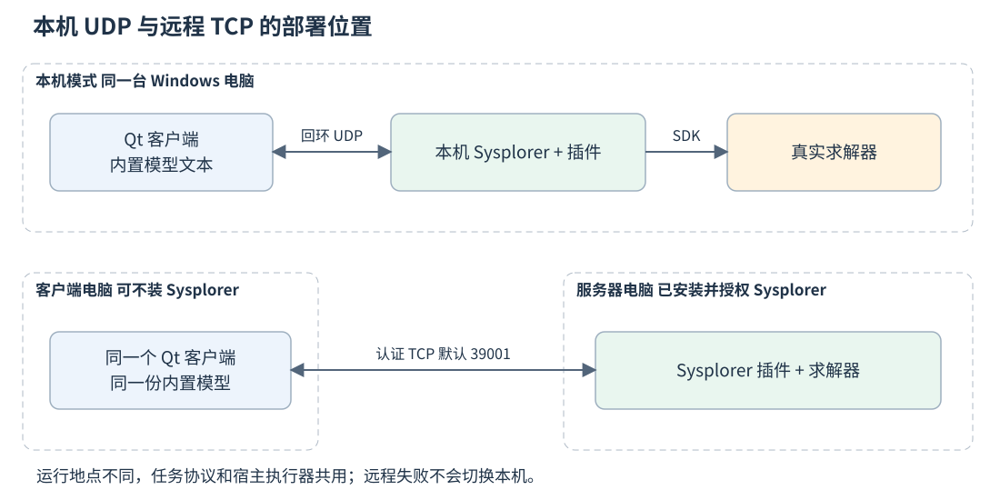
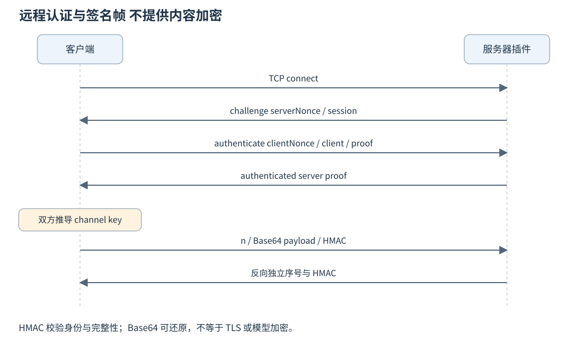
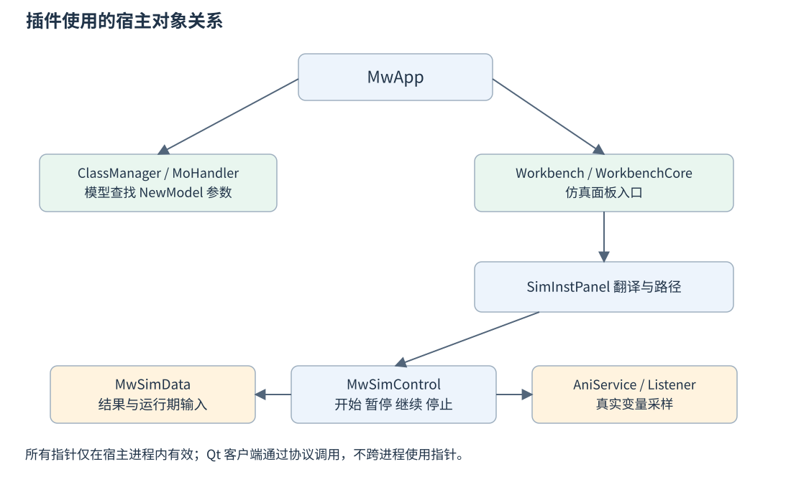
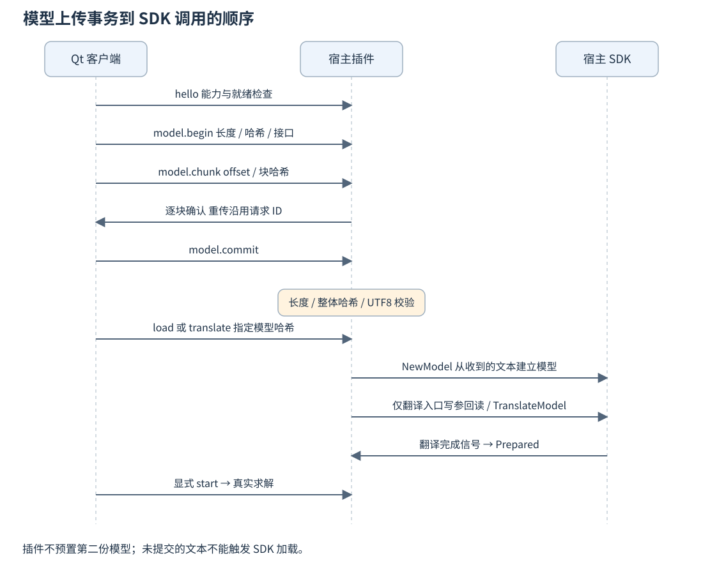
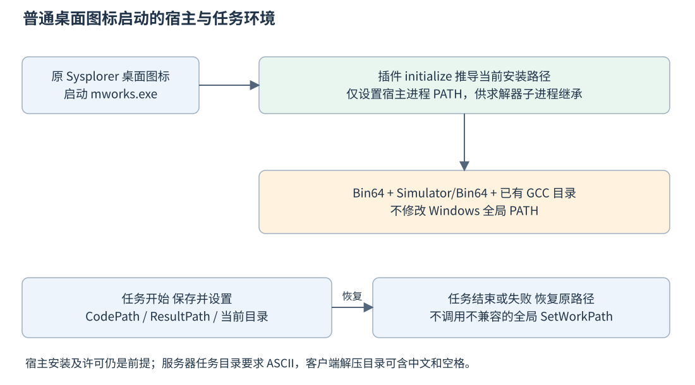
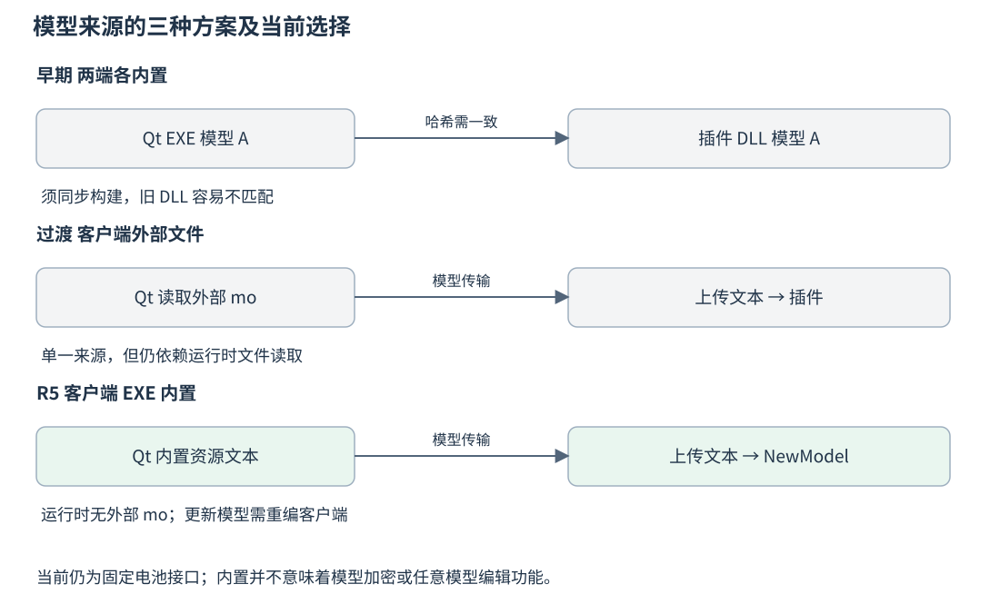

# Sysplorer 调用与部署详解

本文解释 Qt 如何找到并调用本地或远程 Sysplorer、服务器为什么需要插件、模型到底存在哪里，以及首次部署和版本兼容应怎样处理。基线为 R5 客户端及已验证的配套插件；SDK 接口说明依据当前工程实际调用，不承诺其他 Sysplorer 版本具有相同 ABI。

## 一 先回答几个容易混淆的问题

**模型文本由客户端内置并上传，不是客户端和服务器各维护一份。** 项目源码中的 `model/BatterySim.mo` 在构建时进入 Qt EXE；运行时客户端取 Qt 资源，经 UDP/TCP 上传。插件校验后保存在本次宿主会话的内存中，调用 `NewModel(modelText, …)` 建立模型。服务器不用手工打开或预放这一份 `.mo`。

**服务器插件不能独立求解。** DLL 在已安装、已授权的 Sysplorer 内加载，并获取 SDK 对象。服务器必须保持 Sysplorer 运行；当前没有实现 Windows 后台服务或开机自启。

**启动图标不等于引擎 READY。** 进程出现、插件加载、TCP 监听、认证成功、模型上传能力和仿真控制器就绪，是不同的检查层次。Check-Server 只有全部满足才报告“可以连接”，客户端仍须验证实际网络可达性。

## 二 本机模式怎样调用宿主



1. Qt 启动时不自动寻找或打开 Sysplorer。
2. 用户选择本机并连接，或点击本机加载、翻译、开始，runner 先调用本机配置检查。
3. `Setup-Local.ps1` 复用统一部署脚本，确认安装位置和配套 DLL；需要安装更新时提示保存关闭目标实例，并在必要时请求 UAC。
4. runner 扫描当前用户发现目录，核验目标 PID 与 `mworks.exe` 文件身份，选择就绪的目标会话。
5. 找不到可用实例时，在受保护的启动次数规则内按需启动配置的宿主，而不是一开始就开一个。
6. hello 就绪后，通过回环 UDP 上传模型和发出任务控制。

本机 UDP 端口是动态的，默认 TCP 39001 不用于这条回环 UDP 发现链路。本机用户通常不必输入 IP、端口和远程共享凭据，但需要以能访问同一用户发现记录的环境运行 Qt 与宿主。

源码定位：`app/ui/src/sysplorer_runner.cpp` 第 316—329 行。行首数字是文档添加的定位号。

```cpp
 316      auto env=QProcessEnvironment::systemEnvironment();
 317      for(const auto&key:{"QT_QPA_PLATFORM","QT_QPA_PLATFORM_PLUGIN_PATH","QT_PLUGIN_PATH","PYTHONHOME","PYTHONPATH"})env.remove(key);
 318      env.insert("PATH",QDir::toNativeSeparators(QFileInfo(exe).absolutePath())+";"+env.value("PATH"));
 319      auto base=qEnvironmentVariable("BATTERY_SIM_WORKSPACE",QDir::tempPath()+"/BatteryConsoleUDP");
 320      if(!QDir().mkpath(QDir(base).absoluteFilePath("hosts"))){fail(QString::fromUtf8("无法创建 Sysplorer 独立工作目录。"));return false;}
 321      // Native compiler tools are sensitive to long generated paths. QTemporaryDir
 322      // provides a short, unique directory without sharing another task's files.
 323      QTemporaryDir hostWork(QDir(base).absoluteFilePath("hosts/hXXXXXX"));
 324      if(!hostWork.isValid()){fail(QString::fromUtf8("无法创建 Sysplorer 独立工作目录：%1").arg(hostWork.errorString()));return false;}
 325      hostWork.setAutoRemove(false);const auto work=hostWork.path();
 326      QProcess process;process.setProcessEnvironment(env);process.setProgram(exe);
 327      process.setArguments({"-d",work,"-w",work});process.setWorkingDirectory(work);
 328      if(!process.startDetached(&m_launchedPid)){connectionFailed("HOST_START_FAILED",QString::fromUtf8("无法启动 Sysplorer：%1").arg(process.errorString()));return false;}
 329      m_launched=true;trace("launched",{{"pid",double(m_launchedPid)},{"workDir",work}});return true;
```

启动参数为 `-d work -w work`，工作目录为任务根目录下单独生成的短目录。启动环境清理可能从开发终端继承的 Qt/Python 插件路径，并把宿主 Bin64 放到子进程 PATH 前面，防止客户端运行库影响宿主。这个操作是子进程环境配置，不是修改 Windows 全局 PATH。

显式“连接”发现繁忙时会失败并等待用户处理；准备任务路径则可以跳过已经确认繁忙的实例、寻找其他实例或在限制内启动专用实例。不能把两种入口概括成“发现忙就总会启动新窗口”。已存在任务始终不被自动接管。

发现文件约每 2 秒原子更新，包含 PID、EXE、端口、session、连接令牌和更新时间。客户端还会处理短时文件锁和宿主初始化造成的陈旧心跳。一个旧 JSON 文件并不能证明目标进程仍然存活；一个短时读不到的文件也不构成无限新增宿主的理由。

## 三 远程模式怎样调用宿主

远程模式只连接用户填写的服务器地址和 TCP 端口。客户端既不启动自己的本机宿主，也不通过远程 shell 帮服务器启动 Sysplorer。服务器先由人通过原图标启动，插件在其中建立监听；Qt 随后连接该服务。



TCP 是字节流，项目在每个紧凑 JSON 前添加 4 字节大端长度。接收端先积累完整帧，再解析 JSON，单帧上限 1 MiB。不能把一次 readyRead 当作恰好一条消息，也不能用 TCP 本身代替任务去重。

当前认证使用服务器共享凭据，不提供每人独立账号、角色权限或多租户隔离。client UUID 是协议中的任务归属标识，不等同于经过独立身份系统认证的个人账户。

握手依次为 server challenge、client authenticate、server authenticated。双方共享服务器原访问凭据，用 HMAC-SHA256 对不同 purpose 和随机挑战、客户端身份、宿主会话构成的文本进行证明。握手后的通道密钥用于签名消息，两个方向分别维护严格递增的序号。

源码定位：`common/remote_link.cpp` 第 45—56 行。行首数字是文档添加的定位号。

```cpp
  45  QByteArray RemoteLink::proof(const QByteArray& purpose) const {
  46      return mac(m_key.toUtf8(),purpose+'\n'+m_serverNonce.toUtf8()+'\n'+m_clientNonce.toUtf8()+'\n'+m_client.toUtf8()+'\n'+m_session.toUtf8());
  47  }
  48  bool RemoteLink::write(const QJsonObject& value){
  49      if(m_socket->state()!=QAbstractSocket::ConnectedState)return false;
  50      const auto bytes=QJsonDocument(value).toJson(QJsonDocument::Compact);
  51      if(bytes.isEmpty()||bytes.size()>MaxFrame||m_socket->bytesToWrite()>MaxFrame*2){reject(QStringLiteral("FRAME_LIMIT"));return false;}
  52      QByteArray frame(4,0);qToBigEndian<quint32>(quint32(bytes.size()),reinterpret_cast<uchar*>(frame.data()));frame+=bytes;
  53      return m_socket->write(frame)==frame.size();
  54  }
  55  bool RemoteLink::send(const QJsonObject& value){
  56      if(!m_ready)return false;
```

用于 HMAC 的各字段以 LF 分隔，末尾没有额外换行；细节由 RemoteLink 的 proof 和 accept 实现约束。认证完成后的消息为 `n/payload/mac`，payload 是业务 JSON 的 Base64。服务器还检查业务 client 等于已经认证的身份，session 等于当前宿主会话。

这里的认证验证对方持有共享密钥，**没有给业务内容加密**。Base64 不是加密，HMAC 不提供内容保密；需要在受信任局域网或受控 VPN 内使用，不能把当前协议描述成 TLS。HMAC 的一般原理可参考 [RFC 2104](https://www.rfc-editor.org/rfc/rfc2104.html)，本项目明确使用 SHA-256，而非文中历史算法示例。

## 四 插件从哪里获得 SDK 对象



插件是 `MwPlugin` 子类，插件元数据声明 Sysplorer 插件 IID。`initialize()` 建立回环 socket、远程服务器、心跳和采样定时器；`extensionsInitialized()` 再尝试绑定宿主对象；关闭时停定时器、关闭连接、移除本机发现记录并恢复任务路径。

`bindHost()` 逐层取得 MwApp、Workbench/Core、ClassManager、SimInstPanel 和 SimControl。manager 管理模型和参数；panel 负责翻译和结果路径；control 控制求解生命周期；MwSimData 对应翻译或求解产生的数据对象；AniService 提供实时变量采样。

源码定位：`tools/sysplorer_udp_plugin/control_plugin.cpp` 第 113—129 行。行首数字是文档添加的定位号。

```cpp
 113  bool BatteryUdpControl::bindHost(QString &error) {
 114      try {
 115          auto app=sym<MwApp*(*)()>(L"mw_develop.dll","?Instance@MwApp@@SAPEAV1@XZ")();
 116          if(!app||!app->GetWorkbench()) {error="Host is starting";return false;}
 117          core=get<MwWorkbenchCore*>(app->GetWorkbench(),L"mw_develop.dll","?GetCore@MwWorkbench@@QEAAPEAVMwWorkbenchCore@@XZ");
 118          if(!core){error="Host is starting";return false;}
 119          auto nextManager=app->GetClassManager();if(!nextManager){error="Host is starting";return false;}
 120          auto p=core->GetSimInstPanel();if(!p){error="Simulation panel unavailable";return false;}
 121          auto c=get<MwSimControl*>(p,L"mw_develop.dll","?GetSimControl@MwSimInstPanel@@QEAAPEAVMwSimControl@@XZ");
 122          if(!c){error="Simulation controller unavailable";return false;}
 123          if(control && control!=c && active()) {error="Host controller changed";return false;}
 124          const bool changed=control.data()!=c||panel.data()!=p;
 125          manager=nextManager;
 126          if(changed) {
 127              if(control)disconnect(control,nullptr,this,nullptr);
 128              if(panel)disconnect(panel,nullptr,this,nullptr);
 129              control=c;panel=p;
```

不能把一个未初始化的 control 指针缓存为永久可用。代码会重新核验对象，利用 QPointer 跟踪 QObject 生命周期；对象变化时重绑信号，活动任务中出现控制器变化会拒绝继续。Unavailable 表示缺少可用控制器，不能直接解释成别人的任务正在运行。

## 五 模型上传以后发生什么



ModelTransfer::Store 在插件进程内缓存上传。commit 验证完整字节、哈希和 UTF-8 后，load/translate 的 `modelHash` 必须能索引该客户端已经提交的文本。`modelUploads.take()` 返回的是经过校验的字节，不能通过只发送一个新哈希要求插件凭空找模型。

`beginTask()` 检查宿主空闲、任务 ID、参数、时长和速度，固定 owner、taskId、modelHash 与参数，创建独立 ASCII 任务目录，再异步执行 prepare。单个宿主只允许一个活动加载、准备或求解任务；最多八个 TCP 连接或上传缓存不等于八个并发求解器。

源码定位：`tools/sysplorer_udp_plugin/control_plugin.cpp` 第 243—259 行。行首数字是文档添加的定位号。

```cpp
 243              if(ownedModelHash!=modelHash||!modelLoaded){
 244                  require(h->UnloadModel("BatterySim"),"MODEL_UNLOAD_FAILED");modelLoaded=false;ownedModelKey=0;
 245              }
 246          }
 247          if(!modelLoaded){
 248              const auto loaded=h->NewModel(modelText.toUtf8().toStdString(),MoKey(0));
 249              ownedModelKey=quint64(h->DirectLookupType("BatterySim"));
 250              if(ownedModelKey){ownedModelHash=modelHash;ownedModelSource=currentModelSource();}
 251              require(loaded!=0&&ownedModelKey!=0,"MODEL_PARSE_FAILED");
 252              modelLoaded=true;log("model_loaded",{{"modelHash",modelHash}});
 253          }else log("model_reused",{{"modelHash",modelHash}});
 254          auto key=h->DirectLookupType("BatterySim.SingleRun");require(key!=0,"MODEL_INTERFACE_INVALID: BatterySim.SingleRun missing");
 255          for(const auto name:{"runMode","runCurrent","runVoltage","socStart","liveCurrent","liveVoltage","liveMode","liveVMin","liveVMax","liveIMax","cell"})
 256              require(h->LookupComp(key,name)!=0,"MODEL_INTERFACE_INVALID: battery component missing");
 257          for(const auto name:{"SOC","I_act","V_term"})
 258              require(h->LookupCompAndTypeEx(key,MwStrVector{"cell",name})!=0,"MODEL_INTERFACE_INVALID: result component missing");
 259          if(loadOnly){phase="Loaded";persist();log("load_confirmed");return;}
```

先查 BatterySim 命名空间。不存在就建立；存在时必须是插件自己加载的同一对象，且没有用户修改。如果是用户手工加载的同名模型，报 MODEL_NAME_CONFLICT；如果插件模型已被手工编辑，报 MODEL_EDIT_CONFLICT。插件不自动覆盖用户模型，也不擅自保存用户未保存的修改。

文本相同且对象仍然有效时可复用模型类；文本不同只在空闲且归属检查通过时卸载自己的旧类，再从新文本建立。prepare 随后确认 `BatterySim.SingleRun` 存在，并检查固定参数、运行期输入和输出组件。纯传输层的命名正则检查不足以证明接口完整，SDK 层还要再检查。

**这里没有强制先把上传文本写成 `.mo` 再打开的步骤。** 当前实现直接调用 SDK 的 NewModel 从文本建立模型。任务目录仍会包含生成代码、求解器、状态和结果文件；内存模型并不意味着整个仿真不使用磁盘。

## 六 固定模型接口逐项说明

| 接口 | 类型和单位 | 谁写入或读取 | 使用阶段 |
| --- | --- | --- | --- |
| runMode | 起始模式，1 充电或 2 放电 | 插件写参后回读 | 翻译前 |
| runCurrent | 电流幅值，A | 插件写参后回读 | 翻译前 |
| runVoltage | 充电上限或放电下限，V | 插件写参后回读 | 翻译前 |
| socStart | 初始 SOC，0 到 1 | 插件写参后回读 | 翻译前 |
| liveCurrent、liveVoltage | 运行期电流和恒压目标 | SetInputReals | 暂停通信边界 |
| liveMode | Real 输入，转为整数工作模式 | SetInputReals | 运行期，支持 0 到 3 |
| liveVMin、liveVMax、liveIMax | 电压保护和电流限幅 | SetInputReals | 运行期 |
| cell.SOC | SOC，0 到 1 | AniService 和结果对象读取 | 实时及结果 |
| cell.I_act | 实际电流，充电正、放电负，A | 同上 | 实时及结果 |
| cell.V_term | 实际端电压，V | 同上 | 实时及结果 |

输入电压并不是把模型端电压直接钉在一个数值。起始恒流时 runVoltage 是保护边界，端电压由 OCV 和内阻共同决定。运行期恒压模式才使用 liveVoltage 计算受限电流。初始参数和实时输入在语义上不同，因此不能用重新写 socStart 来实现无缝调参。

对起始四项参数，插件使用 SetParamValue 写入，再 GetParamValue 回读，并以数值容差比较。只有全部成功才继续设置任务路径和调用翻译；写参成功但回读不一致也必须失败。

modelHash 对应上传时的原始资源字节，起始参数另记在 params 中。同一文本配不同参数仍是不同任务，不能仅以相同 modelHash 复用任意结果。SDK 写参可能改变宿主内部的完整模型文本，插件会更新 ownedModelSource，区分它自己的合法修改与后续用户手工编辑。

源码定位：`tools/sysplorer_udp_plugin/control_plugin.cpp` 第 260—275 行。行首数字是文档添加的定位号。

```cpp
 260          const std::pair<const char*,QString> args[]={{"runMode",QString::number(mode)},{"runCurrent",QString::number(current,'g',15)},
 261              {"runVoltage",QString::number(voltage,'g',15)},{"socStart",QString::number(soc0,'g',15)}};
 262          for(auto &p:args){
 263              stage=QString::fromUtf8("写入参数");
 264              if(!h->SetParamValue(key,MwStrVector{p.first},p.second.toStdString())){
 265                  fail("PARAM_WRITE_FAILED",QString::fromUtf8("写参失败：%1，期望 %2").arg(QString::fromLatin1(p.first),p.second));return;
 266              }
 267              stage=QString::fromUtf8("回读参数");
 268              bool ok=false;auto back=QString::fromStdString(h->GetParamValue(key,MwStrVector{p.first})).toDouble(&ok);
 269              if(!ok||std::abs(back-p.second.toDouble())>=1e-8){
 270                  fail("PARAM_READBACK_FAILED",QString::fromUtf8("参数回读失败：%1，期望 %2，实际 %3")
 271                      .arg(QString::fromLatin1(p.first),p.second,ok?QString::number(back,'g',15):QString::fromUtf8("非数值")));return;
 272              }
 273              log("parameter_verified",{{"field",p.first},{"expected",p.second},{"actual",back}});
 274              ownedModelSource=currentModelSource();
 275          }
```

## 七 翻译和真实求解怎样衔接

`TranslateModel("BatterySim.SingleRun", false)` 发起异步翻译。插件监听 SigTranslateFinished，取得 MwSimData 后进入 Prepared；翻译返回“已接受”不等于编译和求解器生成已经完成。

显式 start 检查当前仍为 Prepared、控制器 Idle、模型未被编辑和 data/panel/control 仍存在。然后 RebindSimData，配置终止时间、slowdown、通信步长及动画监听器，调用 StartSimulate 的实时模式。启动后仍要观察真实控制器进入 Running，避免把一个接受请求但未运行的宿主显示成仿真成功。

源码定位：`tools/sysplorer_udp_plugin/control_plugin.cpp` 第 349—369 行。行首数字是文档添加的定位号。

```cpp
 349  void BatteryUdpControl::startSolver() {
 350      stage=QString::fromUtf8("启动仿真");
 351      if(phase!="Prepared"||!data)return;
 352      try {
 353          auto c=static_cast<MwSimControl*>(control.data());auto d=static_cast<MwSimData*>(data.data());
 354          c->RebindSimData(d);
 355          c->SetOnlineParamToCurveRes(true);
 356          auto cfg=get<void*>(d->GetSimInstance(),L"modelica_post_processor.dll","?SimConfig@MwModelSimInstance@@QEBAPEAVMwModelSimConfig@@XZ");
 357          require(cfg!=nullptr,"Missing simulation config");
 358          sym<void(*)(void*,double)>(L"modelica_post_processor.dll","?SetStopTime@MwModelSimConfig@@QEAAXN@Z")(cfg,duration);
 359          sym<void(*)(void*,double)>(L"modelica_post_processor.dll","?SetSlowdownFactor@MwModelSimConfig@@QEAAXN@Z")(cfg,1.0/speed);
 360          sym<void(*)(void*,double)>(L"modelica_post_processor.dll","?SetCommunicationStepSize@MwModelSimConfig@@QEAAXN@Z")(cfg,1.0);
 361          sym<void(*)(void*,int)>(L"modelica_post_processor.dll","?SetCommuStepSizeDenominator@MwModelSimConfig@@QEAAXH@Z")(cfg,1);
 362          d->SetSlowdownFactor(1.0/speed);
 363          if(!listenerAttached){c->GetAniService()->AddListener(&listener);listenerAttached=true;}
 364          phase="Starting";startClock.start();c->AnimationStart();
 365          require(c->StartSimulate(MwSimControl::Sim_RealtimeMode),"Host solver rejected start");
 366          collectTimer.start();persist();log("start_accepted",snapshot());
 367          QTimer::singleShot(150,this,[this]{if(!active()||!ownsController()||phase!="Running")return;
 368              auto c=static_cast<MwSimControl*>(control.data());
 369              log("runtime_speed",{{"speed",speed},{"accepted",c->ResetSimConfig(MwSimControl::SIM_SLOWDOWN_FACTOR,1.0/speed)}});});
```

仿真倍速使用 `1.0/speed` 作为 slowdown factor；通信步长配置为 1 秒。它们控制执行和采样节奏，不把电池容量或物理时间单位改掉。插件的 100 ms collect 定时器推进动画采样和检查状态，也不是求解器积分步长的直接等价物。

## 八 在线调参和结果采集的难点

插件注册九个实时变量：SOC、电流、端电压以及六个运行期输入。运行中 tune 会先暂停，写入整组六项输入，确认写入期间时间和 SOC 没有重置，再根据原状态决定是否恢复。

SDK 的输入写入可能排队至下一通信步，即刻 GetReals 仍可能返回旧步的值。因此代码把“写入请求接受”与“模型采样确认”分开：后续 append 在时间越过边界且六项值均匹配后，才记录 tuneHistory 和 confirmedAt。已经暂停的任务需要继续推进到相应采样步后才能完成这项确认。

结束时插件从结果对象读取三个变量的时间序列，必要时按 SOC 的时间网格插值电流和电压。停止任务会按 stopAt 截断，并在可用时补充真实实时样本。完整结果要求退出成功并到达请求终点；不能用配置 StopTime 代替实际有效数据时间。

结果 CSV 的列为 `time,SOC,I_act,V_term`。清单包含 taskId、modelHash、params、runtimeParams、tuneHistory、complete、duration、points、lastTime、csvHash 和 nativeResult。清单的 source 字符串保留历史命名 `sysplorer-host-udp`，即使任务经 TCP 进入也可能出现；不能仅凭这个历史标签判断本次传输模式。

原生 Sysplorer 绘图属于可选能力。2026b 的绘图导出签名与构建 SDK 不完全相同，插件找不到匹配接口时保留 CSV 并提示使用 Qt 查看，不让可选绘图 ABI 阻止插件加载或核心求解。

## 九 为什么普通桌面图标启动现在可以工作



早期 2026b 已能编译 MWSolver.dll，但独立运行返回 `0xC0000135`。对照试验在进程 PATH 中增加宿主 Bin64 后成功，说明当时的阻塞位于求解器 DLL 搜索环境，不是模型没有翻译成功。

修复后的插件从宿主自身安装位置推导 Bin64、Simulator/Bin64 和已有 GCC 运行目录，更新当前宿主进程环境。求解器子进程继承这套环境，因此首次配置完成后，日常可通过原 Sysplorer 桌面图标启动。没有要求用户每次从特殊 PowerShell 启动脚本进入，也不修改系统全局 PATH。

源码定位：`tools/sysplorer_udp_plugin/control_plugin.cpp` 第 74—84 行。行首数字是文档添加的定位号。

```cpp
  74  bool BatteryUdpControl::initialize(QString*) {
  75      session=uuid();token=uuid()+uuid();heartbeat.start();
  76      // Solver children inherit these paths even when Sysplorer is started by its
  77      // ordinary desktop icon. Only this host process environment is changed.
  78      const auto bin=QCoreApplication::applicationDirPath();const auto home=QDir(bin).absoluteFilePath("..");
  79      const auto solver=QDir(home).absoluteFilePath("Simulator/Bin64");
  80      const auto gcc=QDir(home).absoluteFilePath("Simulator/mingw/4.9.4/mingw64/bin");
  81      const auto path=QDir::toNativeSeparators(bin)+";"+QDir::toNativeSeparators(solver)+";"+QDir::toNativeSeparators(gcc)+";"+qEnvironmentVariable("PATH");
  82      SetEnvironmentVariableW(L"PATH",reinterpret_cast<LPCWSTR>(path.utf16()));
  83      _wputenv_s(L"PATH",reinterpret_cast<const wchar_t*>(path.utf16()));
  84      const auto root=qEnvironmentVariable("BATTERY_DISCOVERY_DIR",QStandardPaths::writableLocation(QStandardPaths::GenericDataLocation)+"/BatteryConsole/udp");
```

每个任务另行保存和恢复 CodePath、SimResultPath、面板求解器/结果路径以及进程当前目录。服务器任务根目录要求 ASCII，避免编译工具链处理中文和过长生成路径失败；客户端解压目录可以包含中文和空格，两者不是同一个约束。

## 十 2026a 与 2026b 兼容为什么困难

插件与 Sysplorer 之间存在 C++ ABI 和 Qt 版本依赖。构建工程使用 Sysplorer SDK 2026a 和 MSVC 2017 环境；实际宿主还要逐项核验依赖导出，不能把 Windows DLL 文件复制成功当作 ABI 兼容成功。

| 问题 | 证据或风险 | 当前处理 |
| --- | --- | --- |
| task manager 状态接口变化 | 不同版本提供 IsRunning 或 GetRunningThread | 仅解析已知准确签名，未知则明确拒绝 |
| SetWorkPath 增加不透明上下文参数 | 2026b 缺少旧静态导入，导致插件未加载 | 移除该调用，使用每任务路径，不猜测参数 |
| 原生绘图签名变化 | 可选 CreatePlotWin 导出不匹配 | 动态检测，缺失时保留 Qt 结果查看 |
| 就绪对象不稳定 | manager/panel/control 可能尚未初始化 | 重新绑定并核验，Unavailable 不算繁忙 |
| 求解器依赖搜索路径 | 编译成功而运行 0xC0000135 | 在宿主进程内准备依赖路径 |

已验证的安装实例为本机 2026a 和虚拟机 2026b，不能据此承诺任意小版本兼容。诊断脚本检查缺失 DLL 和导出，出现 PLUGIN_NOT_LOADED 时应先处理加载层，不反复更换密钥。

## 十一 为什么选择当前模型来源方案



| 方案 | 优点 | 代价和实际问题 | 当前定位 |
| --- | --- | --- | --- |
| Qt 与插件各内置一份 | 每端离线可取得模型 | 必须同步两端构建，容易旧 DLL 与新客户端不匹配 | 历史方案 |
| Qt 运行时读外部 mo 再上传 | 可独立更新文本，服务器不再内置 | 外部读取受文件状态和保护视图影响，发布文件需完整 | 过渡方案 |
| Qt 内置文本再上传 | 发布来源单一，减少外部文件依赖 | 更新模型通常重编客户端，仍须兼容固定接口 | R5 当前方案 |

当前插件只维护上传协议和固定业务接口。改变模型参数方程但保持接口时，通常只需重新发布 Qt；新增接口字段、输出变量或生命周期含义时，则需要评估插件与协议的同步升级。上传成功也不会自动安装模型引用的第三方库，宿主仍须具备相应 Modelica 依赖与有效许可。

## 十二 本机首次使用和日常流程

**在哪台电脑：需要自己计算的客户端电脑。** 先安装并授权 Sysplorer 2026a 或已验证的 2026b；仅解压 Qt 包不能替代宿主安装和许可。

1. 完整解压客户端包到新目录，双击 Start-Client.cmd，确认显示内置模型和原界面。
2. 点击连接设置，选择本机并保存连接。多个安装时选择正确目录；选择 EXE 时定位到目标的 Bin64/mworks.exe。
3. 若需要安装或更新配套插件，先保存工作、手动关闭该安装下所有实例，再允许必要的 UAC。脚本不自动终止程序。
4. 插件准备完成后，本机按需连接或启动宿主。成功状态为已连接，不需要填写远程密钥。
5. 加载模型，保存或直接填写参数，翻译，开始。等待完整结果后查看和回放。
6. 日常插件未变化时不需要每次重新安装。退出前先停止任务并等待终态。

本机配置记录位于当前用户 LocalAppData 下的 BatteryConsole/local-runtime.json，保存安装位置、任务根目录和插件哈希。它在目标电脑生成，不随开发机客户端配置一起分发。

## 十三 服务器首次配置和日常启动

**在哪台电脑：实际计算的服务器或虚拟机。** 当前实例安装目录为 `C:\Program Files\MWORKS\Sysplorer 2026b`；其他电脑按实际安装选择，不能直接照抄。

1. 完整解压服务器 ZIP，确认其中有 Setup-Server.cmd、插件 DLL 和检查脚本。
2. 双击 Setup-Server.cmd，选择目标安装。若需要更新插件或配置，先保存关闭目标实例；按提示完成必要提权。
3. 脚本校验并安装 DLL，准备可写 ASCII 任务根目录、启用监听，默认 TCP 39001。已有有效端口、任务目录和凭据沿用，缺少有效凭据时才生成。
4. 配置完成页显示服务器 IPv4、端口和凭据文件位置；通过复制访问凭据操作安全提供给客户端。不要把“文件路径”填到客户端密钥框。
5. 用原桌面图标启动 Sysplorer，等初始化完成。无需手工打开模型，也无需在服务器运行 Qt。
6. 双击 Check-Server.cmd，看到 READY 后再到客户端连接。只显示 Listening=True 还不足以证明引擎就绪。
7. 日常保持 Sysplorer 运行即可。重启系统后需重新启动它；当前没有后台服务或开机自启功能。

防火墙首次规则默认限制 Domain/Private 和 LocalSubnet，并绑定目标宿主程序与端口。公共网络或跨子网连接需要管理员按实际网络配置准确来源范围，不能把关闭防火墙作为正常部署步骤。服务器监听 0.0.0.0 表示绑定本机各网卡，客户端仍应填写可达的实际 IPv4。

虚拟机 IPv4 示例 `172.19.15.159` 是该虚拟机地址；默认网关 `172.19.0.1` 是它的网络出口，不能替代服务器地址。除非另行配置并验证端口转发，连接网关不会自动进入虚拟机服务。DHCP 地址变化后应同步客户端设置。

## 十四 客户端连接远程服务器

**在哪台电脑：显示操作界面的电脑。** 仅用远程模式时无需安装本机 Sysplorer。

1. 解压客户端 ZIP，双击 Start-Client.cmd。
2. 连接设置中选择远程，填写服务器当前 IPv4、TCP 端口和原访问凭据。
3. 点击保存并连接。顶部显示远程地址及已连接后，再加载、翻译和开始。
4. 访问凭据在当前 Windows 用户下经 DPAPI 保护保存，通常只填写一次；留空会复用旧值。
5. 若运行中断线，使用重连并核对。若仅下载失败，重试下载，不重复开始计算。

配置值与缓存都在目标电脑生成。正式包不携带开发工作树绑定、开发机私有宿主或实际访问密钥；Qt 运行依赖随包提供，目标电脑不要求安装 Qt 开发工具或 SDK。

## 十五 更新回退及故障定位

只更新模型且接口未变时，重新构建并发布客户端即可。服务器配套插件已满足上传接口时，不需要随每次模型文本变化换 DLL。仅更新插件使用 Update-ServerPlugin.cmd 或 Update-Plugin.ps1，先关闭目标实例；备份旧 DLL、复制并校验 SHA-256，保留 remote.ini、凭据、端口与防火墙。

首次安装或把本机配置提升为服务器，使用 Setup-Server；它与“仅更新插件”目的不同。Setup 也不等于 Check，配置完成后仍要启动宿主并验收引擎。

| 现象或代码 | 先检查的层次 | 下一步 |
| --- | --- | --- |
| TCP 超时 | 地址、VM 状态、路由、防火墙、监听 | 检查实际 IPv4 与 Check-Server，不先重置密钥 |
| CLOSED_BEFORE_CHALLENGE | 目标端口是不是配套服务 | 核对进程、端口和插件加载 |
| 认证失败或认证前关闭 | 原凭据是否完整，旧保存值是否被复用 | 从服务器原文件重填，保留诊断 |
| PLUGIN_NOT_LOADED | DLL 依赖和 ABI | Diagnose-Plugin，核查缺失导出及插件启用状态 |
| REMOTE_DISABLED | 所选安装的 remote.ini | 关闭目标实例后运行 Setup-Server |
| HOST_STARTING 或 Unavailable | 宿主对象与后台初始化 | 等待初始化，不冒充繁忙或反复启动 |
| MODEL_NAME_CONFLICT 或 EDIT_CONFLICT | 用户模型与插件所有权 | 保存用户模型，手动消除冲突后重新准备 |
| START_FAILED | 真实宿主输出、求解器依赖和许可 | 分开看编译完成与求解器运行，保留日志 |
| DownloadFailed | 本地写入、块及文件校验 | 重试下载，服务器计算不重启 |

回退时使用备份插件和对应客户端，保留原配置并确认接口兼容。`remote.ini` 和配置备份可能含凭据，不应发到公共聊天；检查脚本的无密钥诊断 JSON 更适合提供给开发人员。

## 十六 本轮实测与尚未解决的问题

本机普通双击使用当前安装的 2026a，完成加载、翻译、求解及回放。远程使用最终同一 EXE 到实际 2026b 虚拟机，认证、上传、自动加载/翻译、完整求解及下载核验通过。两端各 1,571 行，模型哈希一致，数值差异在本次比较阈值内。详细证据见 `docs/内置模型交付测试报告.md`。

远程第一次 Qt 连接出现过原因未确定的超时，显式重试后通过；R5 远程普通双击回放与调参未重新全部验收。关闭窗口停止任务仍有不稳定时序，必须先停止并确认终态。当前也不承诺多任务并发、跨宿主重启接管、任意 Modelica 模型或不受信网络上的加密传输。

理解这些边界后，部署过程就可以简化为：客户端负责内置模型和操作，服务器负责真实引擎，插件负责把受约束的任务消息转换成 SDK 调用；两端通过任务身份、模型哈希和结果核验把一次计算闭合起来。
